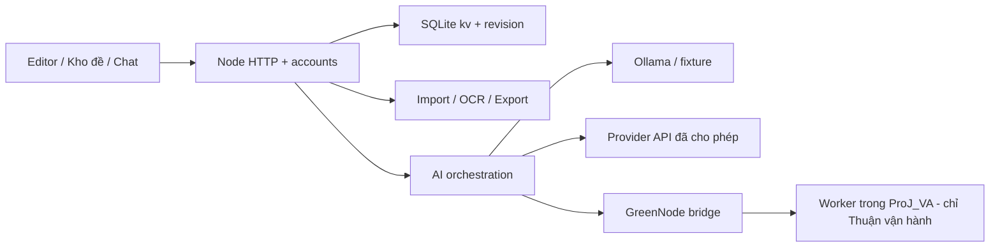

# Kiến trúc hiện tại và hướng chia module

**Kiến trúc đích đã đổi: [Python/FastAPI là backend chính](PYTHON_MIGRATION.md). `backend/` hiện có scaffold chạy được, chưa migrate xong. Phần Node dưới đây chỉ mô tả prototype kế thừa.**

## Đã có trong source prototype

Frontend ES modules + TipTap/MathLive/KaTeX → HTTP Node 24 → SQLite key/value JSON có revision. `server.mjs` nạp `mvp-server.mjs`; route AI/job trong `workbench-server.mjs`. Các test hiện có là điểm khởi đầu, không phải bằng chứng chịu tải production.

`backend-store.mjs`: bảng `kv(key,value,rev,updated)`, giá trị JSON; không có schema quan hệ hoàn chỉnh. `accounts.mjs` áp scope theo tài khoản, session/cookie, cấu hình online yêu cầu HTTPS. `storage.js` có cơ chế lưu frontend. Cần bảo toàn API/caller và dữ liệu cũ khi thay thiết kế DB.

## Ranh giới được giao

UI không truy cập DB/provider trực tiếp. BE-2 giữ hợp đồng HTTP FastAPI và auth; BE-3 giữ lưu trữ; BE-4 giữ xử lý tài liệu; BE-1 giữ AI/worker; BE-5 giữ tích hợp job, CI và kiểm chứng. Shared domain `core.js`, `blocks.js`, `rich-document.js`, `geometry.js` thay đổi cần test cả editor và export.

Tạo backend Python riêng; chuyển từng vertical slice có pytest/OpenAPI và UI compatibility. Không proxy core sang Node. Không di chuyển source hàng loạt trong PR tổ chức repo. Nếu tách module, làm PR nhỏ có compatibility test trước và cập nhật import/build/Docker/caller tương ứng. Không đưa DB production vào ổ mạng NFS chỉ vì bản thử cũ đã chạy.

## Quyết định còn phải chốt

- BE-3 viết ADR Python repository với SQLite local hay PostgreSQL cho bản nhiều người, so sánh transaction/versioning/backup/chi phí. SQLite vẫn là bản chạy mặc định cho đến khi migration + adapter + test sẵn sàng; ERD mới không đồng nghĩa đã triển khai.
- BE-2 xác định auth/email recovery/threat boundaries trước mở đăng ký rộng.
- BE-1/BE-5 chuẩn hóa job timeout/cancel/retry và provenance; không tự fallback sang API trả phí.
- Hạ tầng thử không được coi là SLA 24/7. Thuận quyết định thời điểm mở server; repo/CI không có quyền auto-deploy.

## API hiện có để nhóm dò source

| Nhóm | Ví dụ route hiện có | Nơi đọc |
|---|---|---|
| Tài khoản | `/api/account`, `/api/account/login`, `/api/account/register`, `/api/account/logout` | `workbench-server.mjs`, `accounts.mjs` |
| Workspace | `/api/kv?key=state`, PUT `/api/kv` | `mvp-server.mjs`, `storage.js` |
| AI config | `/api/status`, `/api/config`, `/api/test-provider` | `mvp-server.mjs`, `connections.js` |
| Trợ lý | `/api/assistant/plan`, `/patch`, `/chat`, `/job`, `/cancel`, `/stream` | `workbench-server.mjs`, `workbench.js`, `studio.js` |
| Tài liệu | `/api/extract`, `/api/ocr`, `/api/page-image`, `/api/save-export` | `mvp-server.mjs`, importers/exports |
| Chia sẻ | `/api/share`, `/api/share/revoke`, `/s/:token` | hai file server |

Đây là chỉ mục, **chưa là OpenAPI đầy đủ**. BE-2-001 phải ghi method, request/response, lỗi, scope, precondition theo source/test thực tế; UI không tự đoán hợp đồng mới. Fixture đề: `assets/reference-exam.json`, `assets/demo-ai-exam.json`; test fixture AI nằm trong `tests/*browser.mjs`.
