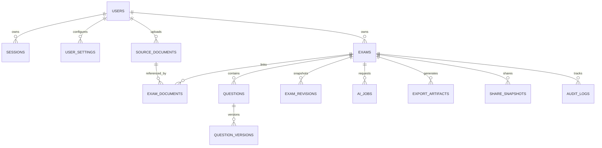

# Kế hoạch dữ liệu — đặc tả thiết kế BE-3-001

**Trạng thái: đã hoàn tất đặc tả thiết kế ERD, Python Repository Contracts, ADR và kế hoạch migration 5 pha của BE-3-001 tại [Hợp đồng dữ liệu (`docs/contracts/du-lieu.md`)](../contracts/du-lieu.md), đã kiểm chứng thực nghiệm DDL/migration/round-trip trên SQLite 3.49.1 (Python 3.12). Chưa thay thế runtime production sang schema mới khi các lát `BE-3-002` và `BE-3-003` chưa cắt nhánh.** Không tạo DB rỗng rồi coi dữ liệu thật đã chuyển xong; không thay source trước khi kiểm caller và fixtures.

## Entity mục tiêu (15 bảng chuẩn hóa)

*(Ngoài 13 bảng nghiệp vụ trên còn 2 bảng vận hành di trú: `schema_migrations` và `migration_quarantine` — xem đầy đủ Data Dictionary 15 bảng tại [Mục 2 `docs/contracts/du-lieu.md`](../contracts/du-lieu.md)).*

Mỗi tài nguyên có `owner_id`/server-side scope; `revision` thuộc đề (`exams.revision`) và được kiểm tra nguyên tử (optimistic concurrency `WHERE id = :id AND owner_id = :owner_id AND revision = :expected_revision`) khi lưu/sửa AI; phiên bản từng câu lưu trong `question_versions` (7 trường chuẩn Abstraction + metadata mở rộng). Snapshot chia sẻ (`share_snapshots`) là bản cố định có `revoked` và `expires_at`, không bao giờ chứa `api_key_encrypted` hoặc prompt riêng tư. Toàn bộ `richDoc`, `optionDocs`, `rubric`, `blockIds` (8 UUID/câu + 3 UUID/đề), hình ảnh, công thức, đơn vị và nguồn tài liệu được bảo toàn 100% qua round-trip JSON (`points_q4 = round(points * 4)`).

## Đầu ra BE-3-001 đã nghiệm thu tại [`docs/contracts/du-lieu.md`](../contracts/du-lieu.md)

1. **W01 — Inventory 12 nhóm key/prefix:** Kiểm kê đầy đủ `backend-store.mjs`, `storage.js`, `accounts.mjs`, `mvp-server.mjs`, `workbench-server.mjs`; lập bảng ánh xạ sang 15 bảng quan hệ kèm quy tắc bóc tách blob sang `.data/blobs/{sha256[:2]}/{sha256}.bin`.
2. **W02 — ERD & Data Dictionary 15 bảng:** Tách rõ 3 trạng thái (`draft_status`, `verification_status`, `approval_status`), kế thừa 6 thực thể cốt lõi + `SessionContext` + 7 trường `QuestionVersion` từ [Hồ sơ đã có (`HO_SO_DA_CO.md`)](../course/HO_SO_DA_CO.md). Khóa chính kép `(owner_id, id)` cho `source_documents` và `ON DELETE SET NULL` cho `ai_jobs.exam_id` / `share_snapshots.exam_id` để chống lỗi đề gốc đã xóa.
3. **W03 — ADR-001 (SQLite stdlib WAL vs PostgreSQL):** Giữ `sqlite3` (Python standard library) ở chế độ `WAL` + `synchronous=NORMAL` + `foreign_keys=ON` + `BEGIN IMMEDIATE` cho M1–M3, chưa thêm dependency ngoài vào `backend/pyproject.toml`. Đóng gói qua `UnitOfWork` và 8 Python Repository Protocols (đầy đủ 9 trường chuẩn [Khuôn mẫu hợp đồng (`CONTRACTS.md`)](../course/CONTRACTS.md)).
4. **W04 — Kế hoạch migration 5 pha idempotent & Backup/Restore:** Quét `state` lập map tên file trước khi stream `file:*`, cô lập bản ghi hỏng vào `migration_quarantine`, sao lưu nhất quán qua `sqlite3.Connection.backup()`, chỉ tráo bảng `kv` thành `kv_legacy_backup` khi đạt đối soát.
5. **W05 & Kiểm chứng tự động T01–T05 (`pytest`):** Đã gắn kèm trên nhánh module thực thi [`backend/src/mach_backend/be3_schema_migration.py`](../../backend/src/mach_backend/be3_schema_migration.py), bộ kiểm thử [`backend/tests/test_be3_migration.py`](../../backend/tests/test_be3_migration.py) và fixture [`tests/fixtures/be3-legacy-kv.json`](../../tests/fixtures/be3-legacy-kv.json) (`21` bản ghi KV sạch + `2` bản ghi hỏng):
   - `T01`: SHA-256 canonical state trước và sau di trú khớp tuyệt đối (`user_a`: `75fe5228...`, `user_b`: `51e480ea...`), `foreign_key_check = 0`, `integrity_check = ok`.
   - `T02`: Cô lập đúng 2 bản ghi hỏng vào `quarantine_legacy_items`, rollback nguyên tử khi lỗi I/O giả lập, backup/restore qua `conn.backup()` đạt.
   - `T03`: Chạy lại migration lần 2 giữ nguyên số dòng (`idempotent_equal = true`), xung đột `expected_revision` trả đúng `RevisionConflictError` (`409 Conflict`).
   - `T04`: Bảo toàn lịch sử `QuestionVersion` (`v1`, `v2`, `richDoc`, `explanationDoc`) khi sinh lại đề (`apply_generation`) nhờ `questions.is_active = 0` và Partial Unique Index `idx_questions_active_order WHERE is_active = 1`; lỗi giữa lúc ghi sẽ rollback sạch toàn bộ giao dịch.
   - `T05`: Phân biệt gửi lặp hợp lệ và tái sử dụng `requestId` khác nội dung hoặc khác thao tác (`patch <-> generate` $\rightarrow$ `409 job_conflict`) bền vững sau khi đóng/mở lại SQLite repository nhờ lưu `(job_kind, request_digest)` trong `ai_jobs`.

Mặc định giữ SQLite local cho nhóm chạy editor. Việc viết code thực thi repository (`BE-3-002`) và CLI migration/locking (`BE-3-003`) sẽ thực hiện ở các PR riêng ở M2/M3; người vận hành dữ liệu thật trên GreenNode vẫn là Thuận.
