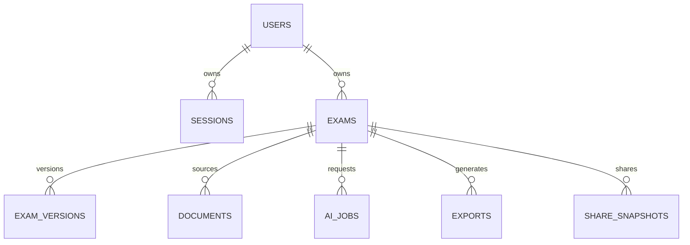

# Kế hoạch dữ liệu — bản đề xuất cho BE-3

**Trạng thái: chưa triển khai schema/migration mới. Đích là repository/transaction/migration bằng Python; SQLite KV Node là nguồn tham chiếu.** Không tạo DB rỗng rồi coi dữ liệu thật đã chuyển xong; không thay source trước khi kiểm caller và fixtures.

## Entity mục tiêu để thảo luận

Mỗi tài nguyên cần owner/server-side scope; revision/version thuộc đề và được đối chiếu khi lưu/sửa AI. Snapshot chia sẻ là bản cố định, thu hồi được; không trả lại API key/prompt chứa thông tin riêng. RichDoc, UUID block, hình, đơn vị và nguồn phải bảo toàn qua migration.

## Đầu ra BE-3-001

1. Inventory các key/prefix đang dùng trong backend/accounts/workbench; cột/index/constraint đích và dung lượng tệp.
2. ADR SQLite local hay PostgreSQL, môi trường dev/test/prod, một hay nhiều process, transaction và optimistic concurrency. PostgreSQL là ứng viên, chưa là lựa chọn đã cài hoặc mua hosting.
3. Fixture migration tự tạo, số lượng bản ghi/ID/revision trước-sau, checksum nội dung, test chạy lại hai lần.
4. Kịch bản backup nhất quán, restore vào DB trống trên bản sao, rollback khi lỗi giữa migration. Không sao chép SQLite đang mở bằng `cp` đơn lẻ.

Mặc định giữ SQLite local cho nhóm chạy editor. Thay driver/schema là task có PR riêng, test callers/import/export/session; không đưa tài nguyên DB của người khác lên server hoặc lưu trên NFS mặc định. Người vận hành dữ liệu thật vẫn là Thuận.
