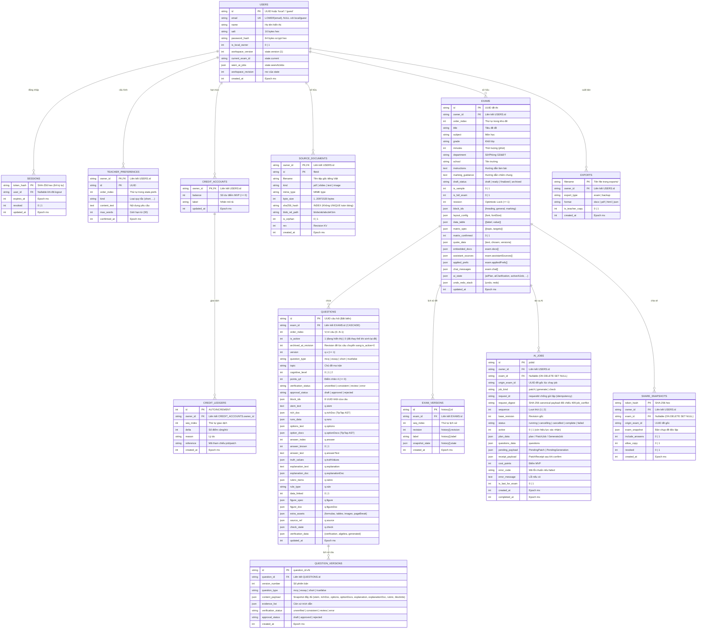
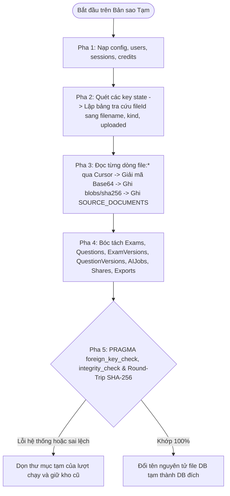

# Hợp đồng Dữ liệu, Kiểm kê Nguồn & Kế hoạch Lưu trữ (BE-3)

**Mã tài liệu:** `C02-DATA`  
**Mảng phụ trách:** BE-3 (Dữ liệu, Persistence, Versioning & Migration)  
**Mốc áp dụng:** Milestone 1 (`BE-3-001`, Issue #6)  
**Trạng thái:** Đề xuất kỹ thuật đã kiểm chứng DDL & Round-Trip trên SQLite 3.49.1 (Chờ `BE-2`, `UI-2`, `BE-4`, `BE-5` review hợp đồng)  
**Truy vết:** Yêu cầu `R2, R3, R6, R7`; Use cases `UC-01, UC-02, UC-03, UC-06, UC-08, UC-09, UC-11`; Hồ sơ môn `CT-03, CT-05, CT-06` ([CONTRACTS.md](../course/CONTRACTS.md), [HO_SO_DA_CO.md](../course/HO_SO_DA_CO.md), [DATA_PLAN.md](../architecture/DATA_PLAN.md))

---

## 1. W01 — Kiểm kê thực chứng kho dữ liệu cũ (Legacy Store Inventory)

Hệ thống Node hiện tại dùng SQLite bảng đơn `kv(key TEXT PRIMARY KEY, value TEXT NOT NULL, rev INTEGER NOT NULL DEFAULT 1, updated INTEGER NOT NULL)` tại `.data/workspace.sqlite` ([backend-store.mjs](../../backend-store.mjs)). Ngoài ra, bản xuất Word/PDF/JSON được ghi trực tiếp ra thư mục `.data/exports/` hoặc `exports/` ([mvp-server.mjs](../../mvp-server.mjs)).

### 1.1. Đầy đủ 12 nhóm Key/Prefix trong SQLite `kv` và Shape Fixture

| STT | Khóa / Tiền tố (Key / Prefix) | Nguồn đọc/ghi (Consumers) | Số bản ghi trong Fixture chuẩn | Cấu trúc thực tế của `value` & Rủi ro khi di trú |
|---|---|---|---|---|
| 1 | `config` | `mvp-server.mjs:20,34,43` | `1` | `{routes, search, ollama, api, greennode, ...}`. Đã xóa API key nhạy cảm trước khi lưu. |
| 2 | `user:<userId>` | `accounts.mjs:9,11,12` | `2` | `{id, name, email, salt, passwordHash}`. `id`, `salt` (16 bytes hex); `passwordHash` (`scryptSync` 64 bytes hex). |
| 3 | `email:<email>` | `accounts.mjs:11,12` | `2` | `string` (`userId`). Index tra cứu ngược từ email chữ thường sang `userId`. Thay bằng `UNIQUE(email)` trong bảng `users`. |
| 4 | `session:<sha256(token)>` | `accounts.mjs:7,10,16` | `2` | `{userId, expires}` (đang hoạt động) hoặc **`{expires: 0}` không có `userId`** (khi đã logout ở `accounts.mjs:16`). |
| 5 | `local-owner` | `accounts.mjs:11,16` | `1` | `string` (`userId`). Đánh dấu tài khoản đầu tiên đăng ký ở chế độ offline để chuyển dữ liệu khách sang `guest:*`. |
| 6 | `credits:<userId>` | `accounts.mjs:13-15` | `2` | `{balance, ledger: [{delta, reason, reference, at}], label}`. Giữ tối đa 100 giao dịch gần nhất. |
| 7 | `u:<userId>:state`<br>`guest:state`<br>`state` | `mvp-server.mjs:41,42`<br>`accounts.mjs:11`<br>`app.js:172` | `2` | `{version, current, exams: [...], prefs: [...], seenAIJobs?: [...]}`. Chứa toàn bộ kho đề, thói quen ra đề (`prefs`), ID đề đang mở (`current`). |
| 8 | `u:<userId>:file:<fileId>`<br>`guest:file:<fileId>`<br>`file:<fileId>` | `mvp-server.mjs:28,41,42`<br>`mvp.js:48` | `3` | Chuỗi `data:<mime>;base64,...` (tối đa 20 MB sau giải mã). **Không chứa `filename`**; tên file nằm ở `exam.docs[].name` trong `state`. |
| 9 | `export-owner:<filename>` | `mvp-server.mjs:58,62`<br>`accounts.mjs:11` | `1` | `string` (`currentOwner`: `'local'` hoặc `userId`). Kiểm quyền tải tệp tại `/exports/<filename>`. |
| 10 | `u:<userId>:job:<jobId>`<br>`guest:job:<jobId>`<br>`job:<jobId>` | `workbench-server.mjs:21-23` | `2` | `{id, examId, baseRevision, status, plan, questions, created, completed?, cost?, error?}`. `examId` có thể trỏ tới đề đã bị xóa. |
| **11** | `u:<userId>:last-job:<examId>`<br>`guest:last-job:<examId>`<br>`last-job:<examId>` | `workbench-server.mjs:21,23` | `1` | `string` (`jobId`). Con trỏ tìm job AI gần nhất của một đề thi. |
| **12** | `share:<sha256(token)>` | `workbench-server.mjs:24-26`<br>`mvp-server.mjs:39` | `2` | `{owner, examId, exam, answers, allowCopy, created, revoked?}`. Bản chụp đề độc lập; `examId` gốc có thể đã bị xóa khỏi `state.exams`. |
| **Tổng** | **12 nhóm khóa** | **Toàn bộ ứng dụng** | **21 dòng `kv` chuẩn** (+2 dòng lỗi ở ca `T02` trong [`tests/fixtures/be3-legacy-kv.json`](../../tests/fixtures/be3-legacy-kv.json)) | Ánh xạ sang **15 bảng quan hệ đích** mà không mất bất kỳ trường nào. |

### 1.2. Kiểm kê chính xác toàn bộ trường của `state`, `Exam` và `Question` trong mã nguồn thật

Bảng dưới đây ghi nhận **tên biến chính xác 100%** từ [core.js](../../core.js), [blocks.js](../../blocks.js), [mvp.js](../../mvp.js) và [workbench.js](../../workbench.js):

* **Cấp Workspace (`state`):** `version` (`1`), `current` (UUID đề đang mở), `prefs` (`[{id, text, kind, maxWords, confirmedAt}]`), `seenAIJobs` (`[jobId, ...]`), `exams` (`[Exam, ...]`).
* **Cấp Đề thi (`Exam`):**
  * Đầu đề & Cấu hình: `id`, `title`, `subject`, `grade`, `minutes`, `department`, `school`, `instructions`, `markingGuidance`, `layout` (`{font, fontSize}`), `sample`, `fullExam`.
  * Định danh khối cho AI Patch: `blockIds` (`{heading, general, marking}` — [blocks.js:16](../../blocks.js)).
  * Bảng số liệu & Ma trận: `data` (`[{label, value}]` dùng cho biểu đồ và quy tắc `max`/`difference`), `matrix` (`[{topic, targets: [n0, n1, n2]}]`), `matrixConfirmed`.
  * Ngữ liệu & Tư liệu: `quote` (`{text, chosen, versions: [...]}`), `docs` (`[{id, fileId?, name, kind, sample, text, pages?, method?, uploaded?}]`), `assistantSources`, `appliedPrefs`.
  * Trợ lý AI & Phiên bản: `chat` (`[{role, text, at?, undoRevision?}]`), `aiPlan`, `aiClarification`, `activeAIJob`, `aiConsent`, `aiEffort`, `aiChatMode`, `autoUpdate`, `revision`, `updated`, `history` (`[{id, label, at, revision, state}]`), `undo`, `redo`.
* **Cấp Câu hỏi (`Question`):**
  * Định danh & Phân loại: `id` (UUID bất biến, độc lập thứ tự), `v` (version câu hỏi `>= 1`), `type` (`'mcq' | 'essay' | 'short' | 'truefalse'`), `topic`, `level` (`0 | 1 | 2`), `points` (bội số `0.25`).
  * Định danh khối cho AI Patch: `blockIds` (`{stem, explanation, rubric, figure, options, answer, answerText, truthValues}` — [blocks.js:4,16](../../blocks.js)).
  * Thân câu & Phương án (**lưu ý đúng tên biến thật trong code**):
    * `stem` (plain text), **`richDoc`** (cây JSON AST TipTap của thân câu — **không phải `stemDoc`**), `runs`.
    * `options` (mảng chuỗi), **`optionDocs`** (mảng cây JSON AST TipTap của từng phương án — **không phải `optionsDoc`**).
  * Đáp án, Lời giải & Barem: `answer` (`0..3`), `answerKnown` (boolean), `answerText` (cho câu `short`), `truthValues` (mảng 4 boolean cho câu `truefalse`), `explanation`, `explanationDoc` (TipTap AST), `rubric` (`[{text, points, richDoc?}]`).
  * Tài nguyên phụ & Kiểm chứng: `formulas` (`[{id, latex}]`), `tables` (`[{id, rows}]`), `images` (`[{id, data, caption}]`), `pageBreak` (boolean), `figure` (JSON tọa độ), `figureDoc`, `rule`, `dataLinked`, `source` (`{docId, location, page?, quote?}`), `check` (`{version, status, problems, evidence, at, method, solver?}`), `verification`, `algebra`, `generated`.

---

## 2. W02 — Mô hình Thực thể Quan hệ (ERD), Ánh xạ Abstraction & Data Dictionary

### 2.1. Đối chiếu với 6 đối tượng miền trong Hồ sơ Abstraction ([HO_SO_DA_CO.md](../course/HO_SO_DA_CO.md))

| Đối tượng miền (Abstraction) | Bảng vật lý trong DB Python | Quy tắc kế thừa và bảo toàn bất biến |
|---|---|---|
| **1. ExamRequest** | `ai_jobs` (`plan_data`, `questions_data`, `base_revision`) | Bảo toàn yêu cầu sinh/sửa đề, phạm vi `scopes` và `base_revision`. |
| **2. SourceDocument** | `source_documents` + cột `embedded_docs` + `.data/blobs/` | Khóa chính kép `(owner_id, id)` cô lập từng giáo viên; file nhị phân chống trùng theo `sha256_hash`. |
| **3. ExamMatrix** | Cột `matrix_spec`, `matrix_confirmed`, `data_table` (`exams`) | Bảo toàn ma trận chủ đề × 3 mức độ nhận thức và bảng số liệu biểu đồ. |
| **4. Question & QuestionVersion** | `questions` + `question_versions` | Đủ 7 trường bắt buộc của Abstraction (`questionId`, `versionId`, `content`, `questionType`, `evidence`, `verificationStatus`, `approvalStatus`) + đầy đủ `richDoc`, `optionDocs`, `blockIds`, `points_q4`. |
| **5. ExamDraft** | `exams` + `exam_versions` | Quản lý trạng thái đề (`draft_status`), khóa lạc quan (`revision`) và lịch sử phiên bản (`exam_versions`). |
| **6. TeacherPreference** | `teacher_preferences` + cột `applied_prefs` (`exams`) | Tách rõ yêu cầu cấp tài khoản (`state.prefs`) và bản chụp yêu cầu đã áp dụng vào từng đề (`exam.appliedPrefs`). |
| **SessionContext** | `users` (`current_exam_id`, `seen_ai_jobs`) + `sessions` | Khôi phục chính xác ngữ cảnh phiên làm việc và đề đang mở. |

### 2.2. Quy tắc "Ba trạng thái độc lập" & Biểu diễn Điểm chính xác (`points_q4`)

1. **Tách bạch 3 trạng thái độc lập ([LY_THUYET.md](../context/LY_THUYET.md), [HO_SO_DA_CO.md](../course/HO_SO_DA_CO.md)):**
   * **`exams.draft_status` (Trạng thái cả bản đề):** `'draft' | 'ready' | 'finalized' | 'archived'`.
   * **`questions.verification_status` (Trạng thái hệ thống/AI kiểm tra):** `'unverified' | 'consistent' | 'review' | 'error'`.
   * **`questions.approval_status` (Trạng thái giáo viên duyệt câu):** `'draft' | 'approved' | 'rejected'`.
   * *Ánh xạ từ `q.check` cũ:* Nếu `q.check.version == q.v` và `q.check.status == 'approved'` $\rightarrow$ `approval_status = 'approved'`, còn `verification_status` nhận `'review'` (nếu `problems` không rỗng) hoặc `'consistent'`. Khi câu hỏi tăng version (`v + 1`), cả hai trạng thái quay về `'unverified'` và `'draft'`.
2. **Biểu diễn điểm số chính xác bằng số nguyên 1/4 điểm (`points_q4` — [CONTRACTS.md:13](../course/CONTRACTS.md)):**
   * Mọi điểm số trong đề và barem đều là bội số của `0.25`. Lưu trong SQLite dưới dạng **`points_q4 INTEGER NOT NULL CHECK (points_q4 >= 0)`** (`points_q4 = round(points * 4)`).
   * Ví dụ: `0.25 điểm -> 1`, `1.25 điểm -> 5`, `2.0 điểm -> 8`, tổng đề `10.0 điểm -> 40`. Loại bỏ 100% sai số dấu phẩy động IEEE 754 khi kiểm tra tổng điểm.

### 2.3. Sơ đồ ERD Chuẩn hóa (15 bảng)



### 2.4. Từ điển Dữ liệu Chi tiết (Data Dictionary: 15 Bảng)

| Bảng | Khóa chính & Khóa ngoại | Các trường dữ liệu, Kiểu, Đơn vị & Nullability | Ràng buộc Toàn vẹn & Index |
|---|---|---|---|
| `app_configs` | `PK(key)` | `key TEXT NOT NULL`, `value_json TEXT NOT NULL` (JSON), `rev INTEGER NOT NULL DEFAULT 1`, `updated_at INTEGER NOT NULL` (Epoch ms UTC) | Lưu `config` hệ thống; không chứa API key bí mật. |
| `users` | `PK(id)` | `id TEXT NOT NULL`, `email TEXT NULL` (lowercase), `name TEXT NOT NULL`, `salt TEXT NULL`, `password_hash TEXT NULL`, `is_local_owner INT NOT NULL`, `workspace_version INT NOT NULL`, `current_exam_id TEXT NULL`, `seen_ai_jobs TEXT NOT NULL`, `workspace_revision INT NOT NULL`, `created_at INT NOT NULL` | `UNIQUE(email)`, `CHECK(workspace_revision >= 0)`. Có sẵn 2 dòng hệ thống `'local'` và `'guest'`. |
| `sessions` | `PK(token_hash)`, `FK(user_id -> users.id ON DELETE CASCADE)` | `token_hash TEXT NOT NULL` (SHA-256 hex 64 ký tự), `user_id TEXT NULL`, `expires_at INT NOT NULL` (Epoch ms), `revoked INT NOT NULL` (`0\|1`), `updated_at INT NOT NULL` | `INDEX idx_sessions_user(user_id)`. Cho phép `user_id NULL` khi `revoked = 1` để tương thích bản ghi logout `{expires: 0}` của Node cũ. |
| `credit_accounts` | `PK(owner_id)`, `FK(owner_id -> users.id ON DELETE CASCADE)` | `owner_id TEXT NOT NULL`, `balance INT NOT NULL DEFAULT 1000` (điểm MVP), `label TEXT NOT NULL`, `updated_at INT NOT NULL` | `CHECK(balance >= 0)`. |
| `credit_ledgers` | `PK(id AUTOINCREMENT)`, `FK(owner_id -> credit_accounts.owner_id ON DELETE CASCADE)` | `seq_index INT NOT NULL`, `delta INT NOT NULL` (điểm), `reason TEXT NOT NULL`, `reference TEXT NULL`, `created_at INT NOT NULL` | `UNIQUE(owner_id, seq_index)`. |
| `teacher_preferences` | `PK(owner_id, id)`, `FK(owner_id -> users.id ON DELETE CASCADE)` | `order_index INT NOT NULL`, `kind TEXT NOT NULL`, `content_text TEXT NOT NULL`, `max_words INT NULL` (số từ), `confirmed_at INT NOT NULL` | Bảo toàn thứ tự `state.prefs[]` qua `order_index`. |
| `source_documents` | `PK(owner_id, id)`, `FK(owner_id -> users.id ON DELETE CASCADE)` | `filename TEXT NOT NULL`, `kind TEXT NOT NULL` (`pdf\|slides\|text\|image`), `mime_type TEXT NOT NULL`, `byte_size INT NOT NULL` (bytes), `sha256_hash TEXT NOT NULL`, `blob_rel_path TEXT NOT NULL`, `is_orphan INT NOT NULL` (`0\|1`), `rev INT NOT NULL`, `created_at INT NOT NULL` | `CHECK(byte_size > 0 AND byte_size <= 20971520)`. `INDEX idx_docs_sha256(sha256_hash)` (**Không UNIQUE toàn cục** để nhiều giáo viên cùng tải 1 tệp không bị xung đột). |
| `exams` | `PK(id)`, `FK(owner_id -> users.id ON DELETE CASCADE)` | `order_index INT NOT NULL`, `title TEXT NOT NULL`, `subject TEXT NOT NULL`, `grade TEXT NOT NULL`, `minutes INT NOT NULL` (phút), `department TEXT NOT NULL`, `school TEXT NOT NULL`, `instructions TEXT NOT NULL`, `marking_guidance TEXT NOT NULL`, `draft_status TEXT NOT NULL`, `is_sample INT NOT NULL`, `is_full_exam INT NOT NULL`, `revision INT NOT NULL`, cùng 11 cột JSON (`block_ids` ... `ai_state` chứa `approvedGenerationPlan`, `aiPlan`, `aiClarification`, `activeAIJob`, và `undo_redo_stack`), `updated_at INT NOT NULL` | `CHECK(minutes > 0)`, `CHECK(revision >= 1)`, `CHECK(draft_status IN ('draft','ready','finalized','archived'))`. `INDEX idx_exams_owner(owner_id, order_index)`. |
| `questions` | `PK(id)`, `FK(exam_id -> exams.id ON DELETE CASCADE)` | `order_index INT NOT NULL`, `is_active INT NOT NULL DEFAULT 1` (`1` đang hiển thị trên đề, `0` đã lưu trữ khi sinh lại đề), `archived_at_revision INT NULL`, `version INT NOT NULL`, `question_type TEXT NOT NULL`, `topic TEXT NOT NULL`, `cognitive_level INT NOT NULL` (`0\|1\|2`), `points_q4 INT NOT NULL` (1/4 điểm), `verification_status TEXT NOT NULL`, `approval_status TEXT NOT NULL`, `block_ids TEXT NOT NULL` (8 UUID gồm `stem`, `explanation`, `rubric`, `figure`, `options`, `answer`, `answerText`, `truthValues`), `stem_text TEXT NOT NULL`, `rich_doc TEXT NULL`, `runs_data TEXT NULL`, `options_text TEXT NOT NULL`, `option_docs TEXT NOT NULL`, `answer_index INT NOT NULL`, `answer_known INT NOT NULL`, `answer_text TEXT NOT NULL`, `truth_values TEXT NOT NULL`, `explanation_text TEXT NOT NULL`, `explanation_doc TEXT NULL`, `rubric_items TEXT NOT NULL`, `rule_type TEXT NULL`, `data_linked INT NOT NULL`, `figure_spec TEXT NULL`, `figure_doc TEXT NULL`, `extra_assets TEXT NOT NULL`, `source_ref TEXT NULL`, `check_state TEXT NULL`, `verification_data TEXT NOT NULL`, `updated_at INT NOT NULL` | Partial Unique Index `CREATE UNIQUE INDEX idx_questions_active_order ON questions(exam_id, order_index) WHERE is_active = 1` (tránh đụng độ `order_index` giữa câu cũ đã lưu trữ `is_active = 0` và câu mới `is_active = 1` khi sinh lại đề), `CHECK(points_q4 >= 0)`. |
| `exam_versions` | `PK(id)`, `FK(exam_id -> exams.id ON DELETE CASCADE)` | `seq_index INT NOT NULL`, `revision INT NOT NULL`, `label TEXT NOT NULL`, `snapshot_state TEXT NOT NULL` (JSON), `created_at INT NOT NULL` | `INDEX idx_exam_versions_exam(exam_id, seq_index)`. Ánh xạ 1-1 với `exam.history[]`. |
| `question_versions` | `PK(id)`, `FK(question_id -> questions.id ON DELETE CASCADE)` | `version_number INT NOT NULL`, `question_type TEXT NOT NULL`, `content_payload TEXT NOT NULL` (JSON đầy đủ gồm `stem`, `richDoc`, `options`, `optionDocs`, `explanation`, `explanationDoc`, `rubric`, `blockIds`, `points`), `evidence_list TEXT NOT NULL`, `verification_status TEXT NOT NULL`, `approval_status TEXT NOT NULL`, `created_at INT NOT NULL` | `UNIQUE(question_id, version_number)`. Khớp 7 trường của Schema `QuestionVersion` trong Abstraction. Khi sinh lại đề (`apply_generation`), câu cũ `Q1` chuyển sang `questions.is_active = 0` thay vì `DELETE` vật lý nên toàn bộ lịch sử `Q1 v1, v2...` vẫn được bảo toàn nguyên vẹn. |
| `ai_jobs` | `PK(id)`, `FK(owner_id -> users.id)`, `FK(exam_id -> exams.id ON DELETE SET NULL)` | `origin_exam_id TEXT NOT NULL`, `job_kind TEXT NOT NULL DEFAULT 'generate'` (`'patch'\|'generate'\|'check'`), `request_id TEXT NULL` (idempotency key từ client), `request_digest TEXT NULL` (SHA-256 canonical payload của request), `sequence INT NOT NULL DEFAULT 1` (`1\|2`), `base_revision INT NOT NULL`, `status TEXT NOT NULL`, `active INT NOT NULL DEFAULT 1` (`0\|1`), `plan_data TEXT NOT NULL`, `questions_data TEXT NOT NULL`, `pending_payload TEXT NULL` (`PendingPatch\|PendingGeneration` JSON), `receipt_payload TEXT NULL` (`PatchReceipt` JSON bền vững sau khi xác nhận), `cost_points INT NULL`, `error_code TEXT NULL`, `error_message TEXT NULL`, `is_last_for_exam INT NOT NULL`, `created_at INT NOT NULL`, `completed_at INT NULL` | `INDEX idx_ai_jobs_owner_exam(owner_id, origin_exam_id)`, `UNIQUE(owner_id, origin_exam_id, request_id)`. Nhờ lưu cặp `(job_kind, request_digest)`, sau khi khởi động lại repository vẫn phân biệt chính xác giữa gửi lặp hợp lệ và tái sử dụng `requestId` khác nội dung/khác thao tác (`409 job_conflict`). |
| `share_snapshots` | `PK(token_hash)`, `FK(owner_id -> users.id)`, `FK(exam_id -> exams.id ON DELETE SET NULL)` | `origin_exam_id TEXT NOT NULL`, `exam_snapshot TEXT NOT NULL` (JSON độc lập), `include_answers INT NOT NULL`, `allow_copy INT NOT NULL`, `revoked INT NOT NULL`, `created_at INT NOT NULL` | Cho phép `exam_id NULL` để link chia sẻ không bị hỏng hay lỗi FK khi giáo viên xóa đề gốc. |
| `exports` | `PK(filename)`, `FK(owner_id -> users.id)` | `export_type TEXT NOT NULL` (`exam\|backup`), `format TEXT NOT NULL` (`docx\|pdf\|html\|json`), `is_teacher_copy INT NOT NULL`, `created_at INT NOT NULL` | Kiểm quyền tải tệp `/exports/<filename>` theo `owner_id`. |
| `quarantine_legacy_items` | `PK(legacy_key)` | `raw_value TEXT NOT NULL`, `rev INT NOT NULL`, `updated INT NOT NULL`, `error_reason TEXT NOT NULL`, `quarantined_at INT NOT NULL` | Lưu trữ cách ly các dòng KV lỗi JSON/Base64 để không làm sập toàn bộ quá trình di trú. |

---

## 3. W03 — Báo cáo Quyết định Kiến trúc (ADR-001): SQLite Local vs PostgreSQL

> **Trạng thái ADR:** Đề xuất kỹ thuật từ BE-3, chờ BE-2 và nhóm đồng thuận trước khi thêm bất kỳ driver mới nào vào `backend/pyproject.toml`.

### 3.1. Bảng so sánh toàn diện (Concurrency, Vận hành, Backup, Chi phí & Cài đặt)

| Tiêu chí | SQLite Local (`sqlite3` stdlib Python 3.12) | PostgreSQL 16+ (Ứng viên mở rộng) | Phân tích & Lựa chọn cho đồ án |
|---|---|---|---|
| **1. Chi phí (Cost)** | **0 VNĐ (Miễn phí hoàn toàn)**: Không tốn RAM/CPU cho DB daemon riêng, không tốn phí managed DB hay phút chạy service container trên GitHub Actions. | Tốn RAM/CPU chạy container hoặc phí thuê Cloud DB; tăng thời gian khởi tạo CI. | **SQLite tối ưu tuyệt đối** cho ngân sách sinh viên và gói miễn phí GitHub Actions. |
| **2. Phụ thuộc (`pyproject.toml`)** | **0 dependency mới**: Dùng ngay module `sqlite3` (v3.49.1) có sẵn trong Python 3.12. | Phải cài thêm `psycopg` / `asyncpg` / `sqlalchemy` và Postgres server trên máy cả 8 thành viên. | Giữ nguyên `pyproject.toml` tinh gọn ở M1; tránh hoàn toàn lỗi môi trường giữa Windows/macOS/Linux. |
| **3. Concurrency (Tương tranh)** | Đọc song song không khóa qua `WAL` mode. Ghi tuần tự hóa qua `PRAGMA busy_timeout = 5000` + `threading.Lock` ở tầng Python Repository. Hỗ trợ `APP_SQLITE_EXCLUSIVE=1` (`journal_mode=DELETE, locking_mode=EXCLUSIVE`) khi chạy 1 process trên volume mạng. | Hỗ trợ đọc/ghi đồng thời cao ở cấp độ dòng (MVCC & Row-level lock) qua nhiều worker/máy chủ. | Quy mô đồ án (1 process backend phục vụ giáo viên soạn đề, giao dịch ghi `< 5ms`) chạy hoàn toàn mượt với SQLite. |
| **4. Vận hành (Operations)** | Dữ liệu gói gọn trong `.data/workspace.sqlite` và `.data/blobs/`. Khớp 100% với kiến trúc 1-process hiện tại trên GreenNode của Thuận (`tests/deployment.test.mjs:5`). | Cần quản trị user/role DB, port, migration service, nâng cấp phiên bản pg_data. | Giảm tải vận hành tối đa cho Thuận (người duy nhất quản lý GreenNode). |
| **5. Backup & Restore** | Sao lưu nóng (Online Hot Backup) an toàn ngay trong khi DB đang mở bằng hàm chuẩn **`sqlite3.Connection.backup(target_conn)`** (tuyệt đối không dùng lệnh `cp` đơn lẻ khi đang ghi WAL). | Dùng `pg_dump` / `pg_restore` hoặc snapshot volume. | API `sqlite3.Connection.backup()` tích hợp sẵn trong Python đảm bảo tính nhất quán ACID 100% khi sao lưu. |

### 3.2. Thiết kế Index, Transaction & Quy tắc Serialization chuẩn

1. **Danh mục 6 Index bắt buộc:**
   * `idx_sessions_user ON sessions(user_id)` — Thu hồi nhanh phiên đăng nhập của người dùng.
   * `idx_docs_sha256 ON source_documents(sha256_hash)` — Kiểm tra chống trùng tệp vật lý (`ref_count`) trong $O(\log N)$.
   * `idx_exams_owner ON exams(owner_id, order_index)` — Truy vấn danh sách đề thi của một giáo viên theo đúng thứ tự.
   * `idx_questions_active_order ON questions(exam_id, order_index) WHERE is_active = 1` — Partial Unique Index đảm bảo các câu hỏi đang hiển thị trên đề (`is_active = 1`) không trùng thứ tự `order_index`, đồng thời cho phép giữ lại các câu hỏi cũ đã lưu trữ (`is_active = 0`) cùng lịch sử `question_versions` khi sinh lại đề.
   * `idx_exam_versions_exam ON exam_versions(exam_id, seq_index)` — Mở nhanh lịch sử 100 phiên bản của đề.
   * `idx_ai_jobs_owner_exam ON ai_jobs(owner_id, origin_exam_id)` — Tìm nhanh job AI đang chạy hoặc cần khôi phục của đề.
2. **Quy tắc Transaction & Khóa Lạc quan (OCC):**
   * Mọi thao tác ghi đều nằm trong `with conn:` (tự động `COMMIT` khi thành công, tự động `ROLLBACK` khi ném ngoại lệ).
   * Tuyệt đối **không mở transaction DB trong lúc chờ gọi mạng tới AI provider**.
3. **Quy tắc Serialization & Canonical Checksum:**
   * Chuỗi JSON lưu vào DB hoặc dùng để tính mã băm kiểm chứng phải qua chuẩn hóa `json.dumps(obj, ensure_ascii=False, sort_keys=True, separators=(",", ":"))`.
   * Điểm số khi serialize ra DTO trả về UI: nếu `points_q4 % 4 == 0` trả số nguyên (`points_q4 // 4`), ngược lại trả `points_q4 / 4.0` (ví dụ `8 -> 2`, `5 -> 1.25`).

---

## 4. W04 — Chiến lược Di trú 5 Pha, Backup/Restore & Rollback

### 4.1. Quy trình Di trú 5 Pha (Đúng thứ tự phụ thuộc dữ liệu)



### 4.2. Quy trình Backup & Restore Nhất quán trên Bản sao
* **Backup nhất quán (Online Backup):**
  1. Mở kết nối tới DB đang chạy `src_conn` và mở kết nối tới file sao lưu mới `bck_conn = sqlite3.connect(backup_file)`.
  2. Gọi `src_conn.backup(bck_conn)` (cơ chế trang-theo-trang của SQLite, an toàn ngay cả khi có kết nối khác đang đọc/ghi).
  3. Sao chép thư mục `.data/blobs/` và kiểm tra mã băm của từng tệp `.bin` khớp với cột `sha256_hash` trong bảng `source_documents` của bản sao.
  4. Chạy `PRAGMA integrity_check` và `PRAGMA foreign_key_check` trên `bck_conn` $\rightarrow$ phải trả về `'ok'` và `[]`.
* **Restore & Rollback khi có sự cố:**
  * Di trú và khôi phục luôn ghi vào tệp tạm (thư mục riêng cho mỗi lượt chạy). Chỉ khi toàn bộ kiểm tra ở Pha 5 đạt 100% mới thực hiện hoán đổi đường dẫn (atomic replace). Nếu có bất kỳ lỗi nào giữa chừng, tệp tạm bị xóa sạch và tệp gốc không bị suy suyển dù chỉ 1 byte.

---

## 5. W05 — Hợp đồng Python Repository, Kết quả Thực nghiệm (T01–T05) & Checklist Review

> **Mã nguồn thực thi & Bộ kiểm thử tự động đi kèm trên nhánh:**
> - Module DDL, Migration 5 pha, Khôi phục State & Giao dịch AI: [`backend/src/mach_backend/be3_schema_migration.py`](../../backend/src/mach_backend/be3_schema_migration.py)
> - Fixture KV tổng hợp (21 bản ghi sạch đủ 12 prefix + 2 bản ghi hỏng JSON/Base64): [`tests/fixtures/be3-legacy-kv.json`](../../tests/fixtures/be3-legacy-kv.json)
> - Bộ kiểm thử Pytest tự động (`T01`–`T05`): [`backend/tests/test_be3_migration.py`](../../backend/tests/test_be3_migration.py)
> - Lệnh chạy kiểm chứng độc lập trên máy bất kỳ / CI:
>   ```bash
>   cd backend
>   uv run pytest -v
>   uv run ruff check .
>   uv run ruff format --check .
>   uv run ty check src
>   ```

### 5.1. Hợp đồng Python Repository (Theo mẫu 9 mục của [CONTRACTS.md](../course/CONTRACTS.md))

#### Hợp đồng 1: `WorkspaceRepository.get_workspace_state` & `save_workspace_state`
```text
Tên/phiên bản: WorkspaceRepository.get_workspace_state / save_workspace_state (v1.0 - Đề xuất)
Người sở hữu + người dùng hợp đồng: Owner: BE-3 | Consumers: BE-2 (API /api/kv, /api/exams), UI-1, UI-2
Input (field/type/unit/required/limits):
  - owner_id: str (required, 'local' | 'guest' | hex32 userId)
  - payload (khi save): dict {version: int, current: str|None, exams: list[ExamDTO], prefs: list[PrefDTO], seenAIJobs?: list[str]} (required, <= 1000 exams)
  - base_revision (khi save): int | None (từ header If-Match; nếu truyền vào phải >= 0)
Output thành công:
  - Khi get: {value: WorkspaceStateDTO | None, revision: int, updated: int (epoch ms)}
  - Khi save: {revision: int (workspace_revision mới = rev cũ + 1)}
Lỗi có thể trả + status/code:
  - 400 VALIDATION_ERROR: Thiếu mảng exams/prefs hoặc điểm câu hỏi không phải bội số 0.25.
  - 409 REVISION_CONFLICT: base_revision != current_workspace_revision ("Dữ liệu đã được thay đổi ở cửa sổ khác. Hãy tải lại trước khi tiếp tục.").
Quy tắc quyền/revision/idempotency:
  - Cô lập tuyệt đối theo owner_id (User A không bao giờ đọc/ghi được đề của User B).
  - Tăng workspace_revision thêm 1 trong cùng một SQLite transaction với cập nhật exams, questions, exam_versions, teacher_preferences.
Ví dụ input → output:
  - save_workspace_state(owner_id="a100...01", payload=stateUserA, base_revision=1) -> {"revision": 2}
Ca rỗng / biên / sai quyền / stale:
  - Tài khoản mới chưa có đề: get trả {"value": None, "revision": 0}.
  - Stale If-Match (base_revision=1 khi DB đang ở revision=2): ném RevisionConflictError(status=409, current_revision=2), giữ nguyên dữ liệu DB.
Fixture và test chứng minh:
  - Ca kiểm tra BE-3-001/T01 và BE-3-001/T03.
```

#### Hợp đồng 2: `DocumentRepository.put_file_data_url` & `get_file_buffer`
```text
Tên/phiên bản: DocumentRepository.put_file_data_url / get_file_buffer (v1.0 - Đề xuất)
Người sở hữu + người dùng hợp đồng: Owner: BE-3 | Consumers: BE-2, BE-4 (Import/OCR/Export), UI-1, UI-2
Input (field/type/unit/required/limits):
  - owner_id: str (required)
  - file_id: str (required, khớp /^[\w-]+$/)
  - data_url (khi put): str dạng "data:<mime>;base64,<payload>" (required, kích thước sau giải mã 1..20971520 bytes = 20 MB)
Output thành công:
  - Khi put: {revision: int, sha256: str, byte_size: int}
  - Khi get: bytes (binary buffer) hoặc chuỗi data_url tương thích /api/kv?key=file:<fileId>
Lỗi có thể trả + status/code:
  - 400 INVALID_FILE_FORMAT: Không đúng định dạng Data URL Base64.
  - 404 FILE_NOT_FOUND: Không tồn tại (owner_id, file_id) ("Chưa tìm thấy tệp gốc trên máy chủ.").
  - 413 FILE_TOO_LARGE: Vượt quá 20 MB ("Tệp vượt giới hạn 20 MB.").
Quy tắc quyền/revision/idempotency:
  - Khóa chính là (owner_id, file_id). Hai giáo viên tải cùng 1 file có cùng sha256 được lưu 2 dòng metadata độc lập nhưng dùng chung 1 file .data/blobs/{sha256[:2]}/{sha256}.bin.
Ví dụ input → output:
  - put_file_data_url("a100...01", "file-shared-pdf", "data:application/pdf;base64,JVBER...") -> {"revision": 1, "byte_size": 58}
Ca rỗng / biên / sai quyền / stale:
  - User B gọi get_file_buffer(owner_id="b200...02", file_id="file-of-user-a") -> 404 FILE_NOT_FOUND.
Fixture và test chứng minh:
  - Ca kiểm tra BE-3-001/T01 (2 user cùng tải 1 PDF) và BE-3-001/T02 (file hỏng Base64).
```

#### Hợp đồng 3: `MigrationService.migrate_legacy_store` & `backup_store`
```text
Tên/phiên bản: MigrationService.migrate_legacy_store / backup_store (v1.0 - Đề xuất)
Người sở hữu + người dùng hợp đồng: Owner: BE-3 | Consumers: BE-5 (QA/Release), BE-1 (Vận hành GreenNode)
Input (field/type/unit/required/limits):
  - src_sqlite: Path (tệp workspace.sqlite cũ, mở ở chế độ URI Read-Only ?mode=ro)
  - dst_sqlite: Path (tệp SQLite đích mới)
  - blobs_dir: Path (thư mục lưu trữ tệp nhị phân tách từ Base64)
Output thành công:
  - MigrationReportDTO {ok: True, table_counts: dict[str, int], physical_blob_count: int, quarantined_items: list[dict]}
Lỗi có thể trả + status/code:
  - 500 MIGRATION_INTEGRITY_ERROR: Lỗi PRAGMA foreign_key_check, PRAGMA integrity_check hoặc lỗi I/O hệ thống -> tự động xóa tệp đích tạm của lượt chạy.
Quy tắc quyền/revision/idempotency:
  - Tuyệt đối Read-Only trên src_sqlite (SHA-256 của src_sqlite trước và sau khi chạy phải giống hệt nhau).
  - Idempotent: Chạy lại N lần trên cùng nguồn không tạo bản sao và không tăng sai lệch revision.
  - Bản ghi KV hỏng JSON/Base64 được cách ly vào bảng quarantine_legacy_items, không làm chết các đề hợp lệ khác.
Fixture và test chứng minh:
  - Ca kiểm tra BE-3-001/T01, BE-3-001/T02, BE-3-001/T03.
```

#### Hợp đồng 4: `ConfirmationRepository` & Callbacks Đọc Snapshot AI (`ReadPatchInputs`, `ReadGenerationInputs`, `ReadCheckInputs`, `stage`, `transaction`) — Đồng bộ với PR #39 (`BE-1`) và PR #41 (`BE-2`)
```text
Tên/phiên bản: ConfirmationRepository & AI Snapshot Readers (v1.1 - Đã đối chiếu PR #39 & PR #41)
Người sở hữu + người dùng hợp đồng: Owner: BE-3 | Consumers: BE-1 (patch_confirmation.py, generation_submission.py, patch_submission.py, check_routes.py), BE-2 (FastAPI routes), BE-5 (PatchJobRunner)
Input (field/type/unit/required/limits):
  - owner_id: str (required, lấy từ phiên xác thực BE-2)
  - exam_id: UUID (required)
  - job_id (khi confirm/transaction): UUID (required)
  - source_keys (khi read_inputs): tuple[tuple[UUID, Locator], ...] (tối đa 12 đoạn nguồn, Locator.kind in {'page', 'passage', 'region'}, index >= 1, regionId bắt buộc khi kind == 'region')
  - pending (khi stage): PendingPatch | PendingGeneration (required)
Output thành công:
  - ReadPatchInputs: PatchInputs(owner_id, exam: ExamSnapshot, sources: tuple[SourceFragment, ...]) | None
  - ReadGenerationInputs: GenerationInputs(owner_id, exam: ExamSnapshot, approved_plan: GenerationPlan | None, sources: tuple[SourceFragment, ...]) | None
  - ReadCheckInputs: CheckInputs(owner_id, exam_id, base_revision, question: BlindQuestion, saved_answer: Answer, sources: tuple[SourceFragment, ...]) | None
  - stage(pending): bool (True nếu ghi thành công vào ai_jobs.pending_payload khi exam.revision == job.baseRevision, nguồn còn khớp và approvedGenerationPlan chưa đổi)
  - transaction(owner_id, exam_id, job_id): ContextManager[PatchTransaction] cung cấp:
    + tx.read() -> ConfirmationState(owner_id, pending, exam, sources, receipt, approved_plan) | None (chỉ đọc job có active = 1)
    + tx.write(exam: ExamSnapshot, receipt: PatchReceipt) -> None
Lỗi có thể trả + status/code:
  - 404 proposal_not_found / exam_not_found / question_not_found / source_not_found: Không tìm thấy trong phạm vi owner_id hoặc active = 0.
  - 409 stale_snapshot / plan_not_approved / exam_read_only / rich_document_conflict: Đề (baseRevision), câu (questionVersion), đoạn nguồn (sourceVersion) hoặc ma trận duyệt (approvedGenerationPlan) đã đổi trước hoặc trong lúc chờ model.
  - Quy tắc quyền/revision/idempotency:
    - Mọi thao tác đọc snapshot (read_inputs, current) và ghi xác nhận (stage, tx.write) đều lọc cứng theo owner_id của phiên.
    - Đối chiếu gửi lặp bền vững qua khởi động lại (`replay_or_register_submission`):
      + Lưu `(owner_id, origin_exam_id, request_id, job_kind, request_digest, sequence, status)` vào bảng `ai_jobs`, trong đó `request_digest = sha256(canonical_payload)` với `patch` và `sha256(b"generate:" + canonical_payload)` với `generate` (khớp `patch_routes.py` trong PR #39).
      + Khi client gửi lại cùng `(owner_id, origin_exam_id, request_id)` (kể cả sau khi đóng/mở lại SQLite repository): nếu `(job_kind, request_digest)` khớp 100% thì trả lại đúng `job` đã lưu (không gọi lại model, không tạo job mới); nếu `request_digest` khác (sửa nội dung nhưng giữ `requestId` cũ) hoặc `job_kind` khác (dùng lại `requestId` của Patch sang Generate hoặc ngược lại) thì ném `JobConflictError` (`409 job_conflict`).
    - Trong `tx.write(exam, receipt)` (`confirm_patch_or_generation_tx`), thực hiện nguyên tử trong 1 giao dịch `BEGIN IMMEDIATE`:
      1. Chèn bản đề cũ (`old_exam` ở `base_revision`) vào bảng `exam_versions` (`history`).
      2. Cập nhật bảng `exams` (tăng `revision = base_revision + 1`; với Sinh đề thì xóa `aiPlan` / `approvedGenerationPlan`, đặt `draft_status = 'draft'`, `is_full_exam = 1`, `is_sample = 0`).
      3. Bảo toàn lịch sử `QuestionVersion` qua cả Sửa câu (`patch`) và Sinh lại đề (`generate`):
         - Với **Sửa câu (`patch`)**: cập nhật dòng `questions` hiện hữu (`version = q.v + 1`, `is_active = 1`) và chèn thêm phiên bản mới `question_id:v{N}` vào `question_versions` (chứa đầy đủ `stem`, `richDoc`, `options`, `optionDocs`, `explanation`, `explanationDoc`, `rubric`, `blockIds`).
         - Với **Sinh lại đề (`generate`)**: đánh dấu các câu hỏi cũ không còn trong bộ câu mới thành `questions.is_active = 0, archived_at_revision = new_revision` (**không xóa vật lý dòng `questions` cũ**), chèn các câu UUID mới với `is_active = 1`, và ghi `question_versions` (`v1`) cho các câu mới. Nhờ Partial Unique Index `idx_questions_active_order WHERE is_active = 1`, các câu mới ở `order_index = 0..N-1` không đụng độ với câu cũ đã lưu trữ, trong khi toàn bộ lịch sử `Q1 v1`, `Q1 v2` cùng `richDoc`/`explanationDoc` vẫn đọc lại được nguyên vẹn qua `get_question_version_history()`.
      4. Ghi biên nhận `receipt.model_dump_json()` vào `ai_jobs.receipt_payload`.
    - Idempotency bền vững khi xác nhận: Nếu `tx.read()` thấy `ai_jobs.receipt_payload` khác `NULL`, trả ngay `PatchReceipt` cũ (giữ nguyên cùng danh sách `changedQuestionIds` / UUID câu mới kể cả sau khi khởi động lại tiến trình).
    - Phục hồi/hủy job: Khi job bị hủy (`/cancel`) hoặc hết hạn, cập nhật `ai_jobs.active = 0` và `status = 'cancelled'` để chặn mọi phản hồi muộn từ provider hoặc yêu cầu confirm về sau.
  - Ví dụ input → output:
    - confirm_patch(repo, owner_id="teacher-1", exam_id=UUID("..."), job_id=UUID("..."), base_revision=4) -> PatchReceipt(jobId=..., examId=..., baseRevision=4, revision=5, changedQuestionIds=(UUID("..."),))
  - Ca rỗng / biên / sai quyền / stale:
    - Gửi confirm lần 2 với cùng (owner_id, exam_id, job_id, base_revision=4): trả lại đúng PatchReceipt(revision=5) từ ai_jobs.receipt_payload, không ghi thêm dòng thứ 2 vào exam_versions.
    - Lỗi giữa lúc ghi tx.write (ví dụ lỗi I/O trước khi cập nhật receipt_payload): SQLite tự động ROLLBACK cả exam_versions, exams, questions và question_versions về trạng thái trước giao dịch.
  - Fixture và test chứng minh:
    - Kiểm chứng tự động tại `test_t04_preserve_question_versions_across_patch_and_regeneration` và `test_t05_persistent_replay_and_cross_operation_conflict_after_restart` trong [`backend/tests/test_be3_migration.py`](../../backend/tests/test_be3_migration.py).
```

### 5.2. Báo cáo Thực nghiệm Kiểm chứng T01 – T05 (Chạy tự động qua `pytest` trên Python 3.12 / SQLite 3.49.1)

Bộ dữ liệu mẫu trong [`tests/fixtures/be3-legacy-kv.json`](../../tests/fixtures/be3-legacy-kv.json) và module thực thi [`backend/src/mach_backend/be3_schema_migration.py`](../../backend/src/mach_backend/be3_schema_migration.py) được kiểm thử tự động bằng [`backend/tests/test_be3_migration.py`](../../backend/tests/test_be3_migration.py). Dưới đây là số liệu thực nghiệm chính xác (`expected == actual`):

1. **Thống kê kiểm đếm bản ghi (`21` dòng KV nguồn sạch $\rightarrow$ `15` bảng đích ở cả Lần chạy 1 và Lần chạy 2 Idempotent):**
   * `app_configs`: `1` | `users`: `4` (`local`, `guest`, `userA`, `userB`) | `sessions`: `2` (1 đang hoạt động, 1 đã logout `{expires: 0}` có `revoked = 1, user_id = NULL`)
   * `credit_accounts`: `2` | `credit_ledgers`: `1` | `teacher_preferences`: `1`
   * `source_documents`: `3` (2 tài liệu PDF của 2 giáo viên có cùng nội dung + 1 ảnh mồ côi `is_orphan = 1`) $\rightarrow$ Số file vật lý trong `blobs/`: **`2` file `.bin`** (đã chống trùng theo SHA-256).
   * `exams`: `2` (`exam-math-001` với `revision = 2`; `exam-geo-001` với `revision = 1`) | `questions`: `3` (`q-math-001` `0.25đ -> points_q4 = 1`; `q-math-002` `2.0đ -> points_q4 = 8`; `q-geo-001` `0.5đ -> points_q4 = 2`)
   * `exam_versions`: `2` | `question_versions`: `3` | `ai_jobs`: `2` (gồm 1 job trỏ tới đề đã xóa `exam_id = NULL, origin_exam_id = 'exam-deleted-999'`) | `share_snapshots`: `2` (gồm 1 share trỏ tới đề đã xóa `exam_id = NULL`) | `exports`: `1` | `quarantine_legacy_items`: `0` (trên kho sạch).
   * **Lưu ý kỹ thuật Pha 1:** Khi đọc bảng `kv` với `PRAGMA foreign_keys = ON`, truy vấn Pha 1 bắt buộc sắp xếp `ORDER BY CASE WHEN key = 'config' THEN 0 WHEN key LIKE 'user:%' THEN 1 ELSE 2 END, key` để các dòng `user:*` luôn được nạp trước `credits:*` và `session:*` (tránh lỗi khóa ngoại do thứ tự bảng chữ cái `'c' < 'u'`).

2. **Bảng kết quả thực chạy 5 ca kiểm thử tự động (`T01` – `T05`):**

| Ca | Thao tác thực nghiệm (`backend/tests/test_be3_migration.py`) | Expected (Kỳ vọng) | Actual (Thực tế đo được trên SQLite 3.49.1) | Kết luận |
|---|---|---|---|---|
| **T01** | Di trú kho sạch `21` dòng KV sang `15` bảng mới, sau đó gọi `reconstruct_workspace_state()` tái tạo lại `state` của Giáo viên A (Toán, có `richDoc`, `optionDocs`, `rubric[].richDoc`, `blockIds`, `figure`, `formulas`, `tables`, `history`) và Giáo viên B (Địa lí, có `data`, `quote`). | Checksum SHA-256 của JSON canonical trước và sau di trú khớp 100%; `PRAGMA foreign_key_check` = `[]`; `PRAGMA integrity_check` = `'ok'`. | - `state_a` SHA-256: `75fe5228d005d4216023c5a24844a06f07abe5d51b1df08429a9db0c071f06c6` (Khớp 100%)<br>- `state_b` SHA-256: `51e480ea2462b5445ff24b02666af7b2b4a0a47eda20ef4f898184f8ad78f6da` (Khớp 100%)<br>- FK & Integrity: `'ok'` | **ĐẠT (PASS)** |
| **T02** | 1. Bơm thêm 2 dòng hỏng (`u:corrupt-user:state` cụt JSON và `file:file-corrupt-b64` sai Base64) rồi chạy di trú.<br>2. Giả lập lỗi giữa chừng (`simulate_mid_failure=True`).<br>3. Chạy `conn.backup()` sang DB sao lưu. | 1. Cách ly đúng 2 dòng hỏng vào `quarantine_legacy_items`, 2 đề hợp lệ vẫn sống.<br>2. Khi lỗi giữa chừng, xóa sạch file đích tạm, file nguồn giữ nguyên SHA-256.<br>3. Bản backup đạt `integrity_check = 'ok'`. | 1. `quarantined_count = 2`, `surviving_exams_count = 2`.<br>2. SHA-256 file nguồn trước & sau giữ nguyên tuyệt đối.<br>3. `online_backup_test`: `integrity = 'ok'`, `counts_match = true`. | **ĐẠT (PASS)** |
| **T03** | 1. Chạy lại `migrate_legacy_store()` lần thứ 2 trên cùng DB đích.<br>2. Hai phiên cùng đọc `exam-math-001` ở `revision = 2`: Phiên 1 cập nhật lên `revision = 3`; Phiên 2 gửi cập nhật với `base_revision = 2`. | 1. Số bản ghi cả 15 bảng ở lần 2 bằng hệt lần 1.<br>2. Phiên 2 bị từ chối với `RevisionConflictError(status=409, current_revision=3)`. | 1. `table_counts_run1 == table_counts_run2` (`True`).<br>2. Phiên 1 nhận `revision = 3`; Phiên 2 nhận `status = 409, current_revision = 3`. | **ĐẠT (PASS)** |
| **T04** | 1. Câu `q-math-001` đang ở `v1` $\rightarrow$ xác nhận Patch tăng lên `v2` (có `richDoc` và `explanationDoc` mới).<br>2. Xác nhận Generate thay thế đề bằng câu mới `q-math-gen-001` ở cùng `order_index = 0`.<br>3. Giả lập lỗi giữa giao dịch (`simulate_mid_write_failure=True`). | 1. Đề hiện hành chỉ hiển thị `q-math-gen-001` (`is_active = 1`).<br>2. Mở lại lịch sử câu `q-math-001` vẫn đọc được nguyên vẹn cả `v1` và `v2` cùng `richDoc`/`explanationDoc`.<br>3. Khi lỗi giữa chừng, rollback sạch cả `exams`, `exam_versions`, `questions`, `question_versions` và `receipt_payload`. | 1. `reconstruct_workspace_state` trả đúng `["q-math-gen-001"]`.<br>2. `get_question_version_history("q-math-001")` trả đủ `[v1, v2]` kèm `richDoc` & `explanationDoc`.<br>3. Giao dịch lỗi tự động rollback về đúng `revision = 4`, không rò rỉ dữ liệu dở dang. | **ĐẠT (PASS)** |
| **T05** | 1. Đăng ký `requestId = "req-patch-001"` cho thao tác `patch`, sau đó **đóng kết nối SQLite và mở lại từ file**.<br>2. Gửi lại đúng `(owner, exam, requestId, payload)` sau khi mở lại DB.<br>3. Gửi lại cùng `requestId` nhưng đổi nội dung `prompt`.<br>4. Gửi lại cùng `requestId` nhưng đổi sang thao tác `generate`. | 1. Lần gửi lặp hợp lệ sau khi khởi động lại trả về đúng `job_id` cũ (`replayed = True`).<br>2. Đổi nội dung hoặc dùng chéo `requestId` giữa `patch` và `generate` bị chặn ngay với `JobConflictError(status=409, code="job_conflict")`, số dòng `ai_jobs` không tăng. | 1. `replay["replayed"] == True`, `job_id == "job-patch-101"`.<br>2. Cả 2 trường hợp đổi nội dung và đổi `job_kind` đều ném `409 job_conflict`; tổng số dòng `ai_jobs` cho `requestId` đó giữ nguyên bằng `1`. | **ĐẠT (PASS)** |

3. **Bốn ca hồi quy bổ sung sau review PR #38 / PR #42 (đồng thời, trạng thái khóa/duyệt & an toàn công bố migration):**
   * `test_concurrent_revision_updates_report_one_conflict`: Hai thread dùng `Barrier(2)` cùng đọc `revision = 2` và gọi `update_exam_with_occ` (`UPDATE ... WHERE owner_id = ? AND revision = ? RETURNING revision`) $\rightarrow$ 1 luồng ghi thành công (`revision = 3`), luồng còn lại nhận `RevisionConflictError(status=409, current_revision=3)`, không xảy ra ghi đè thầm lặng.
   * `test_locked_exam_and_question_statuses_survive_roundtrip`: Đề có `draftStatus = "finalized"`, câu có `verificationStatus = "review"`, `approvalStatus = "rejected"`, `evidence = [...]` $\rightarrow$ migrate và `reconstruct_workspace_state()` trả lại khớp 100% object đề gốc (đồng thời giữ nguyên checksum 2 fixture legacy).
   * `test_failed_publication_preserves_existing_store[blob]` & `[database]`: Bổ sung tệp mới vào nguồn rồi tiêm lỗi `OSError` ngay tại bước chuyển blob mới hoặc tại `tmp_sqlite.replace(dst_sqlite)` $\rightarrow$ tệp DB đích cũ và toàn bộ blob cũ giữ nguyên 100% (`PRAGMA integrity_check == 'ok'`), chạy lại migration kế tiếp vẫn khôi phục bình thường (các blob mới theo hash đã chép trước khi lỗi được tái sử dụng).

### 5.3. Truy vết Hồ sơ Môn học (CT-03, CT-05, CT-06)

* **Đóng góp cho [CT-03 (Issue #28)](../course/CONTRACTS.md):** Ánh xạ đầy đủ 6 đối tượng miền + `SessionContext` và 7 trường `QuestionVersion` từ hồ sơ Abstraction sang 15 bảng SQLite/Python; tách bạch 3 trạng thái (`draft_status`, `verification_status`, `approval_status`); định nghĩa hợp đồng Repository 9 mục.
* **Đóng góp cho [CT-05 (Issue #30)](../course/ALGORITHM.md):** Cung cấp lưu đồ thuật toán di trú 5 pha và thuật toán kiểm tra khóa lạc quan kép (OCC), với độ phức tạp thời gian $O(N_{\text{exams}} + N_{\text{questions}} + N_{\text{files}})$ và độ phức tạp bộ nhớ $O(\max(\text{file\_size})) \le 20\text{ MB}$ nhờ đọc streaming từng tệp qua cursor.
* **Đóng góp cho [CT-06 (Issue #31)](../course/EVALUATION.md):** Cung cấp bộ số đo thực nghiệm kiểm chứng tính toàn vẹn dữ liệu (`SHA-256 round-trip match = 100%`, `foreign_key_check = 0 lỗi`, `quarantine survival = 100%`).

### 5.4. Checklist Review Bàn giao cho các Mảng Liên quan (`BE-1`, `BE-2`, `UI-2`, `BE-4`, `BE-5`)

Khi các thành viên nhận task ở các mảng liên quan, vui lòng rà soát và tick xác nhận các mục dưới đây trong Issue #6:

- [x] **Đã đối chiếu với `BE-1` (PR #39 — Hợp đồng AI Sinh/Sửa/Kiểm & Giao dịch xác nhận) và `BE-2` (PR #41 — Bản đồ API & Quyền):**
  - Bảng `ai_jobs` đã bổ sung `request_id` (chống gửi lặp `requestId`), `active` (`0|1`), `pending_payload` (`PendingPatch | PendingGeneration`) và `receipt_payload` (`PatchReceipt` bền vững qua khởi động lại).
  - Bảng `exams.ai_state` bảo toàn `approvedGenerationPlan` để `ReadGenerationInputs`, `stage` và `ConfirmationRepository.transaction` đối chiếu ma trận đã duyệt trong cùng giao dịch `BEGIN IMMEDIATE`.
  - Tách biệt rõ 3 giá trị phiên bản như yêu cầu tại `docs/contracts/http.md`: `users.workspace_revision` (workspace KV), `exams.revision` (`baseRevision` của đề) và `questions.version` (`questionVersion` / `q.v` của từng câu).
  - Ánh xạ đầy đủ `SourceFragment(ownerId, sourceId, sourceVersion, locator, text)` từ `source_documents` (`rev` $\rightarrow$ `sourceVersion`) và `exam.embedded_docs` theo đúng khóa `(sourceId, locator)`.
- [ ] **Dành cho `BE-2` (API / Auth / Quyền):**
  - Xác nhận cấu trúc bảng `users`, `sessions` (cho phép `user_id NULL` khi `revoked = 1`), `credit_accounts` và `exports` khớp với middleware xác thực cookie `soande_session`.
  - Xác nhận mã lỗi `409 Conflict` (`RevisionConflictError` / `stale_snapshot` / `plan_not_approved`) và thông điệp tiếng Việt khớp với hợp đồng OpenAPI `C01`.
- [ ] **Dành cho `UI-2` (Editor / Công thức / Bảng / Hình):**
  - Xác nhận bảng ánh xạ giữ nguyên đúng tên trường `q.richDoc`, `q.runs`, `q.optionDocs`, `q.explanationDoc`, `q.rubric[].richDoc`, `q.blockIds` (8 UUID gồm `stem`, `explanation`, `rubric`, `figure`, `options`, `answer`, `answerText`, `truthValues`), `q.formulas`, `q.tables`, `q.images`, `q.figure` và `exam.history` / `exam.undo`.
  - Xác nhận quy đổi điểm `points_q4 / 4` trả về đúng số điểm hiển thị trên trình soạn thảo.
- [ ] **Dành cho `BE-4` (Import / OCR / Export):**
  - Xác nhận khóa chính kép `(owner_id, id)` trên `source_documents` và cách lưu tệp vật lý `.data/blobs/{sha256[:2]}/{sha256}.bin` đáp ứng luồng đọc PDF/ảnh (tối đa 20 MB) và lưu trạng thái OCR theo trang trong `embedded_docs`.
- [ ] **Dành cho `BE-5` (Job / Tích hợp / QA):**
  - Xác nhận bảng `ai_jobs` (trạng thái `running | cancelling | cancelled | complete | failed`, `active`, `pending_payload`, `receipt_payload`, cờ `is_last_for_exam` và `exam_id ON DELETE SET NULL`) đáp ứng luồng SSE streaming, hủy job và khôi phục job/biên nhận sau khi khởi động lại tiến trình.
