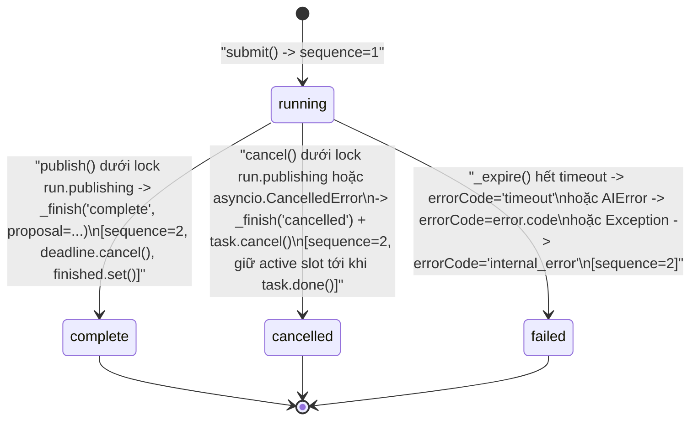

# Hợp đồng Job AI, SSE `patch`, Ngưỡng Tải & Quy trình Tích hợp/CI (BE-5)

**Mã hợp đồng:** `C04` (Job / SSE / cancel / retry / recovery) & `C05` (phần đồng bộ confirm / idempotency với `BE-2`)  
**Mảng phụ trách:** `BE-5` (Tích hợp luồng Job, SSE, Ngưỡng tài nguyên, CI & Nghiệm thu)  
**Mốc & Issue gốc:** Milestone 1 — `BE-5-001` (Issue `#8`: `W02`, `W04`, `W05`, `T01`, `T03`; tài liệu này chốt chuẩn theo tên file `docs/contracts/job-va-sse.md`, thay cho đường dẫn dự kiến `docs/contracts/jobs.md` nêu ở bản nháp issue)  
**Tài liệu nền giữ nguyên không sửa đè:** Phần thiết kế `W01` của `PhuQuang0307` trong [tro-ly-va-job.md](../design/tro-ly-va-job.md), hợp đồng HTTP tại [http.md](http.md), hợp đồng dữ liệu tại [du-lieu.md](du-lieu.md) và hợp đồng AI tại [ai.md](ai.md).  
**Bên nhận bàn giao & Review:** `BE-1`, `BE-2`, `BE-3`, `UI-3`

---

## Quy ước phân loại trạng thái & ranh giới an toàn

- **`[Hiện có / Đã chạy bằng Python]`**: Hành vi, DTO, route, khóa đồng thời, hằng số hoặc test đã triển khai trực tiếp trong `backend/src/mach_backend/` và `backend/tests/`.
- **`[Fixture / Mock]`**: Kịch bản kiểm thử dùng `httpx.MockTransport`, `tests/fixtures/`, kho SQLite tạm hoặc Chrome chạy cổng loopback; **không** dùng dữ liệu giáo viên thật, model trả phí hay server thật.
- **`[Chờ review nhóm / Thành viên xác nhận]`**: Các điểm lệch giữa kế hoạch cũ / UI JS và mã Python hiện hành, hoặc ngưỡng vận hành production cần chủ sở hữu xác nhận trước khi nâng tải.

> **Ranh giới vận hành GreenNode & bí mật:** Tài liệu này **tuyệt đối không** chứa URL, IP, token, mật khẩu hay mã mời của máy chủ GreenNode (cổng `4182`). Chỉ chủ sở hữu (`ngocthuan1505`) thao tác trên server thật theo quy trình tại [ops/greennode/README.md](../../ops/greennode/README.md). CI chỉ chạy fixture cục bộ và không deploy.

---

## 1. W02 — Máy trạng thái Job Python, Hợp đồng SSE `patch` & Ca kiểm `T03`

### 1.1. Các route điều phối job & xác nhận trong FastAPI (`[Hiện có / Đã chạy bằng Python]`)

`build_ai_router` (`backend/src/mach_backend/ai_routes.py`) khởi tạo **một** thể hiện `PatchJobRunner` dùng chung và gắn 7 route chuẩn qua `patch_routes.py` và `check_routes.py`:

| Route | Phương thức & Mã thành công | Payload / Tham số chính | Mã lỗi chính (`submission_error` / route) |
|---|---|---|---|
| `/api/exams/{exam_id}/proposals` | `POST` -> `202` `PatchJobStatus` | Request kèm `requestId`; tính `digest = sha256(request.model_dump_json().encode()).hexdigest()` | `403 consent_required`, `404 exam_not_found`/`source_not_found`, `409 stale_snapshot`/`exam_read_only`/`job_conflict`/`plan_not_approved`, `429 job_limit`, `422` (khác) |
| `/api/exams/{exam_id}/proposals/generate` | `POST` -> `202` `PatchJobStatus` | Request kèm `requestId`; tính `digest = sha256(b"generate:" + request.model_dump_json().encode()).hexdigest()` | Như trên |
| `/api/exams/{exam_id}/proposals/{job_id}/status` | `GET` -> `200` `PatchJobStatus` | `exam_id`, `job_id` | `404 job_not_found` |
| `/api/exams/{exam_id}/proposals/{job_id}/cancel` | `POST` -> `200` `PatchJobStatus` | `exam_id`, `job_id` | `404 job_not_found` |
| `/api/exams/{exam_id}/proposals/{job_id}/events` | `GET` -> `200` `text/event-stream` | Header tùy chọn `Last-Event-ID` (`0..2`, mặc định `0`); response có `Cache-Control: no-store`, `X-Accel-Buffering: no` | `404 job_not_found` |
| `/api/exams/{exam_id}/proposals/{job_id}/confirm` | `POST` -> `200` `PatchReceipt` | `ConfirmPatchRequest(baseRevision: Revision)` | `404 proposal_not_found`, `409` (`stale_snapshot`, xung đột) |
| `/api/exams/{exam_id}/questions/{question_id}/check` | `POST` -> `200` `CheckReport` | `CheckSubmission`; `Cache-Control: no-store` | `403`, `404`, `409`, `429`, `502`, `503`, `504`, `422` |

**Các route liên quan ngoài `build_ai_router` (`local_workspace.py` & `poc_scoped_patch.py`):**
- `GET /api/exams/{exam_id}/proposals/latest` (`local_workspace.py`): route khôi phục khi tiến trình Python vừa khởi động lại (không còn job trong RAM của `PatchJobRunner`). Trả trạng thái từ `matrix_pending` -> `complete`, hoặc đọc `matrix-latest:{exam_id}` + `matrix-agent-result:{job_id}` -> `cancelled` hoặc `failed` (`errorCode="interrupted"`).
- `POST /api/assistant/patch`, `POST /api/exams/{exam_id}/edits/{proposal_id}/confirm`, `POST /api/exams/{exam_id}/edits/{proposal_id}/discard` (`poc_scoped_patch.py`): nhánh PoC sửa cục bộ đồng bộ dùng `wait_for_disconnect(request)` trả HTTP `499` và hủy coroutine `work` khi client ngắt kết nối (khác với luồng job bất đồng bộ qua `PatchJobRunner`).

### 1.2. Máy trạng thái job Python (`PatchJobRunner`) & Đối chiếu trạng thái `cancelling`



**Làm rõ sai lệch quan trọng về trạng thái `cancelling` (đối chiếu mã thật):**
1. **Trong `PatchJobRunner` hiện tại (`[Hiện có / Đã chạy bằng Python]` — `patch_jobs.py`):**
   - Kiểu dữ liệu thực tế là `TerminalStatus = Literal["complete", "cancelled", "failed"]` và `PatchJobStatus.status` là `Literal["running", "complete", "cancelled", "failed"]`.
   - Khi `cancel()` được gọi trên job đang chạy, runner giữ khóa `run.publishing`, chuyển ngay `run.state.status = "cancelled"` (`sequence = 2`), gọi `run.task.cancel()`, và trả về `PatchJobStatus(status="cancelled")`. **DTO công khai qua JSON/SSE hiện không phát chuỗi `"cancelling"`.**
   - Tuy nhiên, **khoảng chuyển tiếp nội bộ tương đương `cancelling` vẫn tồn tại trong runtime**: trong khi coroutine `_execute(run)` đang thu hồi sau `task.cancel()` (có thể theo dõi qua `asyncio.Task.cancelling()` ở `ai_service.py`), `run.task.done()` vẫn là `False`. Bộ đếm slot trong `PatchJobRunner.submit()` kiểm `sum(run.task is not None and not run.task.done() for run in self._runs.values())` — nghĩa là **job đang hủy vẫn giữ slot `max_active` cho đến khi task dừng hẳn** nhằm tránh mở thêm job mới đè lên model đang dở (`test_ai_capacity.py`, `test_patch_confirmation.py`).
2. **Nơi chuỗi `"cancelling"` có xuất hiện trong repo:**
   - Bản server Node tham chiếu cũ `workbench-server.mjs` (đã mô tả trong phần `W01` của [tro-ly-va-job.md](../design/tro-ly-va-job.md)).
   - Schema mục tiêu `ai_jobs` của `BE-3` (`backend/src/mach_backend/be3_schema_migration.py`):
     `status TEXT NOT NULL CHECK (status IN ('running', 'cancelling', 'cancelled', 'complete', 'failed'))`.
3. **`[Chờ review nhóm / Thành viên xác nhận]` (`BE-5` + `BE-3` + `UI-3`):** Chốt xem ở M2 có giữ nguyên 4 giá trị `PatchJobStatus.status` trên wire (`running | complete | cancelled | failed`, coi `cancelling` là trạng thái nội bộ khi task/DB đang dọn dẹp) hay bổ sung `"cancelling"` vào SSE. Hiện tại mọi consumer SSE **chỉ được mong đợi 4 giá trị** của `PatchJobStatus.status`.

### 1.3. Hợp đồng SSE `patch` & Đối chiếu `baseRevision`/`baseVersion`, `owner`

**Định dạng SSE wire từ `GET /api/exams/{exam_id}/proposals/{job_id}/events` (`patch_routes.py`):**

```text
id: 1
event: patch
data: {"jobId":"...","examId":"...","baseRevision":1,"sequence":1,"status":"running","proposal":null,"errorCode":null}

id: 2
event: patch
data: {"jobId":"...","examId":"...","baseRevision":1,"sequence":2,"status":"complete","proposal":{...},"errorCode":null}
```

**Bảng đối chiếu trường `C04` giữa `KE_HOACH_TICH_HOP.md` và DTO `PatchJobStatus` (`ai_contract.py`, `patch_jobs.py`):**

| Tên trong `KE_HOACH_TICH_HOP.md` / Yêu cầu | Trường thực tế trong Python / SSE | Kiểu & Giá trị | Quy tắc & Ghi chú đối chiếu |
|---|---|---|---|
| `id: 1`, `id: 2` | Line `id: {update.sequence}` + field `sequence` | `Literal[1, 2]` | `1` là trạng thái khởi chạy (`running`); `2` là trạng thái kết thúc duy nhất (`complete`, `cancelled`, hoặc `failed`). |
| `event: patch` | Line `event: patch` | Cố định `"patch"` | Phát cho cả `sequence = 1` và `sequence = 2`. |
| `jobId` | `jobId` (kế thừa từ `JobIdentity`) | `UUID` | Định danh duy nhất của job. |
| *(trong `JobIdentity`)* | `examId` | `UUID` | ID đề thi mục tiêu của job. |
| `baseVersion` *(cách gọi cũ ở C04)* | **`baseRevision`** | `Revision` (`int >= 1`) | **Sai lệch tên trường:** Bảng `C04` trong `KE_HOACH_TICH_HOP.md` gọi là `baseVersion`, nhưng toàn bộ DTO Python (`JobIdentity`, `PatchJobStatus`, `ConfirmPatchRequest`) dùng **`baseRevision`**. `[Chờ review nhóm / Thành viên xác nhận]` chuẩn hóa bảng `C04` theo `baseRevision`. |
| `owner` *(cách gọi cũ ở C04)* | **Không có trong JSON SSE;** giữ server-side tại `run.job.ownerId` | `str` (nội bộ server) | Mọi lệnh `replay`, `submit`, `status`, `cancel`, `events` đều đi qua `_owned(owner_id, exam_id, job_id)`. Nếu khác `(ownerId, examId)`, server trả **`404 job_not_found`** — không để lộ `ownerId` hay sự tồn tại job cho user khác. |
| Terminal status & payload | `status`, `proposal`, `errorCode` | `PatchProposal \| GenerateProposal \| None`, `str \| None` | Khi `status == "complete"`, `proposal != None` và `errorCode == None`. Khi `status == "failed"`, `proposal == None` và `errorCode` mang mã lỗi (ví dụ `"timeout"`, `"internal_error"`, hoặc mã từ `AIError`). |

**Hành vi `Last-Event-ID` (`Header(alias="Last-Event-ID", ge=0, le=2) = 0` trong `patch_routes.py`):**
1. Mặc định không gửi `Last-Event-ID` (`after = 0`): nếu `run.state.sequence == 1`, server phát frame `id: 1`, sau đó `await run.finished.wait()`; khi xong phát frame `id: 2` rồi đóng stream.
2. Reconnect với `Last-Event-ID: 1` (`after = 1`): server bỏ qua `id: 1`, chỉ chờ `run.finished.wait()` và phát `id: 2` (hoặc phát ngay `id: 2` nếu job đã xong trước lúc nối lại).
3. Gửi `Last-Event-ID: 2` (`after = 2`): server không phát lại frame nào nữa và kết thúc stream.
4. Nếu job kết thúc trước khi client mở SSE lần đầu (`after = 0`, `sequence == 2`), nhánh `if run.state.sequence == 1` bị bỏ qua và client nhận thẳng frame `id: 2`.

> **Tình trạng tích hợp UI hiện tại (`[Chờ review nhóm / Thành viên xác nhận]`):** `matrix-synthesis.js` hiện đang gọi poll `/status` và `/trace` mỗi `1000ms` (với nút `#matrix-poll-retry`), chưa dùng `GET /events` SSE (`UI-3-002` / `BE-5-002`). Khi tích hợp SSE trên UI, cần giữ fallback `GET /status` hoặc `GET /proposals/latest` cho tình huống kết nối ngắt dài hoặc server vừa khởi động lại.

### 1.4. Ràng buộc một terminal state duy nhất, Dedupe (`T03`) & Hủy sát lúc commit

1. **Một terminal state duy nhất phía server (`[Hiện có / Đã chạy bằng Python]`):**
   - Phương thức `_finish(self, run, status: TerminalStatus, *, proposal=None, error_code=None)` kiểm tra **`if run.state.status != "running": return`** trước khi gán `sequence = 2`, `status`, `proposal`/`errorCode`, gọi `run.deadline.cancel()` và `run.finished.set()`.
   - Toàn bộ 4 nguồn kết thúc (`publish`, `cancel`, `_expire`, và khối `except` trong `_execute`) đều đi qua `_finish`. Nhờ đó mỗi `jobId` chỉ có **tối đa một** chuyển đổi từ `running` sang `TerminalStatus`, không thể vừa `complete` vừa `cancelled`/`failed`.
2. **Hủy sát lúc commit không ghi đè đề và không nhân đôi nội dung (`[Hiện có / Đã chạy bằng Python]`):**
   - **Tầng stage pending (`PatchJobRunner.publish` vs `PatchJobRunner.cancel`):** Cả `publish()` và `cancel()` đều phải giữ khóa `async with run.publishing:`. Trong `publish()`, sau khi kiểm tra `run.state.status == "running"` và `_snapshot_is_current`, runner mới gọi `await self._store_pending(pending)` rồi `_finish(run, "complete", proposal=pending.proposal)`. Nếu `cancel()` vào trước -> `status` trở thành `"cancelled"`, nên `publish()` vào sau trả `False` và **không** lưu pending. Ngược lại, nếu `publish()` đã lưu pending và gọi `_finish(run, "complete")` trước -> `cancel()` vào sau thấy `status != "running"` nên giữ nguyên `"complete"` (đề thi vẫn chưa bị sửa vì phải qua bước `/confirm`).
   - **Tầng commit vào đề (`POST /api/exams/{exam_id}/proposals/{job_id}/confirm` -> `patch_confirmation.confirm_patch`):** Chạy độc lập trong `with repo.transaction(owner_id, exam_id, job_id) as tx:`, đối chiếu `job.baseRevision == base_revision` (lệch trả `409 stale_snapshot`), cập nhật đề và biên nhận chung một giao dịch nguyên tử; nếu `state.receipt is not None` thì trả lại `state.receipt` đã lưu chứ không áp dụng patch lần thứ hai.
   - Do đó, `cancel` sát lúc commit không bao giờ tự động ghi đè đề thi, còn xác nhận trùng không bao giờ nhân đôi câu hỏi hay nội dung patch.
3. **Dedupe & xử lý lệch thứ tự (`BE-5-001/T03`):**
   - **Phía server (`[Hiện có / Đã chạy bằng Python]`):**
     - `POST /proposals` và `POST /proposals/generate` khử trùng bằng `(ownerId, examId, requestId)` + `digest` qua `PatchJobRunner.replay()`: cùng `requestId` + cùng payload trả lại đúng `run.state` ban đầu (`202`), khác payload trả `409 job_conflict`.
     - `POST /proposals/{job_id}/cancel` và `POST /proposals/{job_id}/confirm` đều idempotent (trả về trạng thái/biên nhận đã chốt).
   - **Quy tắc bắt buộc phía client / consumer SSE (`[Chờ review nhóm / Thành viên xác nhận]` hoàn tất ở `UI-3-002` / `BE-5-002`):**
     1. Gắn trạng thái UI theo cặp `(jobId, sequence)`.
     2. Nếu đã nhận `sequence = 2` (từ SSE hoặc từ poll `/status`) thì **bỏ qua** mọi frame `id: 1` hoặc response cũ đến trễ (`sequence < currentMaxSequence`).
     3. Nếu nhận hai lần sự kiện kết thúc có `sequence = 2` (do reconnect, gộp SSE + `/status`, hoặc user bấm retry), **dedupe** theo `jobId`: chỉ render proposal/thông báo lỗi đúng một lần và không mở thêm job mới.
     4. Khi user vừa bấm Hủy nhưng `cancel` trả về hoặc SSE phát `status: "complete"`, client phải chấp nhận terminal state từ server (hiển thị proposal đang chờ kèm tùy chọn bỏ qua / `/discard`, không giả vờ trạng thái `cancelled`).

---

## 2. W04 — Bảng Ngưỡng cấu hình, Giới hạn tải & Số đo kiểm thử thật

> **Tuyên bố nguyên tắc dữ liệu (KHÔNG BỊA SLA):** Bảng dưới đây **chỉ** tổng hợp các hằng số, tham số và giới hạn đọc trực tiếp từ mã nguồn hiện hành kèm số đo kiểm thử thật đã lưu biên bản trong repo. Tài liệu này **không tự đặt cam kết SLA** (như độ trễ p95/p99, thông lượng người dùng đồng thời production hay tỷ lệ uptime). Mọi điều chỉnh khi mở rộng tải server đều **`[Chờ owner/Thuận xác nhận ngưỡng vận hành thực tế nếu nâng tải]`**.

### 2.1. Ngưỡng AI, Job, Timeout & Concurrency (`[Hiện có / Đã chạy bằng Python]`)

| Nhóm | Tên hằng số / Tham số | Giá trị / Biên hợp lệ | Đơn vị | Tệp nguồn | Ghi chú hành vi |
|---|---|---|---|---|---|
| Trần timeout AI | `MAX_AI_SECONDS` | `900` (`0 < timeout_seconds <= 900`) | giây | `ai_service.py`, `patch_jobs.py` | Trần cứng tối đa cho `PatchJobRunner` và các lệnh chạy dài. |
| Job runner mặc định | `PatchJobRunner(timeout_seconds, max_active, max_retained)` | `timeout_seconds = 900`, `max_active = 1`, `max_retained = 50` (ràng buộc `1 <= max_active <= max_retained`) | giây / job / job | `local_workspace.py`, `patch_jobs.py` | Vượt `max_active` trả `429 job_limit`; job đang hủy vẫn giữ slot tới khi task xong. |
| Provider cục bộ | `OllamaProvider.max_active` | Mặc định `1` (`max_active >= 1`) | request đồng thời | `ai_service.py` | Điều tiết số lời gọi đồng thời tới Ollama qua `asyncio.Semaphore`. |
| Khóa toàn tiến trình team | `team_workspace.start_lock` | `1` tác vụ AI / tiến trình (`asyncio.Lock` + `ai_busy()`) | tác vụ | `team_workspace.py` | Chống nhiều tài khoản team chạy model đồng thời làm treo CPU/GPU. |
| Chính sách agent PoC | `RunPolicy.maxModelCalls` | Mặc định `24`, biên `4..64` | lượt gọi model | `poc_policy.py` | Số lượt gọi model tối đa trong một phiên agent. |
| Chính sách timeout PoC | `RunPolicy.timeoutSeconds` | Mặc định `900`, biên `30..900` | giây | `poc_policy.py` | Ngân sách thời gian tổng của một lần chạy `RunPolicy`. |
| Ngân sách gọi model | `CallBudget(max_calls, seconds)` | Mặc định `24` lượt / `900` giây (biên `1..64` lượt, `>0..900` giây) | lượt / giây | `poc_policy.py` | Cụ thể: PoC sửa cục bộ `CallBudget(6, 300)` (`poc_scoped_patch.py`), check câu hỏi `CallBudget(3, 180)` (`workspace_check.py`), gợi ý đơn `CallBudget(1, 90)` (`local_workspace.py`). |
| Kiểm tra câu hỏi | `build_check_router` | Biên `0 < timeout_seconds <= 300`; cấu hình chạy `timeout_seconds = 180`, `max_active = 1` | giây / job | `check_routes.py`, `workspace_check.py` | Router check không cho phép vượt quá `300` giây. |
| Thử lại kiểm câu đơn | `RetryingGeneration` | `timeout_seconds = 90`, `range(1, 3)` (`2` lần thử) | giây / lần | `local_workspace.py` | Tự động thử lại tối đa 2 lượt cho kiểm tra câu hỏi đơn lẻ. |
| Gợi ý cấu trúc & chat | `plan_exam`, `chat` | `asyncio.timeout(90)` (`plan_exam`), `httpx.AsyncClient(timeout=180)` (`chat`) | giây | `local_workspace.py` | Áp dụng cho `/api/ai/exam-plan` và `/api/assistant/chat`. |
| Gemini stream & no-budget cap | `GeminiModel._call_once` | Stream timeout `180`; cap khi thiếu budget: `self.log.index >= 8` (`8` lượt) | giây / lượt | `gemini_model.py` | Chặn vòng lặp vô hạn nếu caller không truyền `CallBudget`. |
| LocalModel mặc định | `LocalModel` (khi thiếu budget) | Timeout `300` | giây | `poc_matrix.py` | Timeout HTTP cho cuộc gọi model cục bộ khi không có `CallBudget`. |
| Agent HTTP client | `AgentGeneration` | `httpx.Timeout(900, connect=5)` | giây | `workspace_agent.py` | Chờ kết nối tối đa `5s`, tổng thời gian đọc `900s`. |
| CLI PoC matrix | `poc_matrix.py --timeout` | Mặc định `900`, biên `1..1800` | giây | `poc_matrix.py` | Cho phép kéo dài tới `1800s` khi thử nghiệm CLI offline. |
| Pytest smoke model | `conftest.py --smoke-timeout` | Mặc định `120`, biên `>0..300` | giây | `backend/tests/conftest.py` | Chỉ dùng cho test opt-in với model thật (`KIEM_NHANH_AI.md`). |

### 2.2. Ngưỡng kích thước, Retention, Subprocess, Phiên & CI (`[Hiện có / Đã chạy bằng Python]`)

| Nhóm | Tên hằng số / Tham số | Giá trị / Biên hợp lệ | Đơn vị | Tệp nguồn | Ghi chú hành vi |
|---|---|---|---|---|---|
| Phản hồi AI | `MAX_RESPONSE_BYTES` | `256 * 1024` (`262144`) | bytes (`256 KiB`) | `ai_service.py`, `gemini_model.py`, `poc_matrix.py`, `matrix_provider.py` | Cắt/từ chối response model vượt quá `256 KiB`. |
| Văn bản khối sửa | `MAX_BLOCK_TEXT` | `12000` | ký tự | `ai_contract.py` | Độ dài tối đa văn bản đầu vào/ra của một block. |
| Phạm vi mục tiêu sửa | `targets` | Tối đa `12` (`ai_contract.py`, `patch_submission.py`); PoC tối đa `4` câu (`poc_scoped_patch.py`) | mục tiêu / job | `ai_contract.py`, `patch_submission.py`, `poc_scoped_patch.py` | Giới hạn số lượng block/câu được AI sửa trong một job. |
| Đoạn nguồn đầu vào | `sources` | Tối đa `12` đoạn; tổng `<= 50000` ký tự (AI job) hoặc `12000` (PoC/check) | đoạn / ký tự | `ai_contract.py`, `poc_scoped_patch.py`, `workspace_check.py` | Chỉ nhận locator, server tự đọc snapshot từ kho. |
| Số câu ma trận | `MAX_MATRIX_QUESTIONS` | `30` | câu hỏi / đề | `ai_questions.py` | Giới hạn số câu hỏi cho một lượt sinh theo ma trận. |
| Tệp nguồn & ma trận | `MAX_DOCUMENT`, `MAX_FILE`, `MAX_TEXT` | `MAX_DOCUMENT = 15 * 1024 * 1024` (`15 MiB`), `MAX_FILE = 15 * 1024 * 1024` (`15 MiB`), `MAX_TEXT = 40000` | bytes / ký tự | `local_documents.py`, `matrix_import.py`, `workspace_backup.py` | Chặn trước khi giải mã ZIP/PDF/AI OCR. |
| DDL `source_documents` | `byte_size` (`BE-3`) | `1..20971520` (`20 MiB`) | bytes | `be3_schema_migration.py` | Bao phủ dữ liệu di trú cũ; cần đồng bộ upload trần `15 MiB` ở M2. |
| Gói sao lưu kho | `MAX_BACKUP` | `150 * 1024 * 1024` (`150 MiB`) | bytes | `workspace_backup.py`, `local_workspace.py`, `team_workspace.py` | Áp dụng cho `/api/workspace/restore` và `/restore/preview`. |
| Middleware HTTP body | Body size limit | Mặc định `30 * 1024 * 1024` (`30 MiB`); `/api/account/*`: `8192` bytes (`team_workspace.py`); `/restore*`: `MAX_BACKUP` (`150 MiB`) | bytes | `local_workspace.py`, `team_workspace.py` | Chặn tải request quá lớn ngay ở lớp middleware. |
| Giữ lịch sử (retention) | `scoped-patch:%`, `undo`, `history`, `prior_feedback` | `scoped-patch:%`: `50` (`OFFSET 50`); `undo`: `60` (`[-60:]`); `history`: `100` (`[-100:]`); `prior_feedback`: `20` (`LIMIT 20`) | bản ghi / bước | `poc_scoped_patch.py`, `workspace_store.py` | Giữ kích thước trạng thái kho nằm trong giới hạn ổn định. |
| Render PDF / Ảnh | `export_slot`, `rendering`, Chrome timeout | `asyncio.Semaphore(1)`; `export_assets.py`: `timeout=40`s, `--virtual-time-budget=6000`ms; PDF `local_documents.py`: `timeout=45`s, `--virtual-time-budget=3000`ms | slot / giây / ms | `local_workspace.py`, `workspace_shares.py`, `export_assets.py`, `local_documents.py` | Mỗi lần chỉ chạy 1 tiến trình Chrome headless xuất bản. |
| Phiên & Tài khoản | `SESSION_SECONDS`, khóa brute-force, mã mời | Phiên: `8 * 3600` (`28.800`s / `8`h); khóa: `count >= 10` trong `600`s; mời: `86400`s (`24`h) | giây / lần | `team_accounts.py`, `team_workspace.py` | Cookie `HttpOnly`, `SameSite=Strict`. |
| SQLite & Credential | `sqlite3.connect`, `LocalConnectionStore` | `timeout=5`s (`sqlite3`, `icacls`); max size `131072` bytes (`128 KiB`) | giây / bytes | `workspace_store.py`, `team_accounts.py`, `local_credentials.py` | Giới hạn khóa chờ ghi SQLite và file cấu hình kết nối Windows. |
| CI & Docker | `.github/workflows/ci.yml`, `Dockerfile` | CI job: `timeout-minutes: 15`; Docker healthcheck: `--interval=30s --timeout=5s --start-period=15s` (port `4182`) | phút / giây | `.github/workflows/ci.yml`, `Dockerfile` | Tránh treo runner CI và giám sát tình trạng container. |

### 2.3. Số đo kiểm thử thật đã ghi nhận trong repo (KHÔNG PHẢI SLA)

- **Kiểm nhanh với model thật trên máy phát triển (`[Hiện có / Đã chạy bằng Python]` — trích [KIEM_NHANH_AI.md](../testing/KIEM_NHANH_AI.md)):**
  - *Điều kiện đo cụ thể:* ngày `11/11/2026`, laptop Windows chạy CPU, `Ollama 0.40.16`, `num_ctx=4096`, timeout `120s`, model `qwen2.5:3b` (`357c53fb659c`).
  - *Kết quả đo được:* `patch` `27,320s`; `generate` `37,945s`; `check` `23,370s`; `patch+save` qua HTTP `28,008s`; thời gian đóng HTTP transport sau lệnh `cancel` là `5,180 ms` (tổng thời gian test `28,010s`); `check` qua HTTP `35,099s`; `generate+confirm` qua HTTP `44,699s`; `generate` từ lúc gửi request đến lúc lưu `52,066s`.
- **Bộ kiểm thử hồi quy (`[Fixture / Mock]` — trích [BAN_THU_18_11.md](../testing/BAN_THU_18_11.md)):**
  - Ghi nhận ngày `18/11/2026`: `619` Python tests pass (`5` model smoke tests được skip vì là test opt-in với model thật), `124` Node tests pass, `14` kiểm tra `check:team` pass.
- **Điểm cần xác nhận (`[Chờ owner/Thuận xác nhận ngưỡng vận hành thực tế nếu nâng tải]`):** Toàn bộ ngưỡng concurrency (`max_active = 1` ở `PatchJobRunner`, `OllamaProvider`, `team_workspace.start_lock`, `export_slot`) được thiết kế để an toàn trên 1 CPU/GPU cục bộ. Khi chạy đa thành viên trên GreenNode, chỉ `ngocthuan1505` quyết định việc tăng `max_active` hoặc `timeout_seconds` sau khi đo tải thực tế trên server.

---

## 3. W05 & T01 — Gates M1/M2/M3, Phân loại Test, Tái lập Clone sạch & Quy trình Bàn giao

### 3.1. Tổng hợp Gates M1 / M2 / M3 (trích chuẩn từ [KE_HOACH_TICH_HOP.md](../team/KE_HOACH_TICH_HOP.md) & [RELEASE.md](../team/RELEASE.md))

| Gate | Tiêu chí bắt buộc phải có bằng chứng | Ràng buộc không được làm giả / nhảy cóc |
|---|---|---|
| **M1 — Sẵn sàng ghép các phần** | - Cả `8` task `001` có artifact/consumer review; hợp đồng `C01`–`C07` đủ ví dụ, mã lỗi và điểm mở.<br>- Baseline demo/source/fixture tái lập; phân tách rõ source Node tham chiếu và Python đích.<br>- `CT-01`/`02`/`03` tái sử dụng proposal/decomposition/abstraction; khóa scope, ngưỡng tài nguyên test trước khi đo và PoC phần rủi ro. | Thiếu khảo sát hoặc đồng bộ slide phải ghi pending riêng, không bịa để vượt gate. Còn mâu thuẫn contract chặn luồng thì chưa gọi M1 đã nghiệm thu. |
| **M2 — Luồng chính chạy qua Python** | - Nối được lát `auth/ownership -> repo/đề/version -> source/document -> AI/job/proposal -> export` có `pytest`/contract test.<br>- UI thật gọi Python, giữ `richDoc`/UUID/revision và golden behavior; công khai bảng route còn Node/mock/đã chuyển.<br>- Đủ negative test cho scope/stale/confirm trùng/cancel/quyền/file và prompt injection; PoC/thuật toán có kết quả theo commit; integration plan có `expected/actual`. | Model thật pending thì không tính phần model thật đã đạt. Không dùng CI xanh để che bug blocker hoặc thiếu rollback test. |
| **M3 — Candidate review được & Gói nộp tái lập** | - Các task `003` có người khác review; **`BE-5-003` phụ thuộc trực tiếp vào `BE-1-003`** cho bằng chứng AI thật (không dùng fixture thay thế).<br>- Chạy các luồng chính **khi Node API tắt** trên clone sạch (quyền, restore, Word/PDF, mobile/keyboard có bằng chứng hoặc pending công khai).<br>- `R1`–`R8` và `CT-01`…`06` truy vết tới artifact thực; `R8` có ít nhất 1 vòng cải tiến trước/sau.<br>- Báo cáo/demo/runbook khớp **cùng candidate commit SHA**, đã chốt format nộp lớp. | Không tự tick thay review; hoàn tất `BE-1-003` là bằng chứng kỹ thuật, **không tự bật web/deploy** — chỉ `ngocthuan1505` quyết định phát hành và thao tác GreenNode. |

### 3.2. Phân loại 4 tầng kiểm thử

| Tầng kiểm thử | Mục tiêu & Nguồn dữ liệu | Lệnh / Phạm vi thực tế trong repo | Có chạy trong CI không? |
|---|---|---|---|
| **1. Unit & Contract Python** | Kiểm định hàm lõi, Pydantic schema, máy trạng thái `PatchJobRunner`, lock đồng thời, SQLite rollback, parser `word_export`/`matrix_import`/`local_documents` bằng dữ liệu tổng hợp & `httpx.MockTransport`. | `backend/tests/test_*.py` (`pytest`, kết hợp `ruff check .`, `ruff format --check .`, `ty check src`). | **Có** (job `python`). |
| **2. Integration API & Parity (Python vs Legacy)** | Nối FastAPI routes thật + SQLite thật + kho tài khoản/backup/share + so sánh hành vi fixture giữa `backend/src/mach_backend/` và baseline JS. | `backend/tests/test_ai_routes.py`, `test_local_workspace.py`, `test_team_workspace.py`, `test_workspace_backup.py`, `test_workspace_shares.py`; `npm test` (`tests/*.test.mjs`, `ui2-golden.test.mjs`). | **Có** (fixture thuần, không secret). |
| **3. UI End-to-End trên Trình duyệt thật (`IT-01`…`IT-11`)** | Chạy Chrome headless điều khiển giao diện web gọi vào FastAPI (tạo đề, `richDoc`, conflict 409, nguồn A/B, xuất Word/PDF/HTML, khôi phục, 2 tài khoản, mobile `390×844` + bàn phím). | `scripts/kiem-ung-vien.py` (gọi các script `scripts/kiem-ui-*.mjs` và `tests/ui2-baseline-browser.mjs`) + fixture phản hồi mẫu từ `scripts/chay-fixture-poc.py`. | **Một phần** (job `test` chạy `npm test` gồm UI baseline trên Chrome Ubuntu; toàn bộ `IT-01`–`IT-11` qua `kiem-ung-vien.py` chạy local để xuất gói nghiệm thu theo commit SHA). |
| **4. Model thật & Kiểm định server** | Kiểm tra Sinh / Sửa / Kiểm và hủy job trực tiếp qua Ollama/Gemini thật trên dữ liệu mẫu được phép (`BE-1-003` -> `BE-5-003`). | `pytest` với `--run-model-smoke --smoke-timeout 120` hoặc chạy thủ công theo [KIEM_NHANH_AI.md](../testing/KIEM_NHANH_AI.md) & [ops/greennode/README.md](../../ops/greennode/README.md). | **Không** (mặc định skip 5 ca smoke nếu không gắn flag opt-in; CI không có GPU/Ollama/secret/GreenNode runner). |

### 3.3. Hướng dẫn tái lập từ clone sạch (`BE-5-001/T01`)

#### A. Trên Linux CI (`.github/workflows/ci.yml` & `Dockerfile`)

CI dùng hai job độc lập với `timeout-minutes: 15`, **không có secrets**, **không deploy**, chỉ dùng fixture:
1. **Job `python` (`ubuntu-latest`):**
   - Cài `uv` (`astral-sh/setup-uv`, version `'0.13.6'`, `python-version: '3.12'`).
   - Tại `working-directory: backend`:
     ```bash
     uv sync --frozen
     uv run pytest
     uv run ruff check .
     uv run ruff format --check .
     uv run ty check src
     ```
   - Build Docker image (`python:3.12-slim-bookworm` + `uv:0.13.6` + Chromium, `USER soande` `uid 10001`), khởi chạy container bằng `uvicorn`, kiểm tra HTTP loopback `/` trả về `200` và xác nhận container **không chứa Node**: `! command -v node && test "$(id -u)" = 10001`.
2. **Job `test` (`ubuntu-24.04`):**
   - Cài Node `24`, thiết lập `BROWSER_PATH` tới Google Chrome, sau đó chạy tại gốc repo:
     ```bash
     npm ci --no-audit --no-fund
     npm test
     npm run check:team
     npm run build-editor
     ```

#### B. Trên Windows PowerShell từ clone sạch

Yêu cầu: Git, Python 3.12 + `uv` (`0.13.6`), Node.js `24` (cho bộ test JS/UI và build editor), Google Chrome hoặc Microsoft Edge (cho xuất PDF/hình và test UI).

```powershell
# 1. Cài dependencies (từ thư mục gốc repo sau khi git clone)
npm ci
Push-Location backend
uv sync --frozen

# 2. Chạy toàn bộ kiểm tra Python (unit, contract, lint, type check)
uv run pytest
uv run ruff check .
uv run ruff format --check .
uv run ty check src
Pop-Location

# 3. Chạy kiểm tra Node/UI baseline & tính toàn vẹn hồ sơ nhóm
npm test
npm run check:team

# 4. (Tùy chọn) Chạy bộ 11 kịch bản UI E2E IT-01..IT-11 trên FastAPI + Chrome
# Yêu cầu có Chrome và gói npm đã cài từ bước 1
uv run --project backend --frozen python -X utf8 scripts/kiem-ung-vien.py outputs/kiem-ung-vien
# Có thể chạy riêng 1 ca, ví dụ ca 06:
# uv run --project backend --frozen python -X utf8 scripts/kiem-ung-vien.py outputs/kiem-ung-vien --case 06

# 5. Khởi động bản FastAPI local trực tiếp (không cần Node server)
uv run --project backend --frozen --no-dev --python 3.12 python -m uvicorn mach_backend.local_workspace:app --app-dir backend/src --host 127.0.0.1 --port 4182
```

- **Kiểm chứng độc lập không phụ thuộc Node trên Windows (tham khảo [DOI_CHIEU_PYTHON.md](../testing/DOI_CHIEU_PYTHON.md)):** Tạm bỏ đường dẫn Node/npm khỏi `$env:PATH` trong phiên PowerShell rồi chạy lại `uv run pytest` cho các bộ nhập/xuất/AI để xác minh backend Python không gọi ngầm Node.
- **Lưu artifact đối chiếu (`BE-5-001/T01`):** Mọi lần chạy `kiem-ung-vien.py` phải xuất ra thư mục mới trong `outputs/` và kiểm tra `result.json` (có đúng commit SHA hiện tại, log, ảnh từng ca `IT-01`–`IT-11`); tuyệt đối không commit `outputs/`, `.data/`, `.runtime/` hay `.env` lên Git.

### 3.4. Quy trình Bug / PR / CI & Trách nhiệm bàn giao giữa các nhóm

| Vai trò / Nhóm | Trách nhiệm trực tiếp | Giao điểm bàn giao & Quy tắc phối hợp |
|---|---|---|
| **Mọi thành viên tạo PR** | Giữ PR nhỏ theo từng `task/Wxx` và `task/Txx`; chạy đúng bộ kiểm trước khi đẩy (`pytest` + `ruff` + `ty` nếu chạm Python; `npm test` + `npm run check:team` + `npm run build-editor` nếu chạm JS/tài liệu/editor); báo tiến độ trong issue theo [BAO_CAO.md](../team/BAO_CAO.md). | Hẹn trước với người đang giữ tệp dùng chung trong issue; có **ít nhất 1 người khác** review; không tự đổi Status/assignee của người khác. |
| **Báo lỗi (`.github/ISSUE_TEMPLATE/bug.md`)** | Dùng template `[Bug] ` (nhãn `type:bug,status:ready`), ghi đủ: bước tái hiện bằng **dữ liệu giả**, **Mong đợi / Thực tế**, **Commit / trình duyệt / viewport / môn-lớp**, log/ảnh **đã che thông tin riêng**, mức ảnh hưởng mất dữ liệu. | Không dán mật khẩu, token, URL GreenNode hay tệp giáo viên thật. Lỗi server chuyển cho `ngocthuan1505`. Blocker (mất dữ liệu, đọc chéo tài khoản, lộ đáp án/key, áp sai scope/version, gãy luồng chính) phải sửa/retest trước merge candidate, không hạ mức để đóng task. |
| **`BE-1` (AI / Prompt / Validation)** | Khóa schema proposal/evidence/check, chạy PoC & model thật (`BE-1-003`). | Bàn giao schema và bằng chứng model thật cho `BE-5` (`BE-5-003` phụ thuộc `BE-1-003`) và `UI-3`. |
| **`BE-2` (API / Auth / Permission / Confirm)** | Đảm bảo route `/api/*`, `X-Workspace-Context`, ownership, transaction `confirm_patch`, mã lỗi HTTP chuẩn [http.md](http.md). | Phối hợp `BE-5` khóa mapping lỗi `403/404/409/429` và idempotency xác nhận `baseRevision`. |
| **`BE-3` (SQLite / Schema / Backup / Migration)** | Khóa `ai_jobs`, `source_documents`, giao dịch rollback, khôi phục bản sao (`IT-11`). | Thống nhất trạng thái `cancelling` trong `ai_jobs` và cơ chế khôi phục job khi server restart với `BE-5`. |
| **`BE-4` (Tài liệu / OCR / Export)** | Khóa [tai-lieu.md](tai-lieu.md), trích trang/slide/locator, giới hạn `15 MiB` / trang / prompt safety, bản xuất HS/GV. | Phối hợp `BE-5` về ngưỡng `MAX_DOCUMENT`, `MAX_BACKUP`, timeout Chrome export trong bảng `W04`. |
| **`UI-1` / `UI-2` / `UI-3` (Giao diện)** | Kết nối trực tiếp API Python; riêng `UI-3` nâng cấp polling `matrix-synthesis.js` sang SSE `GET /events` (`Last-Event-ID`, dedupe `(jobId, sequence)`). | Gửi kèm ảnh viewport desktop/mobile và kiểm bàn phím/IME (`IT-05`..`IT-11`) khi review PR UI. |
| **`BE-5` (Tích hợp & CI)** | Duy trì `PatchJobRunner`, cấu hình ngưỡng `W04`, tổng hợp checklist candidate [RELEASE.md](../team/RELEASE.md) trên từng commit SHA. | Chỉ tổng hợp báo cáo và đề nghị review; **không** tự phát hành lên GreenNode. |
| **Chủ sở hữu (`ngocthuan1505`)** | Duyệt PR chạm GreenNode, vận hành deploy trên `/network-volume/ProJ_VA` theo [ops/greennode/README.md](../../ops/greennode/README.md), chốt quyết định mở/đóng web và ngưỡng nâng tải thực tế. | Nắm toàn quyền cấu hình/URL/token/dữ liệu trên GreenNode; thực hiện rollback về release cũ nếu lỗi. |
