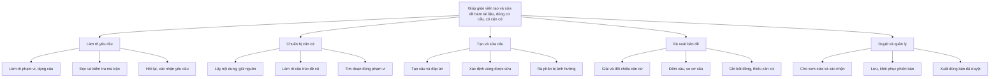

# Cây công việc và lộ trình

Nhóm đã có cây 3 cấp, bảy chức năng, luồng phối hợp và bốn pattern trong bộ **Decomposition–Pattern 23 trang**. Cây dưới chép lại ý chính của trang 3 bằng chữ để tiện liên kết task; không thay sơ đồ nhóm đã trình bày. Xem [nguồn và trạng thái hồ sơ](HO_SO_DA_CO.md). Đối chiếu phương pháp: Topic 1 trang 16, 36–38; Topic 3 trang 8–9, 17–18, 42.

Phần còn làm ở CT-02 là **ghép thiết kế đã có với kế hoạch hiện thực**. 24 issue `UI/BE-*-001/002/003` chia mỗi gói thành đặc tả → triển khai → nghiệm thu; trong issue có các bước nhỏ, input/output và điều kiện xong. Mỗi bước gán đúng một người; nếu không hoàn thành được trong khoảng một ngày thì tách tiếp issue, liên kết cha/phụ thuộc và thêm vào bảng. Chưa có ước lượng ngày công thật từ thành viên; không coi cây này là lịch cam kết.

| Chức năng đã phân tích ở trang 4–10 | Vai trò nhận phần triển khai và phối hợp |
|---|---|
| Chuẩn bị tài liệu | BE-4 + BE-3; UI-2 kiểm đối chiếu nguồn |
| Truy xuất nội dung | BE-1 + BE-4 + BE-3; thống nhất metadata/phiên bản |
| Tạo câu hỏi | BE-1 + BE-2; UI-3 yêu cầu/làm rõ, BE-5 job |
| Kiểm tra đáp án và căn cứ | BE-1 + BE-5; giáo viên duyệt, không tự chứng nhận đúng |
| Chỉnh sửa đề | UI-2/3 + BE-1/2/3; phạm vi, revision và undo |
| Số hóa đề cũ | BE-4 + UI-2; vùng chưa chắc cần đối chiếu bản gốc |
| Lưu và xuất | BE-3/4 + UI-1/2; BE-2 ownership, BE-5 tích hợp |

Đây là ánh xạ trách nhiệm **cho việc tiếp theo**, không gán ngược người thực hiện các slide đã có. Bốn pattern trang 15–18 được giữ làm cơ sở test: tìm căn cứ, so ô ma trận, rà ảnh hưởng, xác nhận trước lưu.

## Mẫu nhận diện pattern cho từng lá

Ghi `mục tiêu → pattern → công cụ đã có → đầu vào → đầu ra → owner → xong khi`. Ví dụ sửa vùng: validation + optimistic concurrency; Pydantic/repository Python; input có revision/vùng; output là đề xuất đã kiểm, chỉ ghi sau consent; BE-1/2/3 chia interface; xong khi ca stale/ngoài vùng/hủy không ghi đề. AI sinh nội dung là phần xác suất, không thay quy tắc kiểm quyền/version.

## Lộ trình tương đối, chưa đặt ngày nộp

| Giai đoạn | Đầu ra môn | Công việc kỹ thuật đi kèm | Điều kiện chuyển |
|---|---|---|---|
| Phân tích | CT-01 Problem Brief + 3 người dùng, baseline công cụ | UI/BE task 001 ghi hành vi hiện có | Có bằng chứng, phạm vi/metrics được nhóm duyệt |
| Phân rã và trừu tượng | CT-02/03 cây 3 cấp, model, contracts | Chốt API/DB/fixture, mock UI | Các phần ghép cùng field/type/units; PoC đã chọn |
| Proposal + PoC | CT-04 một thí nghiệm rủi ro nhất | BE-1 + UI-3 + BE-5, dữ liệu mẫu | Có kết quả thật hoặc kết luận chưa đủ bằng chứng, không thay bằng login đẹp |
| Thuật toán và MVP | CT-05 pseudocode/flowchart/dry run; core test được | Task 002, Python từng slice, UI tích hợp | Tạo/sửa/lưu/xuất và test vào Python; chưa giả full migration |
| Nghiệm thu và đánh giá | CT-06 phản hồi, trade-off, báo cáo/demo | Task 003 và release checklist | Không còn blocker ở phạm vi demo; có giới hạn và mục tiêu vòng sau |

Tuần 1–11 trong Topic 1 là khung môn; Thuận xác nhận tuần hiện tại, ngày nộp và lịch nhóm trước khi thêm deadline vào milestone. Không đổi assignee/tiến độ sẵn có để khớp lịch minh họa.

## Trách nhiệm tài liệu chung

UI-1 điều phối Problem Brief/flow; UI-2 đóng góp mẫu công thức và tính đúng bản in; UI-3 đóng góp giả thuyết chat/preview; BE-1 PoC AI và runbook riêng; BE-2 hợp đồng/thuật toán; BE-3 model/version/restore; BE-4 import/export; BE-5 CI, test log và báo cáo tổng hợp. Người điều phối tổng hợp, không làm thay phần bằng chứng của bảy người còn lại.

Thiếu GreenNode không chặn phỏng vấn, wireframe, OpenAPI, DB local, thuật toán hay fixture. Chỉ ghi chặn model thật/triển khai thật trong phần cần server, chuẩn bị code/runbook để Thuận tự chạy sau.
