# Cây công việc và lộ trình

Nhóm đã có cây 3 cấp, bảy chức năng, luồng phối hợp và bốn pattern trong bộ **Decomposition–Pattern 23 trang**. Cây dưới chép lại ý chính của trang 3 bằng chữ để tiện liên kết task; không thay sơ đồ nhóm đã trình bày. Xem [nguồn và trạng thái hồ sơ](HO_SO_DA_CO.md). Đối chiếu phương pháp: Topic 1 trang 16, 36–38; Topic 3 trang 8–9, 17–18, 42.

```mermaid
flowchart TD
  A[Giúp giáo viên tạo và sửa đề bám tài liệu, đúng cơ cấu, có căn cứ] --> B[Làm rõ yêu cầu]
  A --> C[Chuẩn bị căn cứ]
  A --> D[Tạo và sửa câu]
  A --> E[Rà soát bản đề]
  A --> F[Duyệt và quản lý]
  B --> B1[B1 · Làm rõ phạm vi, dạng câu]
  B --> B2[B2 · Đọc và kiểm tra ma trận]
  B --> B3[B3 · Hỏi lại, xác nhận yêu cầu]
  C --> C1[C1 · Lấy nội dung, giữ nguồn]
  C --> C2[C2 · Làm rõ cấu trúc đề cũ]
  C --> C3[C3 · Tìm đoạn đúng phạm vi]
  D --> D1[D1 · Tạo câu và đáp án]
  D --> D2[D2 · Xác định vùng được sửa]
  D --> D3[D3 · Rà phần bị ảnh hưởng]
  E --> E1[E1 · Giải và đối chiếu căn cứ]
  E --> E2[E2 · Đếm câu, so cơ cấu]
  E --> E3[E3 · Ghi bất đồng, thiếu căn cứ]
  F --> F1[F1 · Cho xem sửa và xác nhận]
  F --> F2[F2 · Lưu, khôi phục phiên bản]
  F --> F3[F3 · Xuất đúng bản đã duyệt]
```

Phần còn làm ở CT-02 là **ghép thiết kế đã có với kế hoạch hiện thực**. 24 issue `UI/BE-*-001/002/003` chia mỗi gói thành đặc tả → triển khai → nghiệm thu; trong issue có các bước nhỏ, input/output và điều kiện xong. Mỗi bước gán đúng một người; nếu không hoàn thành được trong khoảng một ngày thì tách tiếp issue, liên kết cha/phụ thuộc và thêm vào bảng. Chưa có ước lượng ngày công thật từ thành viên; không coi cây này là lịch cam kết.

| Chức năng đã phân tích ở trang 4–10 | Vai trò nhận phần triển khai và phối hợp |
|---|---|
| Chuẩn bị tài liệu | BE-4 + BE-3; UI-2 kiểm đối chiếu nguồn |
| Truy xuất nội dung | BE-1 + BE-4 + BE-3; thống nhất metadata/phiên bản |
| Tạo câu hỏi | BE-1 + BE-2; UI-3 yêu cầu/làm rõ, BE-5 job |
| Kiểm tra đáp án và căn cứ | BE-1 + BE-5; giáo viên duyệt, không tự chứng nhận đúng |
| Chỉnh sửa đề | UI-2/3 + BE-1/2/3; phạm vi, revision và undo |
| Số hóa đề cũ | BE-4 + UI-2; vùng chưa chắc cần đối chiếu bản gốc |
| Lưu và xuất | BE-3/4 + UI-1/2; BE-2 ownership, BE-5 tích hợp |

Đây là ánh xạ trách nhiệm **cho việc tiếp theo**, không gán ngược người thực hiện các slide đã có. Bốn pattern trang 15–18 được giữ làm cơ sở test: tìm căn cứ, so ô ma trận, rà ảnh hưởng, xác nhận trước lưu.

## Từ lá đến gói việc và ca nghiệm thu

Mỗi dòng nối ba issue đặc tả, triển khai và nghiệm thu với các lá mà mảng đó phụ trách hoặc phối hợp. Khi nhận việc, mở issue tương ứng để xem Wxx, Txx và người nhận bàn giao. Mã mảng dùng để tìm trách nhiệm kỹ thuật. Người thực hiện được ghi trên [bảng tiến độ](https://github.com/users/ngocthuan1505/projects/1/views/1).

| Mảng | Lá | Đặc tả | Triển khai | Nghiệm thu | Đầu vào → đầu ra và ca đối chiếu |
|---|---|---|---|---|---|
| UI-1 | B1, B3, F2, F3 | [#1][1] | [#9][9] | [#17][17] | Phiên và đề của tài khoản → kho đề, yêu cầu đã xác nhận, thao tác xuất. IT-01, IT-03, IT-10 |
| UI-2 | C2, D2, D3, F1, F3 | [#2][2] | [#10][10] | [#18][18] | Đề cũ, richDoc và vùng chọn → chỉnh sửa trực quan, cấu trúc giữ nguyên và bản in. IT-05, IT-06, IT-08, IT-10 |
| UI-3 | B1, B3, D1, D2, E3, F1 | [#3][3] | [#11][11] | [#19][19] | Yêu cầu chat và trạng thái job → tiến độ, so sánh đề xuất, quyết định lưu hoặc bỏ. IT-03, IT-04, IT-06, IT-11 |
| BE-1 | B2, C3, D1, D3, E1, E2, E3 | [#4][4] | [#12][12] | [#20][20] | Ma trận và đoạn nguồn → bộ câu, giải độc lập, phản hồi có căn cứ. IT-04, IT-07, IT-09 |
| BE-2 | B3, D2, F1, F2, F3 | [#5][5] | [#13][13] | [#21][21] | Tài khoản, quyền, phiên bản, scope → API xác thực, giao dịch áp dụng và quyền tải. IT-01, IT-06, IT-10 |
| BE-3 | C1, C3, D3, F1, F2 | [#6][6] | [#14][14] | [#22][22] | ID và phiên bản đề, richDoc, nguồn → snapshot, lịch sử, sao lưu và khôi phục. IT-05, IT-08, IT-09, IT-11 |
| BE-4 | B2, C1, C2, F3 | [#7][7] | [#15][15] | [#23][23] | Tệp nguồn, ma trận và đề đã duyệt → dữ liệu có locator, Word/PDF học sinh và giáo viên. IT-02, IT-09, IT-10 |
| BE-5 | D1, E1, E2, E3, F1, F2 | [#8][8] | [#16][16] | [#24][24] | Yêu cầu và revision → job có giới hạn, SSE và bằng chứng phát hành. IT-04, IT-07, IT-11 |

Một đường truy vết cụ thể là D2 → #10 → C05 → #19 / IT-06. Vùng chọn và revision đi từ editor sang API. API trả đề xuất, rồi ca nghiệm thu kiểm sửa đúng phạm vi, chặn đề cũ và hoàn tác. Các hợp đồng C01–C07 và phụ thuộc cứng nằm trong [kế hoạch tích hợp](../team/KE_HOACH_TICH_HOP.md). Dùng [kịch bản IT-01…11](../testing/KIEM_THU_TICH_HOP.md) để tra kết quả mong đợi trước khi nhận việc.

Lá rủi ro nhất của CT-04 là D1 kết hợp E1 và E2. Bộ câu có thể đủ ô nhưng vẫn sai đáp án hoặc lệch mức. PoC chạy vòng sinh, kiểm độc lập và phản hồi lỗi trong ngân sách mỗi lần thử. Khi bộ kiểm chưa đạt, bản đề giữ nguyên và giáo viên có thể tiếp tục soạn thủ công. [Thiết kế và bằng chứng PoC](POC.md)

## Mẫu nhận diện pattern cho từng lá

Ghi `mục tiêu → pattern → công cụ đã có → đầu vào → đầu ra → owner → xong khi`. Ví dụ sửa vùng: validation + optimistic concurrency; Pydantic/repository Python; input có revision/vùng; output là đề xuất đã kiểm, chỉ ghi sau consent; BE-1/2/3 chia interface; xong khi ca stale/ngoài vùng/hủy không ghi đề. AI sinh nội dung là phần xác suất, không thay quy tắc kiểm quyền/version.

## Lộ trình tương đối, chưa đặt ngày nộp

| Giai đoạn | Đầu ra môn | Công việc kỹ thuật đi kèm | Điều kiện chuyển |
|---|---|---|---|
| Phân tích | CT-01 Problem Brief + 3 người dùng, baseline công cụ | UI/BE task 001 ghi hành vi hiện có | Có bằng chứng, phạm vi/metrics được nhóm duyệt |
| Phân rã và trừu tượng | CT-02/03 cây 3 cấp, model, contracts | Chốt API/DB/fixture, mock UI | Các phần ghép cùng field/type/units; PoC đã chọn |
| Proposal + PoC | CT-04 một thí nghiệm rủi ro nhất | BE-1 + UI-3 + BE-5, dữ liệu mẫu | Có kết quả thật hoặc kết luận chưa đủ bằng chứng, không thay bằng login đẹp |
| Thuật toán và MVP | CT-05 pseudocode/flowchart/dry run; core test được | Task 002, Python từng slice, UI tích hợp | Tạo/sửa/lưu/xuất và test vào Python; chưa giả full migration |
| Nghiệm thu và đánh giá | CT-06 phản hồi, trade-off, báo cáo/demo | Task 003 và release checklist | Không còn blocker ở phạm vi demo; có giới hạn và mục tiêu vòng sau |

Tuần 1–11 trong Topic 1 là khung môn; Thuận xác nhận tuần hiện tại, ngày nộp và lịch nhóm trước khi thêm deadline vào milestone. Không đổi assignee/tiến độ sẵn có để khớp lịch minh họa.

## Trách nhiệm tài liệu chung

UI-1 điều phối Problem Brief/flow ([đặc tả màn hình](../design/luong-man-hinh.md)); UI-2 đóng góp mẫu công thức và tính đúng bản in ([đặc tả editor & richDoc](../design/editor-va-richdoc.md)); UI-3 đóng góp giả thuyết chat/preview ([trợ lý và job](../design/tro-ly-va-job.md)); BE-1 PoC AI và runbook riêng ([hợp đồng AI](../contracts/ai.md)); BE-2 hợp đồng/thuật toán ([hợp đồng HTTP](../contracts/http.md)); BE-3 model/version/restore ([hợp đồng dữ liệu](../contracts/du-lieu.md)); BE-4 import/export ([hợp đồng tài liệu](../contracts/tai-lieu.md)); BE-5 CI, test log và báo cáo tổng hợp ([hợp đồng Job & SSE](../contracts/job-va-sse.md)). Người điều phối tổng hợp, không làm thay phần bằng chứng của bảy người còn lại.

Thiếu GreenNode không chặn phỏng vấn, wireframe, OpenAPI, DB local, thuật toán hay fixture. Chỉ ghi chặn model thật/triển khai thật trong phần cần server, chuẩn bị code/runbook tại [ops/greennode/README.md](../../ops/greennode/README.md) để Thuận tự chạy sau.

### Đối chiếu hiện trạng thực thi trên nhánh `codex/ban-thu-13` (`8d37a0f`)

- **`[Hiện có / Đã chạy bằng Python]`:** Bộ kiểm tra Python tại `8d37a0f` đạt **`710 passed, 5 skipped, 1 warning, 3 subtests passed`** (`110.66s`), cùng `ruff format --check .` (`94` tệp), `ruff check .`, `ty check src` đạt; lượt kiểm với `PATH` tắt Node/npm đạt **`167 passed`** (`51.99s`); gói cài sạch `ung-vien-48` (`SHA-256: 1a28c3c62d77fcc9eec1531e8222284b174bff5844c7e1c4a5813614f4e92f06`) xuất thực Word/PDF HS-GV không cần Node; tỷ lệ mã nguồn trong Git (`git ls-tree -rl HEAD`) đạt `1.239.067 B` Python (dự kiến **`48,73%`** Linguist khi merge PR #46) so với `1.121.180 B` JS tự viết (`44,09%`). Chi tiết tại [DOI_CHIEU_PYTHON.md](../testing/DOI_CHIEU_PYTHON.md).
- **`[Fixture / Mock]`:** Hồi quy `npm test` (`139 passed`), `npm run check:team` (`14 passed`), `npm run build-editor` (`436.8kb`), và 11 ca Chrome `IT-01`..`IT-11` chạy qua hai lượt (`10/11` + rerun `--case 11` và `10/11` + rerun `--case 05` đạt đủ). Chi tiết tại [KIEM_THU_TICH_HOP.md](../testing/KIEM_THU_TICH_HOP.md).
- **`[Chờ review nhóm / Thành viên xác nhận]` & model thật:** Lượt `qwen3:4b` Vulkan cục bộ mới nhất sau Pha 2 (`47c40f8`) đạt `4/5` câu qua `blind_content_check` với cache ổn định nhưng dừng `timeout` tại `ordinal 1` (`901.081s`, giữ nguyên kho); vẫn chờ review chéo các tài liệu M1/M2 và PR giữa thành viên, khảo sát 3 người dùng `CT-01`, lịch môn chính thức, thẩm định sư phạm và diễn tập GreenNode do `ngocthuan1505` tự thực hiện.

[1]: https://github.com/ngocthuan1505/proj_VA_soandethi/issues/1
[2]: https://github.com/ngocthuan1505/proj_VA_soandethi/issues/2
[3]: https://github.com/ngocthuan1505/proj_VA_soandethi/issues/3
[4]: https://github.com/ngocthuan1505/proj_VA_soandethi/issues/4
[5]: https://github.com/ngocthuan1505/proj_VA_soandethi/issues/5
[6]: https://github.com/ngocthuan1505/proj_VA_soandethi/issues/6
[7]: https://github.com/ngocthuan1505/proj_VA_soandethi/issues/7
[8]: https://github.com/ngocthuan1505/proj_VA_soandethi/issues/8
[9]: https://github.com/ngocthuan1505/proj_VA_soandethi/issues/9
[10]: https://github.com/ngocthuan1505/proj_VA_soandethi/issues/10
[11]: https://github.com/ngocthuan1505/proj_VA_soandethi/issues/11
[12]: https://github.com/ngocthuan1505/proj_VA_soandethi/issues/12
[13]: https://github.com/ngocthuan1505/proj_VA_soandethi/issues/13
[14]: https://github.com/ngocthuan1505/proj_VA_soandethi/issues/14
[15]: https://github.com/ngocthuan1505/proj_VA_soandethi/issues/15
[16]: https://github.com/ngocthuan1505/proj_VA_soandethi/issues/16
[17]: https://github.com/ngocthuan1505/proj_VA_soandethi/issues/17
[18]: https://github.com/ngocthuan1505/proj_VA_soandethi/issues/18
[19]: https://github.com/ngocthuan1505/proj_VA_soandethi/issues/19
[20]: https://github.com/ngocthuan1505/proj_VA_soandethi/issues/20
[21]: https://github.com/ngocthuan1505/proj_VA_soandethi/issues/21
[22]: https://github.com/ngocthuan1505/proj_VA_soandethi/issues/22
[23]: https://github.com/ngocthuan1505/proj_VA_soandethi/issues/23
[24]: https://github.com/ngocthuan1505/proj_VA_soandethi/issues/24
