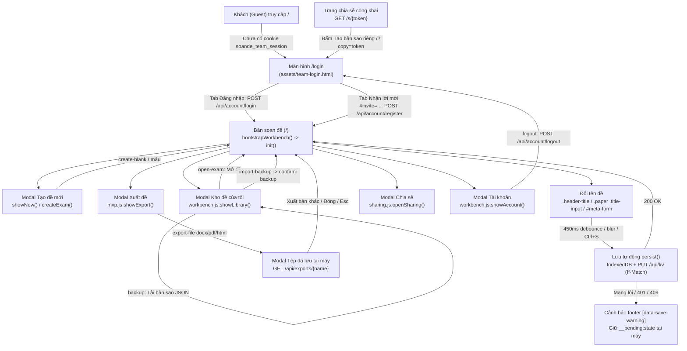

# Đặc tả Luồng màn hình, Kho đề & Tài khoản (`UI-1-001`)

**Mảng / Task:** `UI-1` — [`UI-1-001`](../team/BACKLOG.md#ui-1-001--chốt-sơ-đồ-màn-hình-và-luồng-kho-đềtài-khoản) ([Issue #1](https://github.com/ngocthuan1505/proj_VA_soandethi/issues/1))  
**Phạm vi tài liệu:** `W01`–`W04`, kịch bản `T01`–`T03`; `W05` `[Chờ review wireframe với BE-2/UI-2/UI-3]`  
**Vai trò kiến trúc:** Giao diện JavaScript (`index.html`, `bootstrap.js`, `app.js`, `mvp.js`, `studio.js`, `design.js`, `reference.js`, `workbench.js`, `sharing.js`, `storage.js`, `assets/team-login.html`, `assets/team-login.js`, `assets/usability.js`) là **lớp trình bày hỗ trợ trên trình duyệt**. Toàn bộ nghiệp vụ xác thực phiên, phân quyền `guest` / `member` / `admin`, kho SQLite theo tài khoản, kiểm soát xung đột `If-Match` / `X-Workspace-Context`, xuất tệp `.docx`/`.pdf`/`.html`, chia sẻ snapshot và khôi phục bản sao chạy **hoàn toàn bằng Python FastAPI** trong `backend/src/mach_backend/` (`local_workspace.py`, `team_workspace.py`, `team_accounts.py`, `workspace_store.py`, `local_documents.py`, `workspace_backup.py`, `workspace_shares.py`).  
**Quy ước nhãn trạng thái trong tài liệu:**
- `[Hiện có / Đã chạy bằng Python]`: hành vi đã đối chiếu trực tiếp trong code Python FastAPI + JS hiện hành và đã có script/pytest tương ứng.
- `[Fixture / Mock]`: kiểm thử hoặc minh họa dùng dữ liệu tự tạo, kho thử tạm hoặc model giả lập; không thay thế nghiệm thu model AI thật hay người dùng thật.
- `[Chờ review nhóm / Thành viên xác nhận]`: đề xuất hoàn thiện UX hoặc hợp đồng liên mảng cần chốt với `BE-2` / `BE-3` / `UI-2` / `UI-3` ở `W05` và `M2`.

> **Bảo mật vận hành:** Tài liệu này không chứa URL hay token server thật. Chỉ người chủ sở hữu dự án thao tác hạ tầng GreenNode theo runbook riêng tại [`ops/greennode/README.md`](../../ops/greennode/README.md).

---

## 1. Source đã khảo sát & Nguyên tắc kế thừa

| Thành phần | Tệp nguồn đã đọc trực tiếp | Vai trò trong luồng màn hình & dữ liệu |
|---|---|---|
| Cổng đăng nhập nhóm | [`assets/team-login.html`](../../assets/team-login.html), [`assets/team-login.js`](../../assets/team-login.js), [`assets/team-login.css`](../../assets/team-login.css) | Màn hình `/login` chế độ nhóm tại máy (đăng nhập / nhận lời mời `#invite=...`, giữ `?copy=...`); kế thừa bố cục từ [`assets/online-login.html`](../../assets/online-login.html) |
| Shell & vòng đời đề | [`index.html`](../../index.html), [`bootstrap.js`](../../bootstrap.js), [`app.js`](../../app.js), [`core.js`](../../core.js) | Khởi tạo `#app`, `<dialog id="dialog">`, `#toast`, vòng đời tạo/mở/đổi tên/lưu/xuất/sao lưu và auto-save debounce `450ms` |
| Lớp trình bày & thanh công cụ | [`mvp.js`](../../mvp.js), [`studio.js`](../../studio.js), [`design.js`](../../design.js), [`reference.js`](../../reference.js), [`assets/usability.js`](../../assets/usability.js) | Ghi đè header thành `.mvp-document` + `.menubar` + `.header-actions`, thêm `.design-rail` cố định trái, hộp thoại tìm nhanh `Ctrl+K`, co giãn responsive và trợ năng |
| Kho đề, tài khoản & chia sẻ phía client | [`workbench.js`](../../workbench.js), [`sharing.js`](../../sharing.js), [`storage.js`](../../storage.js) | Kho đề (`showLibrary`, `filterLibrary`), tài khoản (`bootstrapWorkbench`, `showAccount`, `team-invite`), chia sẻ snapshot, hàng đợi `__pending:state` theo namespace `ctx.id` trong IndexedDB `tro-ly-soan-de-v1` |
| CSS desktop / mobile / focus | [`style.css`](../../style.css), [`mvp.css`](../../mvp.css), [`design.css`](../../design.css), [`workbench.css`](../../workbench.css), [`assets/usability.css`](../../assets/usability.css) | Các breakpoint desktop/tablet/mobile (`1650px`, `1450px`, `1100px`, `760px`, `480px`), `:focus-visible`, drawer trái/phải và hiển thị `[data-save-warning]` |
| Backend Python FastAPI (Đơn & Nhóm) | [`local_workspace.py`](../../backend/src/mach_backend/local_workspace.py), [`team_workspace.py`](../../backend/src/mach_backend/team_workspace.py), [`team_accounts.py`](../../backend/src/mach_backend/team_accounts.py), [`workspace_store.py`](../../backend/src/mach_backend/workspace_store.py) | `mach_backend.local_workspace:app` (PoC cục bộ) và `mach_backend.team_workspace:app` (tài khoản nhóm cookie `soande_team_session`, `X-Workspace-Context`, `If-Match`); khác với `mach_backend.main:app` (mới là foundation `/api/health` và `/api/readiness` trả `503`) |
| Xuất, chia sẻ & khôi phục Python | [`local_documents.py`](../../backend/src/mach_backend/local_documents.py), [`workspace_backup.py`](../../backend/src/mach_backend/workspace_backup.py), [`workspace_shares.py`](../../backend/src/mach_backend/workspace_shares.py) | Xuất Word/PDF/HTML, kiểm bản sao tối đa `150 MiB` (`MAX_BACKUP`) / tệp `15 MiB` (`MAX_FILE`), tạo & thu hồi link chia sẻ `/s/{token}` |
| Tài liệu kế hoạch & kiểm thử | [`docs/team/BACKLOG.md`](../team/BACKLOG.md), [`docs/testing/KIEM_THU_TICH_HOP.md`](../testing/KIEM_THU_TICH_HOP.md), [`docs/contracts/http.md`](../contracts/http.md) | Tiêu chí `UI-1-001`, các ca `IT-01`/`IT-10`/`IT-11` đã chạy đối chiếu trên FastAPI |

**Lưu ý chuỗi gắn kết giao diện (`app.js:65`, `mvp.js:31-43`, `workbench.js:79`, `design.js:3-13`):**
Trong code hiện hành, `app.js` dựng khung DOM ban đầu, sau đó tuần tự chạy `mountMVP()` → `mountWorkbench()` → `mountStudio()` (gồm `mountDesign()` và `mountUsability()`). Ở vòng xử lý sự kiện (`app.js:137`), `handleAction` gọi theo thứ tự ưu tiên: `handleStudioAction` (gồm `handleDesignAction`) → `handleWorkbenchAction` → `handleMVPAction` → `switch` mặc định trong `app.js`. Vì vậy:
- Thao tác `library` (`Mở kho đề`) thực tế chạy `workbench.js:showLibrary()` (không chạy `app.js:showLibrary()`).
- Thao tác `export` (`Xuất đề`) thực tế chạy `mvp.js:showExport()` (không chạy `app.js:showExport()`).
- Thao tác `account` (`Tài khoản`) thực tế chạy `workbench.js:showAccount()`.

---

## 2. `W01` — Sơ đồ màn hình & Vòng đời Tạo → Mở → Đổi tên → Tìm → Lưu → Xuất `[Hiện có / Đã chạy bằng Python]`

### 2.1. Sơ đồ điều hướng tổng thể

### 2.2. Danh mục màn hình, modal và nút điều hướng / quay lại

| Định danh màn hình / hộp thoại | Nguồn dựng giao diện | Nút mở (Entry) | Nút điều hướng & quay lại (Exit / Back) |
|---|---|---|---|
| **Màn hình Đăng nhập / Nhận lời mời** (`/login`) | [`assets/team-login.html`](../../assets/team-login.html), [`assets/team-login.js`](../../assets/team-login.js) | Redirect `302` từ `/` khi chưa đăng nhập hoặc sau `logout` | Chuyển tab `Đăng nhập` (`data-mode="login"`) ↔ `Nhận lời mời` (`data-mode="register"`); sau submit thành công chuyển hướng `location.replace('/' hoặc '/?copy=...')` |
| **Shell Bàn soạn đề** (`/`) | [`app.js`](../../app.js), [`mvp.js`](../../mvp.js), [`studio.js`](../../studio.js), [`design.js`](../../design.js) | Sau khi đăng nhập thành công tại `/login` | `.design-rail` bên trái (`Đề mới`, `Bàn soạn`, `Kho đề`, `Học liệu`, `Mẫu đề`, `Tìm nhanh`, `Kết nối`); nút `Tập trung` (`design-focus`) ẩn cả `.sidebar` và `.assistant`; trên mobile có nút `toggle-left`/`collapse-outline` và `toggle-ai`/`toggle-chat` |
| **Modal Tạo đề mới** | `app.js:showNew()` | Rail `Đề mới`, menu `Tệp → Tạo đề mới`, nút `Tạo đề mới` ở chân Kho đề | Nút `×` (`[data-action="close"]`), phím `Escape`, hoặc bấm vùng nền ngoài `<dialog>` để quay về màn hình trước đó; nút `Tạo đề mới` (`create-blank`) tạo đề và đóng modal |
| **Modal Kho đề của tôi** | `workbench.js:showLibrary()` | Rail `Kho đề`, menu `Tệp → Mở kho đề`, lệnh nhanh `Ctrl+K → Mở kho đề` | `Mở` (`open-exam`) chuyển đề hiện tại và đóng modal; `×` hoặc `Escape` quay về Bàn soạn (trả focus về nút `Mở kho đề`); `Tạo đề mới` mở sang `showNew()` |
| **Modal Xóa đề khỏi trình duyệt?** | `app.js` (`case 'delete-exam'`) | Nút `Xóa` trên thẻ `.wb-library-card` | Nút `Tải bản sao` (`backup`), nút `×` (`close`) hoặc `Escape` hủy xóa; `Xóa đề` (`confirm-delete-exam`) xóa rồi gọi lại `showLibrary()` quay về Kho đề |
| **Modal Thông tin đề** | `app.js:showMetadata()` | Bấm vào tiêu đề trên `mvp.js` trước khi thay thành `<input>`, menu `Định dạng → Thông tin & đầu đề`, hoặc `Ctrl+K` | Lưu (`#meta-form` submit) đóng modal về Bàn soạn; `×` hoặc `Escape` hủy sửa |
| **Thanh Tìm & thay thế trong đề** | `studio.js:showFind()` | Phím tắt `Ctrl+F` / `Ctrl+H` hoặc `Ctrl+K → Tìm và thay thế` | Bấm vào kết quả (`studio-find-result`) cuộn tới câu đó; nút `×` (`studio-find-close`) hoặc `Escape` đóng thanh tìm |
| **Modal Xuất đề** | `mvp.js:showExport()` | Header `Xuất đề` (`design-export`), menu `Tệp → Xuất Word / PDF`, toolbar nút In/Xuất, hoặc `Ctrl+K` | Chọn định dạng `Word (.docx)` / `PDF` / `HTML` → chuyển sang modal **Tệp đã lưu tại máy** (có nút `Xuất bản khác` `[data-action="export"]` quay lại danh sách định dạng) hoặc modal **Chưa xuất được tệp** (có nút `Quay lại phần xuất` `[data-action="export"]`); nút `×` / `Escape` về Bàn soạn |
| **Modal Chia sẻ bản đề đã lưu** | `sharing.js:openSharing()` | Header `Chia sẻ` (`[data-action="share"]`) | Tạo xong chuyển modal **Liên kết chia sẻ đã tạo** có nút `Quản lý liên kết` (`[data-action="share"]`) quay lại danh sách link; `Thu hồi` (`revoke-share`) tải lại danh sách; `×` / `Escape` về Bàn soạn |
| **Trang Chia sẻ chỉ xem** (`/s/{token}`) | `workspace_shares.py:view()` | Mở liên kết `/s/{token}` | Thanh `<nav class="shared-bar">`: nút `In bản này` (`window.print()`) và link `Tạo bản sao riêng` (`/?copy={token}` nếu `allowCopy=1`) |
| **Modal Tài khoản / Mời thành viên** | `workbench.js:showAccount()` | Nút `.account-button` (`[data-action="account"]`) góc phải header | Thành viên xem thông tin + nút `Đăng xuất` (`logout`); `admin` có thêm nút `Mời thành viên` (`team-invite` mở form `#team-invite-form`); `×` / `Escape` về Bàn soạn |
| **Modal Khôi phục bản sao dữ liệu** | `app.js` (`import-backup` → `confirm-backup`) | Nút `Khôi phục bản sao JSON` trong Kho đề hoặc menu `Tệp` | Hiện thống kê xem trước (`exams`, `files`, `prefs`), nút `Tải bản sao hiện tại` (`backup`), `×`/`Escape` hủy giữ nguyên kho, `Khôi phục kho này` (`confirm-backup`) ghi rồi `location.reload()` |

### 2.3. Chu trình 6 thao tác cốt lõi (`W01`)

1. **Tạo:** Bấm `Đề mới` (`[data-action="new"]`) → chọn môn nhanh (`design-new-subject`) hoặc gõ `#new-subject` → bấm `Tạo đề mới` (`create-blank`). `createExam()` tạo object đề mới bằng `blank(subject, state.prefs)` (`core.js:92`), đẩy vào `state.exams`, gán `state.current = e.id`, đóng modal, gọi `persist()` và `render()`. Nếu chọn mẫu có sẵn trong `
` hoặc tab `Mẫu đề`, app tạo bản riêng độc lập có sẵn câu hỏi/tư liệu minh họa.
2. **Mở:** Bấm `Kho đề` (`[data-action="library"]`) → xem danh sách `.wb-library-card` hiển thị tên đề, môn, lớp, số câu, ngày cập nhật (`e.updated`) → bấm `Mở` (`open-exam`, `data-id="<exam.id>"`) → `state.current` đổi sang ID được chọn, `selected = null`, đóng modal, gọi `persist()` và `render()`.
3. **Đổi tên:** Có 2 đường chính:
   - Sửa trực tiếp trên `.header-title` (`data-exam-field="title"`, `maxLength=180`) hoặc `.paper .title-input` (`data-exam-field="title"`). Sự kiện `input` đổi `[data-save-status]` thành `'Đang soạn…'` và đặt hẹn giờ `450ms` (`inlineTimer`) phát sự kiện `change` (`app.js:272`); `blur` cũng kích hoạt `change`. Handler `change` gọi `change('Sửa tên đề', ...)` (`{renderPage: false}`), đồng bộ ngược các `[data-exam-field="title"]` khác và `.breadcrumb b`.
   - Sửa qua modal `Thông tin đề` (`#meta-form`) rồi bấm `Lưu thông tin`.
4. **Tìm:**
   - **Tìm đề trong kho:** Mở Kho đề → gõ vào `#library-filter` (`aria-label="Tìm trong kho đề"`). Hàm `filterLibrary(query)` (`workbench.js:66-78`) chuẩn hóa `query.trim().toLocaleLowerCase('vi-VN')`, ẩn/hiện `.wb-library-card` theo `card.dataset.search` (`e.title + ' ' + e.subject`) và cập nhật `#library-status` (`role="status"`).
   - **Tìm trong nội dung đề:** `Ctrl+F` / `Ctrl+H` hoặc `Ctrl+K` mở `.studio-find` (`#find-query`, tùy chọn `#find-case`), liệt kê số lần khớp theo từng câu và cho phép bấm nhảy tới câu (`studio-find-result`).
5. **Lưu:** Mọi thay đổi qua `change()` hoặc `Ctrl+S`/`Cmd+S` (nếu `!event.isComposing`, sau `flushEditor()`) gọi `persist()` (`app.js:47`). `persist()` tăng `saveRequested`, hiển thị `'Đang lưu…'`, gọi `db.put('state', clone(state))`. Trong `storage.js`, bản lưu được ghi vào IndexedDB theo `ctx.id:state` và `ctx.id:__pending:state`, đồng thời xếp hàng tuần tự qua `ctx.remote` để gửi `PUT /api/kv` kèm `If-Match: String(record.base)` và `X-Workspace-Context: team:<user_id>`. Khi thành công, cập nhật `ctx.revision`, xóa `__pending:state` (chỉ xóa đúng `record.id` nếu chưa có lượt gõ mới hơn trong lúc chờ mạng).
6. **Xuất:** Bấm `Xuất đề` (`[data-action="export"]`) → chọn `Bản học sinh` (`data-teacher="false"`) hoặc `Bản giáo viên` (`data-teacher="true"`) và định dạng `docx` / `pdf` / `html` → `exportFile()` (`mvp.js:106`) gọi `flushEditor()`, gửi `POST /api/save-export` tới FastAPI (`local_documents.export_file`), nhận `{filename, url, bytes}` rồi hiển thị link tải `/api/exports/{name}` (bản học sinh loại bỏ đáp án, lời giải, barem và hội thoại). Ngoài ra nút `Sao lưu toàn bộ đề (.json)` (`backup-local`) xuất tệp `Ban-sao-tro-ly-soan-de.json` gồm toàn bộ `state` và `files` đang tham chiếu.

---

## 3. `W02` — Luồng `guest` / `member` / `admin`, Đăng nhập / Hết phiên, Bản nháp & Trạng thái kho

### 3.1. Ma trận quyền `guest` / `member` / `admin` (`[Hiện có / Đã chạy bằng Python]`)

Nguồn xác thực tại [`team_workspace.py`](../../backend/src/mach_backend/team_workspace.py) và [`team_accounts.py`](../../backend/src/mach_backend/team_accounts.py). Mỗi thành viên có kho SQLite riêng tại `<data_dir>/users/<user_id>/workspace.sqlite` (`WorkspaceStore`).

| Tài nguyên / Thao tác | `guest` (chưa đăng nhập / cookie hết hạn) | `member` (cookie hợp lệ, `role='member'`) | `admin` (cookie hợp lệ, `role='admin'`) |
|---|---|---|---|
| `GET /`, `GET /login`, tài sản tĩnh whitelist | `GET /` trả `302` → `/login` (hoặc `/login?copy=<43ch>`). `/login` và tài sản `.js/.css/assets/*` trả `200`. File nhạy cảm (`.sqlite`, `pyproject.toml`, `.git`) trả `404` | Vào `/` bình thường (`200`), phục vụ `ui_entry()` kèm `importmap` hash chống cache | Như `member` |
| `POST /api/account/login`, `POST /api/account/register` | Được phép (kiểm `Host` loopback + `Origin` khớp base URL). Đăng ký bắt buộc có `inviteCode` hợp lệ còn hạn `86400s`. Giới hạn sai mật khẩu: `10` lần / `600s` (`429`) | Được phép (tạo phiên mới, cookie `soande_team_session` `HttpOnly; SameSite=Strict`, hạn `SESSION_SECONDS = 28800` giây = 8 giờ) | Như `member` |
| `GET /api/account`, `POST /api/account/logout` | `401` (`"Đăng nhập trước khi mở kho đề."` / `"Phiên hết hạn. Đăng nhập lại."`) | `200` (kiểm khớp `X-Workspace-Context` nếu có). Logout xóa session token băm trong `sessions` và xóa cookie | Như `member` (`admin: true`) |
| `POST /api/account/invitations` | `401` | `403` (`"Chỉ quản trị viên được đổi cấu hình hoặc mời thành viên."`) | `200`, sinh `inviteCode` dùng 1 lần, hạn `24h`, gắn email nếu truyền |
| `GET /api/kv`, `PUT /api/kv`, `GET /api/source-file/{file_id}` | `401` | Đọc/ghi **chỉ trong `users/<member_id>/workspace.sqlite`** | Đọc/ghi **chỉ trong `users/<admin_id>/workspace.sqlite`** (admin không đọc được kho của member) |
| `GET /api/config`, `POST /api/config` | `401` | `GET /api/config` đọc được cấu hình (không lộ khóa qua API trừ `hasKey`); `POST /api/config` bị chặn `403` (`"Chỉ quản trị viên được đổi kết nối AI."`); trên UI ẩn nút `Kết nối` qua `body.online-member [data-action=connections]` | Được đọc và ghi `POST /api/config`; cấu hình AI được `Dispatch` sao chép trong bộ nhớ cho member dùng chung khi hệ thống không bận |
| `POST /api/save-export`, `GET /api/exports/{name}` | `401` | Tạo và tải tệp trong thư mục `exports/` của đúng tài khoản mình; người dùng khác truy cập trả `404` | Tạo và tải tệp trong thư mục `exports/` của chính admin |
| `POST /api/share`, `GET /api/share`, `POST /api/share/revoke` | `401` | Chỉ tạo từ đề trong kho của mình và chỉ thu hồi link do mình sở hữu (`WHERE token=? AND owner=?`) | Cùng quy tắc theo `owner` |
| `GET /s/{token}` và `GET /api/share/read/{token}` | `GET /s/{token}` **mở được HTML chỉ xem** nếu `revoked=0`. `GET /api/share/read/{token}` ở `team_workspace.py` trả `401` nếu chưa đăng nhập (sau đăng nhập `/?copy={token}` mới đọc JSON để sao chép nếu `allowCopy=1`) | Mở được `/s/{token}` và đọc JSON sao chép qua `/api/share/read/{token}` nếu `allowCopy=1` | Như `member` |
| `POST /api/workspace/restore/preview`, `/api/workspace/restore` | `401` | Xem trước và khôi phục **chỉ trong kho của phiên hiện tại**, kiểm `If-Match` | Cùng quy tắc theo phiên hiện tại |

> **Lưu ý về chế độ PoC cục bộ (`local_workspace.py`):** Khi chạy trực tiếp `mach_backend.local_workspace:app` (không qua `team_workspace.py`), không có bảng `users`/`sessions`; `GET /api/account` trả `user: null, workspace: "local", localPoC: true, admin: true`. Chế độ này chỉ dùng thử 1 người trên máy, không thay thế phân quyền nhóm.

### 3.2. Luồng đăng nhập, hết phiên và bảo vệ bản nháp cục bộ (`T02`)

1. **Cách phân tách bản nháp theo tài khoản (`storage.js:1-69`):**
   - `bootstrapWorkbench()` (`workbench.js:22`) gọi `GET /api/account` trước khi đọc kho, rồi gọi `setIdentity(accountInfo.workspace || accountInfo.user?.id)`.
   - `storage.js` lưu mọi bản ghi trong IndexedDB `tro-ly-soan-de-v1` (store `kv`) dưới khóa **`<ctx.id>:<key>`** và hàng đợi chưa đồng bộ dưới khóa **`<ctx.id>:__pending:<key>`** (ví dụ `team:a1b2...:state` và `team:a1b2...: __pending:state`).
   - Do khác tiền tố `ctx.id`, bản nháp đang chờ đồng bộ của tài khoản A **không bao giờ được đọc hoặc gửi nhầm vào kho của tài khoản B**.
2. **Bảo vệ ở tầng HTTP bằng `X-Workspace-Context` (`storage.js:44`, `team_workspace.py:97-109`):**
   - Mọi request `/api/*` từ bàn soạn (khi `ctx.id.startsWith('team:')`) đính kèm header `X-Workspace-Context: team:<user_id>`.
   - Middleware `boundary()` tại `team_workspace.py` kiểm tra header này trước khi định tuyến:
     - Nếu phiên đã hết hạn / đã logout ở tab khác (`current is None`) → trả **`401`** `{"error": "Phiên hết hạn. Đăng nhập lại."}`.
     - Nếu tab khác đã đăng nhập tài khoản B (`expected != "team:" + current["id"]`) → trả **`409`** `{"error": "Tài khoản đã đổi ở tab khác. Tải lại trang để mở đúng kho.", "code": "workspace_context_changed"}`.
3. **Cách client xử lý khi hết phiên hoặc đổi tài khoản giữa lúc có bản nháp:**
   - **Đã chạy `[Hiện có / Đã chạy bằng Python]`:**
     - `storage.js:43` (`sameIdentity(ctx)`) ném lỗi ngay nếu `ctx !== active` trong trình duyệt.
     - `storage.js:51-54` giữ nguyên `ctx.pending` và `team:<A>:__pending:state` trong IndexedDB khi `!response.ok`; không xóa nháp cục bộ.
     - `storage.js:88-89, 104`: Khi `get('state')` nhận `401`/`403` hoặc `409`, gán `error.auth = true` và **ném thẳng lỗi** thay vì rơi về cache cũ để tránh hiển thị nhầm trạng thái đã xác thực.
     - Khi gặp `409 workspace_context_changed` trên tab A cũ, tab A không thể ghi đè sang kho B và không thể logout phiên của B (`kiem-ui-kho-nhom.mjs:77-83`).
   - **Điểm cần bổ sung ở `UI-1-002` `[Chờ review nhóm / Thành viên xác nhận]`:**
     - Hiện tại khi `PUT /api/kv` trả `401` (phiên hết hạn giữa lúc đang gõ) hoặc `409 workspace_context_changed`, `app.js:31-38` chưa phân biệt thông báo riêng cho `401` / `workspace_context_changed` so với rớt mạng thông thường (vẫn ghi `'Đã lưu tạm · chờ đồng bộ'` và `saveWarningText()` ghi `'Chưa đồng bộ · Kiểm tra mạng hoặc đăng nhập lại'`), đồng thời nút `Tải bản nháp` (`[data-action="backup"]`) đang bị ẩn khi `!db.hasStateConflict()` (`app.js:33`).
     - **Đặc tả đề xuất cho `UI-1-002`:** Khi `PUT /api/kv` trả `401` hoặc `409 workspace_context_changed`, phải: (1) giữ nguyên `team:<A>:__pending:state` trong IndexedDB (tuyệt đối không tự gửi sang session mới nếu khác `user_id`); (2) hiển thị cảnh báo rõ nguyên nhân (`Phiên đăng nhập của tài khoản A đã hết hạn` hoặc `Tab khác đã đổi sang tài khoản khác`); (3) mở sẵn 2 nút hành động: **`Tải bản nháp (.json)`** (gọi `backup()` xuất dữ liệu từ state đang sửa trong bộ nhớ, không gửi lên server mới) và **`Mở đăng nhập đúng tài khoản`** (mở `/login` — sau khi đăng nhập lại đúng tài khoản A, `storage.get('state')` tự phát hiện `team:<A>:__pending:state` có `base === result.revision` để đồng bộ tiếp, hoặc báo `Xung đột lưu` nếu kho A đã có bản mới hơn).

### 3.3. Trạng thái Kho rỗng / Đang tải / Lỗi

| Trạng thái | Điều kiện xảy ra | Hành vi UI hiện có (`[Hiện có / Đã chạy bằng Python]`) | Bổ sung đề xuất `[Chờ review nhóm / Thành viên xác nhận]` |
|---|---|---|---|
| **Đang tải (Loading)** | - Mở trang `/` trước `init()` - Submit `/login` - Đang lưu `persist()` - Đang xuất tệp / khôi phục bản sao | - `#app` hiện `"Đang mở bàn soạn đề…"` (`index.html`). - `#team-login` đặt `aria-busy="true"`, disable nút submit & tab mode. - `[data-save-status]` hiện `'Đang lưu…'`. - Modal `.busy` + `.spinner` (`role="status"`). | Nếu M2/M3 chuyển Kho đề sang `GET /api/exams` phân trang thay vì tải trọn `state`, cần thêm khung skeleton/loading trong `#dialog` và nút Hủy/Đóng an toàn. |
| **Kho rỗng / Không khớp tìm kiếm (Empty)** | - Tài khoản mới (`value: null` trên server) - Kho có `exams: []` - `#library-filter` không khớp đề nào - Đề có `questions: []` | - Khi `GET /api/kv?key=state` trả `null`, `app.js:289` tự khởi tạo 1 đề mẫu (`sample()`), khi xóa đề cuối (`app.js:145`) tự tạo 1 đề trắng (`blank('Lịch sử')`). - Trong **Kho đề** (`workbench.js:74-77`), `#library-status` (`role="status"`) hiển thị `'Chưa có đề nào trong kho.'` (khi 0 card) hoặc `'Không tìm thấy đề phù hợp.'` (khi lọc rỗng), chân modal luôn có CTA `Tạo đề mới` (`primary`). - Trong **Bàn soạn**, đề 0 câu hiện `.empty` (`'Bắt đầu soạn đề…'`) + nút `Thêm câu hỏi` và `.outline-empty`. | Cho phép trạng thái kho 0 đề thật ở tài khoản mới (thay vì ép tạo đề mẫu vào kho server trước khi giáo viên bấm tạo) với màn hình/kho rỗng có sẵn 2 CTA rõ: `Tạo đề mới` và `Mở ví dụ mẫu / Nhập bản sao JSON`. |
| **Lỗi (Error)** | - Lỗi tải JS module (`bootstrap.js`) - Lỗi `401`/`403`/`409`/`422`/`429`/`500` hoặc mất mạng - Lỗi xuất/khôi phục JSON hỏng | - `bootstrap.js` hiện `<section role="alert">` `'Chưa tải được bàn soạn'` + nút `Tải lại giao diện`. - `#login-feedback` (`role="alert"`) hiện thông báo lỗi đăng nhập/mời. - `persist()` lỗi giữ nháp `__pending:state`, bật `[data-save-warning]`, tự `retryPendingWrites()` khi có `online`. - Lỗi xuất/import hiển thị `.alert` trong modal và giữ nguyên đề hiện có, cung cấp nút quay lại (`Quay lại phần xuất`, `close`). | Phân biệt UI giữa lỗi mạng (tạm giữ & tự đồng bộ), lỗi hết phiên `401` (nhắc đăng nhập lại + cho tải bản nháp), và lỗi xung đột `409` (mở modal chọn Tải lại bản mới hoặc Nhân bản nháp). |

---

## 4. `W03` — Đối chiếu từng thao tác UI → Endpoint, Header & Field FastAPI thật

> Mọi route và DTO dưới đây được kiểm chứng trực tiếp từ `local_workspace.py`, `team_workspace.py`, `workspace_store.py`, `local_documents.py`, `workspace_backup.py`, `workspace_shares.py` và client `storage.js`, `app.js`, `mvp.js`, `workbench.js`, `sharing.js`, `assets/team-login.js`.  
> **Lưu ý về foundation `main.py`:** Entrypoint `mach_backend.main:app` hiện mới có `GET /api/health` (`200`) và `GET /api/readiness` (`503`). Các route nghiệp vụ bên dưới đang chạy trên `mach_backend.local_workspace:app` và `mach_backend.team_workspace:app` `[Hiện có / Đã chạy bằng Python]`.

### 4.1. Bảng ánh xạ UI → FastAPI (Auth, Kho đề, Xuất, Chia sẻ, Khôi phục)

| Thao tác UI & caller | Route & Method FastAPI | Header & Ranh giới bảo mật | Request Payload / Query thật | Response DTO / Field thật | Mã lỗi & Status thật | Trạng thái |
|---|---|---|---|---|---|---|
| Kiểm phiên & thông tin workspace lúc mở app (`workbench.js:bootstrapWorkbench`, `refreshAccount`) | `GET /api/account` | `Host` loopback; cookie `soande_team_session`; tùy chọn `X-Workspace-Context: team:<id>` | Không có body | **Team mode:** `{user: {id, email, name, role}, workspace: "team:<id>", localPoC: true, teamMode: true, sharedSnapshots: true, localOnly: true, online: true, admin: bool, credits: {balance: 1000}}` **Local mode:** `{user: null, workspace: "local", credits: {balance: 1000}, localOnly: true, localPoC: true, sharedSnapshots: true, online: false, admin: true}` | `401` nếu chưa đăng nhập; `409 workspace_context_changed` nếu lệch `X-Workspace-Context` | `[Hiện có / Đã chạy bằng Python]` |
| Đăng nhập (`team-login.js`, `workbench.js`) | `POST /api/account/login` | `Host` loopback; `Origin` khớp base URL; tối đa `8192` byte | Pydantic `SignIn` (`extra="forbid"`): `{email: str(3..254), password: str(10..200)}` | `{user: {id, email, name, role}}` + header `Set-Cookie: soande_team_session=...; HttpOnly; SameSite=strict; Max-Age=28800` | `400` email/mật khẩu sai định dạng; `401` sai thông tin; `403` sai Host/Origin; `422` sai schema; `429` sai >= 10 lần/10 phút | `[Hiện có / Đã chạy bằng Python]` |
| Nhận lời mời tạo tài khoản (`team-login.js`) | `POST /api/account/register` | `Host` loopback; `Origin` khớp base URL; tối đa `8192` byte | Pydantic `Register(SignIn)`: `{name: str(1..100), email, password, inviteCode: str(20..100)}` | `{user: {id, email, name, role}}` + `Set-Cookie` như login | `400` lời mời sai/đã dùng/hết hạn; `409` email đã tồn tại; `422` thiếu trường | `[Hiện có / Đã chạy bằng Python]` |
| Đăng xuất (`workbench.js:logout`) | `POST /api/account/logout` | `Origin` khớp base URL; cookie `soande_team_session`; `X-Workspace-Context` | `{}` | `{"ok": true}` + xóa cookie `soande_team_session` | `409 workspace_context_changed` nếu tab cũ lệch tài khoản hiện tại | `[Hiện có / Đã chạy bằng Python]` |
| Admin tạo mã mời thành viên (`workbench.js:team-invite-form`) | `POST /api/account/invitations` | `Origin`; cookie `admin`; kiểm `role == "admin"` | Pydantic `Invitation` (`extra="forbid"`): `{email: str(3..254)}` | `{inviteCode: str, email: str, expiresIn: 86400}` | `401` chưa đăng nhập; `403` nếu `member`; `400` email không hợp lệ | `[Hiện có / Đã chạy bằng Python]` |
| Mở kho đề / tải tệp nguồn (`storage.js:get`) | `GET /api/kv?key=...` | `X-Workspace-Context: team:<id>` (nếu team mode); cookie | Query `key`: `"state"` hoặc khớp regex `file:[\w-]+` | Pydantic `WorkspaceSnapshot`: `{value: JsonValue \| null, revision: int}` (khóa mới chưa có trả `value: null, revision: 0`) | `400` khóa không hợp lệ; `401` hết phiên; `409 workspace_context_changed` | `[Hiện có / Đã chạy bằng Python]` |
| Tạo / Mở / Đổi tên / Sửa / Xóa đề (`storage.js:put`, `app.js:persist`) | `PUT /api/kv` | `Origin`; `Content-Type: application/json`; `X-Workspace-Context`; **`If-Match`** (regex `[0-9]{1,19}`) | Pydantic `WorkspaceWrite`: `{key: "state" \| "file:<id>", value: JsonValue}`. Khi `key == "state"`, `value` phải là `dict` có `exams: list` và `prefs: list` | Pydantic `WorkspaceRevision`: `{revision: int}` (`rev` mới sau ghi; nếu nội dung JSON giống hệt bản đang lưu và `skip_unchanged=True`, giữ nguyên `revision`) | `400` sai định dạng `If-Match` hoặc workspace; `401` hết phiên; `409 stale_snapshot` (`If-Match` lệch `rev` hiện tại) hoặc `409 workspace_context_changed`; `422` sai schema JSON (`ValidationError`) | `[Hiện có / Đã chạy bằng Python]` |
| Kiểm tra trạng thái & cấu hình hệ thống (`mvp.js:refreshStatus`) | `GET /api/status` | Cookie phiên (team mode) | Không có | `{version, storage: "sqlite", online: false, admin: bool, teamMode: bool, matrixPython: bool, matrixAgent: bool, aiBusy: bool, fixture: bool, localPoC: true, config, model, aiProvider, pdf: bool, docx: true, ocr: false, sourceImport, matrixImport, limitations}` | `401` nếu chưa đăng nhập (team mode) | `[Hiện có / Đã chạy bằng Python]` |
| Xuất Word / PDF / HTML (`mvp.js:exportFile`, `app.js:saveLocal`) | `POST /api/save-export` | `Origin`; `X-Workspace-Context`; cookie; qua `export_slot = asyncio.Semaphore(1)` | `{type: "exam" \| "backup", format?: "docx"\|"pdf"\|"html", teacher?: bool, exam?: {...}}` (hoặc `state` khi backup) | `{filename: "De_thi_<uuid>.<ext>", url: "<base>api/exports/<filename>", bytes: int}` | `400` dữ liệu xuất sai; `401` hết phiên; `409` `export_limit`/`invalid_exam`/`unsupported_export`/`stale_document`; `413` quá `30 MiB` | `[Hiện có / Đã chạy bằng Python]` |
| Tải tệp đã xuất (`mvp.js`, link `.saved-export-link`) | `GET /api/exports/{name}` | Cookie phiên (cách ly theo `users/<id>/exports/`) | Path `name` khớp `De_thi_[0-9a-f-]{36}\.(html\|pdf\|docx\|json)` | `FileResponse` (với `.html` xem inline, định dạng khác trả `filename` tải về) | `401` chưa đăng nhập; `404` tệp không tồn tại hoặc thuộc user khác | `[Hiện có / Đã chạy bằng Python]` |
| Đọc tệp PDF nguồn gốc (`mvp.js:showSource`) | `GET /api/source-file/{file_id}` | Cookie phiên (chỉ đọc từ `store` của owner) | Path `file_id` khớp `[\w-]+` | `Response` PDF bytes (`application/pdf`, `Cache-Control: no-store`) | `401` chưa đăng nhập; `404` không tìm thấy/sai chủ; `413` > `15 MiB` | `[Hiện có / Đã chạy bằng Python]` |
| Liệt kê / Tạo / Thu hồi link chia sẻ (`sharing.js`) | `GET /api/share?examId=<uuid>` `POST /api/share` `POST /api/share/revoke` | `Origin`; `X-Workspace-Context`; cookie | `POST /api/share` (`ShareRequest`): `{examId: UUID, baseRevision: int>=1, answers: bool, allowCopy: bool}` `POST /api/share/revoke` (`RevokeRequest`): `{token: str(43)}` | `GET`: `{shares: [{token, url, revision, created, answers, allowCopy}]}` `POST /api/share`: `{token, url, revision, created}` `POST /api/share/revoke`: `{ok: true}` | `401` chưa đăng nhập; `404` `exam_not_found` hoặc không tìm thấy token của owner; `409 stale_snapshot` nếu `exam.revision != baseRevision` | `[Hiện có / Đã chạy bằng Python]` |
| Mở bản chia sẻ / Tạo bản sao riêng (`/?copy=<token>`) | `GET /s/{token}` `GET /api/share/read/{token}` | `GET /s/{token}` công khai theo token `43` ký tự; `GET /api/share/read/{token}` cần phiên ở team mode (`401` nếu guest) | Path `token` khớp `[A-Za-z0-9_-]{43}` | `/s/{token}`: HTML snapshot kèm `<nav class="shared-bar">` + header `no-store`, `no-referrer`, `noindex` `/api/share/read/{token}`: `{allowCopy: bool, revision: int, exam?: {...}}` | `404` nếu token sai hoặc `revoked=1`; `401` ở `/api/share/read/{token}` nếu guest ở team mode | `[Hiện có / Đã chạy bằng Python]` |
| Xem trước & Khôi phục bản sao JSON (`app.js:import-backup` → `confirm-backup`, `storage.js`) | `POST /api/workspace/restore/preview` `POST /api/workspace/restore` | `Origin`; `X-Workspace-Context`; giới hạn `MAX_BACKUP = 150 MiB`; `/restore` bắt buộc header `If-Match` | JSON `{format: "tro-ly-soan-de", version: 1, savedAt, state: {exams, prefs, current}, files: {<fileId>: dataUrl}}` | `/preview`: `{revision, exams, files, prefs}` `/restore`: `{revision, restored: true}` (đồng thời xóa `matrix_pending`, `matrix_trace`, `scoped-patch:*` cũ) | `400` thiếu `If-Match`; `401` hết phiên; `409 invalid_backup` / `stale_snapshot` / `job_limit`; `413` > `150 MiB` | `[Hiện có / Đã chạy bằng Python]` |

### 4.2. Phân tách 3 tầng phiên bản & cấu trúc trường thật của `state` và `exam`

UI và backend phân biệt rõ **3 tầng phiên bản độc lập** (không gộp làm một):
1. **`workspace_revision`** (`kv.rev` trong `WorkspaceStore`): tăng khi `PUT /api/kv` ghi `key="state"`, truyền qua HTTP header `If-Match`.
2. **`exam.revision`**: phiên bản nghiệp vụ của từng đề trong `state.exams[]`, dùng làm `baseRevision` cho `/api/share`, `/api/exams/{exam_id}/matrix/approve`, `/proposals/generate`, `/proposals/{job_id}/confirm`.
3. **`q.v`** (`questionVersion`): phiên bản của từng câu hỏi trong `exam.questions[]`, dùng để phát hiện sửa chéo hoặc làm vô hiệu kết quả `q.check` cũ.

**Các trường chính của `state` và `exam` đang dùng thật giữa UI JS & Python (`core.js`, `workspace_backup.py`, `local_workspace.py`):**
- `state`: `{version: 1, current: <examId>, exams: Exam[], prefs: Preference[]}`.
- `exam`: `{id, revision, title, subject, grade, minutes, school, instructions, sample?, fullExam?, layout: {font, fontSize, pageMargin?}, blockIds: {heading, general, marking}, questions: Question[], docs: SourceDoc[], matrix: MatrixRow[], matrixConfirmed: bool, data: DataRow[], quote: {text, chosen, versions}, appliedPrefs: Preference[], assistantSources: string[], chat: ChatMsg[], history: HistoryEntry[], undo: UndoEntry[], redo: RedoEntry[], updated: int}`.

> **Định hướng M2/M3 `[Chờ review nhóm / Thành viên xác nhận]`:** Hiện tại toàn bộ `state` được đóng gói thành một khóa `key="state"` qua `/api/kv`. Khi `BE-2-002` và `BE-3-002` gắn các bảng quan hệ theo [`docs/contracts/du-lieu.md`](../contracts/du-lieu.md), thao tác tạo/mở/đổi tên/tìm/xóa đề có thể tách thành endpoint riêng (`/api/exams`, `/api/exams/{id}`); khi đó bảng ánh xạ trên sẽ được cập nhật thêm cột endpoint mới mà vẫn giữ nguyên `exam.id` (UUID), `exam.revision` và cấu trúc `richDoc`.

---

## 5. `W04` — Đặc tả Desktop / Mobile, Thứ tự `Tab`/Focus, Thông báo lưu / xung đột & Điểm phối hợp `UI-2` / `UI-3`

### 5.1. Đặc tả bố cục Desktop và Mobile (khớp CSS thực tế)

| Breakpoint | Chế độ hiển thị (`design.css` + `usability.css` + `mvp.css` + `style.css`) | Bố cục vùng chính & Kho đề / Tạo đề |
|---|---|---|
| **Desktop rộng (`>= 1650px`)** | `.design-rail` cố định trái `80px`; `#app` `margin-left: 80px`; `.workspace` 3 cột `254px \| minmax(0,1fr) \| 382px` (`usability.css` `240px \| 1fr \| 384px` khi `.mach`). | Header `100px` hiển thị đủ breadcrumb môn/lớp, `.header-title`, `.saved`, 6 mục `.menubar`, các nút `Tập trung`, `Xuất đề`, `Chia sẻ`, `Trợ lý` và `.account-control`. |
| **Desktop chuẩn (`1101px – 1450px`)** | Ở `<= 1450px`: `.workspace` `210px \| minmax(0,1fr) \| 330px`, ẩn nhãn text nút `Chia sẻ` (`.quiet span`) và ẩn nút `Tập trung` + `.saved` ở `top`. | Toàn bộ thao tác Kho đề (`Kho đề` trên `.design-rail`, menu `Tệp → Mở kho đề`) và `Đề mới` (`+ Đề mới` trên `.design-rail`) luôn hiện trên màn hình chính. |
| **Tablet (`761px – 1100px`)** | Ở `<= 1100px`: cột `.sidebar` thu về `0`, nút mở mục lục `.mobile-nav` hiện trên `.editor-toolbar`; khi mở mục lục thành drawer `left: 80px; width: 250px; z-index: 25`. | Modal `#dialog` rộng `min(880px, calc(100vw - 40px))`, `.modal-body` cuộn riêng, `.modal-foot` dính đáy (`position: sticky`). |
| **Mobile hẹp (`<= 760px`, kiểm chuẩn tại `390×844`)** | - `.design-rail` thu hẹp còn `57px`, `#app` `margin-left: 57px; width: calc(100% - 57px)`. - `.top` cao `90px`; `.menubar` chỉ giữ 4 mục đầu (`Tệp`, `Chỉnh sửa`, `Xem`, `Chèn`, ẩn mục thứ 5–6 `nth-child(n+5)`); ẩn `.header-actions .design-export` và chữ trên nút header (chỉ giữ icon `Chia sẻ`, `Trợ lý`, avatar tài khoản). - `.workspace` còn `1` cột (`minmax(0, 1fr)`); `.sidebar.open` thành drawer `left: 57px; top: 90px; width: calc(100vw - 80px); z-index: 25`; `.assistant.open` phủ toàn vùng `inset: 0; height: var(--chat-viewport-height, 100dvh); z-index: 60` (`usability.css`). | - **Lối vào Kho đề & Tạo đề trên viewport hẹp:** Nút `Đề mới` và `Kho đề` trên `.design-rail` (`57px`) **luôn hiển thị và bấm được**, không bị ẩn theo header. - **Modal Kho đề (`#dialog`):** `width: calc(100vw - 20px); max-height: calc(100dvh - 20px)` (`usability.css:168`); `#library-filter` tự động `font-size: 16px` tránh auto-zoom iOS; thẻ `.wb-library-card` xếp dọc (`flex-direction: column; align-items: flex-start`); khi kho rỗng hoặc lọc không ra kết quả, `#library-status` nằm ngay vùng nội dung và CTA chính **`Tạo đề mới` (`.primary`)** dính đáy `.modal-foot`, luôn truy cập được không cần cuộn vượt khung. |
| **Đăng nhập (`/login` ở `<= 480px`)** | `team-login.css`: `body { padding: 16px }`, `main { width: min(100%, 460px); padding: 24px }`. | Form 1 cột đầy đủ 2 tab, các ô nhập `width: 100%`, nút chính `width: 100%; padding: 13px`. |

### 5.2. Thứ tự `Tab` / Focus & Hành vi bàn phím

1. **Hiển thị focus (`:focus-visible`):**
   - `/login` (`team-login.css`): `outline: 3px solid #7db499; outline-offset: 3px`.
   - Bàn soạn (`design.css`): `outline: 3px solid #379b8b; outline-offset: 3px` cho `button`, `a`, `input`, `textarea`, `select`.
   - Nút trong `style.css`: `outline: 2px solid #7eab8a; outline-offset: 2px`.
2. **Thứ tự `Tab` trên màn hình `/login`:**
   - Logo `.brand` (`href="/login"`) → Tab `Đăng nhập` (`[data-mode="login"]`) → Tab `Nhận lời mời` (`[data-mode="register"]`) → *(nếu `register`: Họ tên)* → Email → Mật khẩu → *(nếu `register`: Mã mời)* → Nút submit `Đăng nhập` / `Tạo tài khoản từ lời mời`. Các input ẩn của tab còn lại có `disabled` nên không nhận nhầm focus khi bấm `Tab`.
3. **Thứ tự `Tab` trên Bàn soạn (`/`):**
   - Nhóm `.design-rail` (theo thứ tự DOM đứng đầu `#app`): Logo `.mach-logo` → `Đề mới` → `Bàn soạn` → `Kho đề` → `Học liệu` → `Mẫu đề` → `Tìm nhanh` → `Kết nối`.
   - Nhóm `header.top`: `.header-title` (`Tên tài liệu`) → `.menubar` (`Tệp` → `Chỉnh sửa` → `Xem` → `Chèn` → `Định dạng` → `Công cụ`) → `.header-actions` (`Tập trung` → `Xuất đề` → `Chia sẻ` → `Trợ lý` → `Tài khoản` → `Hạn mức`).
   - Nhóm `.sidebar` (nếu mở) → `.main` (`.editing-bar` cuộn ngang → `#page-jump` → `.paper`) → `.assistant`.
4. **Thứ tự `Tab` và `Escape` trong Modal Kho đề (`#dialog`, đã kiểm trên `390×844` ở `kiem-ui-kho-nhom.mjs:93-110`):**
   - Mở kho đề bằng `Tab` tới nút `Mở kho đề` → `Enter`.
   - Bên trong `<dialog id="dialog">` (native top-layer): nút đóng `×` (`[data-action="close"]`) → ô tìm kiếm `#library-filter` → các nút trên từng thẻ đề nếu có (`Mở` → `Nhân bản` → `Xóa`) → `.modal-foot` (`Tải bản sao toàn bộ` → `Khôi phục bản sao JSON` → `Tạo đề mới`).
   - Nhấn `Escape`: trình duyệt đóng `<dialog>` và tự động trả tiêu điểm (`document.activeElement`) về đúng nút `Mở kho đề` đã kích hoạt.
5. **Điểm còn thiếu cần bổ sung `[Chờ review nhóm / Thành viên xác nhận]`:**
   - Trên mobile (`<= 1100px`), khi mở `.sidebar.open` qua nút `toggle-left`, hiện chỉ có nút `×` (`collapse-outline`) để đóng; chưa có phím tắt `Escape` đóng `.sidebar.open` và trả focus về nút mở mục lục.
   - Các menu dropdown `.floating-panel.document-menu` đóng được bằng `Escape` (`reference.js:24`), nhưng chưa điều hướng mũi tên lên/xuống giữa các `[role="menuitem"]` và chưa có cơ chế trả focus tự động về nút `.menu-button` đã mở.

### 5.3. Thông báo lưu, xung đột `If-Match` & `X-Workspace-Context`

| Tình huống | Chỉ báo trạng thái `[data-save-status]` | Vùng cảnh báo `[data-save-warning]` (`main-footer`) | Dữ liệu cục bộ & hành động tiếp theo |
|---|---|---|---|
| Đang gõ chữ (`input` trước debounce `450ms`) | `'Đang soạn…'` | Ẩn (`hidden`) | Chờ `450ms` hoặc `blur` rồi gọi `change()` |
| Đang gọi `PUT /api/kv` | `'Đang lưu…'` | Ẩn | Tuần tự hóa qua `saveChain`; `saveRequested` bảo đảm không bỏ sót thay đổi gõ thêm trong lúc đợi |
| Lưu thành công (`200`) | `'Đã lưu vào tài khoản'` *(có `accountInfo.user`)* hoặc `'Đã lưu trên máy'` *(PoC)* | Tự ẩn (`showSaveWarning(false)`) | Cập nhật `ctx.revision`, xóa `__pending:state` khớp `record.id` |
| Mất mạng / server chưa phản hồi | `'Đã lưu tạm · chờ đồng bộ'` | Hiện: `'Chưa đồng bộ · Kiểm tra mạng hoặc đăng nhập lại'` *(nút `Tải bản nháp` đang ẩn)* | Giữ `ctx.pending` và `<ctx.id>:__pending:state`; khi có event `online`, tự chạy `retryPendingWrites()` |
| Xung đột phiên bản (`PUT /api/kv` trả `409 stale_snapshot` do `If-Match` cũ) | `'Xung đột lưu'` | Hiện: `'Xung đột lưu · Đề trên máy chủ đã đổi. Bản nháp còn tại máy.'` + nút **`Tải bản nháp`** (`[data-action="backup"]`) | Không ghi đè bản mới hơn trên server; nút `Tải bản nháp` xuất JSON đầy đủ gồm cả nháp cục bộ. *(Phối hợp UI-2 bổ sung modal chọn Tải lại bản mới / Nhân bản thành đề riêng)* |
| Hết phiên (`401`) hoặc đổi tài khoản ở tab khác (`409 workspace_context_changed` do `X-Workspace-Context`) | Hiện ghi `'Đã lưu tạm · chờ đồng bộ'` *(đề xuất tách nhãn rõ thành `'Phiên hết hạn'` / `'Đổi tài khoản'` `[Chờ review nhóm / Thành viên xác nhận]`)* | Hiện cảnh báo ở footer | Backend chặn hoàn toàn ghi đè sang kho khác (`team_workspace.py:100-109`); IndexedDB giữ riêng nháp tại `<team:userA>:__pending:state`. Cần mở thêm nút `Tải bản nháp` ngay cả khi lỗi `401` / `workspace_context_changed` |

> **Ràng buộc CSS quan trọng:** Ở `style.css` / `mvp.css`, selector `.main-footer span:last-child { display: none }` ẩn phần tử cuối trong footer; `design.css:19-20` khắc phục bằng `.main-footer:has([data-save-warning]:not([hidden])) > span:not([data-save-warning]) { display: none; }` và hiển thị `[data-save-warning]:not([hidden])`. Khi chỉnh sửa shell `UI-1-002` không được làm mất 2 rule CSS này.

### 5.4. Điểm phối hợp với `UI-2`, `UI-3` và `BE-2` / `BE-3`

- **Phối hợp `UI-2` ([`docs/design/editor-va-richdoc.md`](editor-va-richdoc.md)):**
  - `UI-1` gọi `flushEditor()` trước các thao tác toàn đề (`backup`, `save-local`, `export`, `undo`, `redo`, `view-student`, `view-teacher`) trong `app.js:134-136`. Cần bảo đảm thao tác `open-exam`, `new`, `confirm-backup` cũng xả buffer gõ trước khi rời đề.
  - Phối hợp sửa **Bug B** của `UI-2-001` (xử lý `409` khi lưu): `UI-1-002` cung cấp shell modal xung đột để người dùng chọn **Tải lại bản mới từ máy chủ**, **Tải bản nháp JSON**, hoặc **Nhân bản bản đang sửa thành đề riêng** (giữ UUID mới qua `duplicateExam()`).
  - Trên mobile (`<= 760px`), `design.css` đang ẩn 2 menu `Định dạng` và `Công cụ` (`nth-child(n+5)`), dẫn tới một số lệnh của `UI-2` (`layout`, `check-all`, `connections`) chỉ còn đi qua `Ctrl+K` hoặc thanh toolbar ngang. Cần thống nhất nút/menu gộp ở `UI-1-002` để mobile không mất thao tác.
- **Phối hợp `UI-3` ([`docs/design/tro-ly-va-job.md`](tro-ly-va-job.md)):**
  - Khi `busy === true` hoặc `matrixChatRunning(c)` đang chạy, `UI-1` không được chuyển sang đề khác (`open-exam`, `new`, `delete-exam`) để tránh gắn kết quả job/proposal vào sai `examId`.
  - Khi đổi đề (`open-exam`) hoặc hết phiên (`401`) / đổi tài khoản, giữ tách biệt `drafts` trong `#chat-input` và không mang chip ngữ cảnh của đề cũ sang đề mới (`workbench.js:37` reset `scopes`, `proposal`, `recovery` khi `mountedExam !== c.exam().id`).
- **Phối hợp `BE-2` / `BE-3`:**
  - Thống nhất payload lỗi chuẩn (`{code, message, current_revision?}`) cho cả `409 stale_snapshot`, `409 workspace_context_changed`, và `401` hết phiên; thống nhất chuyển dần trạng thái kho từ một blob `key="state"` sang các endpoint đề/phiên bản tại `M2`.

---

## 6. `W05` — `[Chờ review wireframe với BE-2/UI-2/UI-3]`

Các quyết định cần chốt trong buổi review liên mảng trước khi triển khai `UI-1-002`:
1. **Tài khoản mới có kho trống (`0` đề):** Chốt giữa việc tự tạo sẵn 1 đề mẫu như hiện tại (`app.js:289`) hay hiển thị màn hình Kho rỗng với 2 CTA `Tạo đề mới` / `Mở ví dụ mẫu`.
2. **Hiển thị lỗi `401` hết phiên khi đang có bản nháp cục bộ:** Chốt modal/banner giữ nháp và đường dẫn đăng nhập lại không mất thao tác gõ cuối (hiện `saveWarningText()` mới dùng chung chuỗi mạng/đăng nhập và ẩn nút `Tải bản nháp` khi `!hasStateConflict()`).
3. **Modal xung đột `409` dùng chung `UI-1` ↔ `UI-2`:** Chốt luồng 3 lựa chọn (`Tải lại bản mới`, `Tải bản nháp JSON`, `Nhân bản thành đề riêng`) khi `PUT /api/kv` trả `409 stale_snapshot`.
4. **Menu & bàn phím trên mobile (`<= 760px`):** Chốt cách truy cập 2 mục menu `Định dạng` và `Công cụ` đang bị ẩn bởi `design.css` (`nth-child(n+5)`), đồng thời bổ sung `Escape` đóng `.sidebar.open` và điều hướng mũi tên trong dropdown menu.
5. **Lộ trình tách `/api/kv` sang API đề riêng ở `M2` (`BE-2-002` / `BE-3-002`):** Chốt thời điểm thay `GET/PUT /api/kv?key=state` bằng danh sách đề có phân trang và tìm kiếm server-side, kèm trạng thái `Đang tải` riêng cho Kho đề.

---

## 7. Kịch bản kiểm thử `T01`–`T03` (`UI-1-001`)

> Theo [`docs/team/BACKLOG.md`](../team/BACKLOG.md) và [`docs/testing/KIEM_THU_TICH_HOP.md`](../testing/KIEM_THU_TICH_HOP.md), các ca dưới đây phân tách rạch ròi giữa phần **đã có bằng chứng đối chiếu trên kho thử Python `[Fixture / Mock]`** và phần **cần hoàn thiện/kiểm lại ở `UI-1-002` / `UI-1-003` `[Chờ review nhóm / Thành viên xác nhận]`**.

| Mã ca | Loại | Điều kiện & Bước thao tác | Kết quả cần chứng minh (Expected) | Hiện trạng kiểm chứng thực tế |
|---|---|---|---|---|
| **T01** | Đúng | Đăng nhập tài khoản A (`POST /api/account/login`) → Tạo đề mới (`create-blank`) → Đổi tên trên `.header-title` thành `"Kho A · đề Đại số"` → Đợi `PUT /api/kv` `200` → Mở **Kho đề của tôi** → Gõ `"đại số"` vào `#library-filter` → Bấm `Mở` → Bấm `Xuất đề` xuất Word/HTML/PDF. | Kho đề chỉ chứa đề của tài khoản A (tài khoản B đăng nhập tìm `"đại số"` ra `0` đề); tìm kiếm lọc khớp không phân biệt hoa/thường và khoảng trắng hai đầu; mở lại giữ đúng tiêu đề & câu; tệp xuất tải về từ `/api/exports/{name}` hợp lệ và đúng chủ sở hữu. | `[Hiện có / Đã chạy bằng Python]` + `[Fixture / Mock]`: Luồng tạo/đổi tên/tìm/mở trên 2 tài khoản và từ chối guest đã kiểm qua Chrome + `team_workspace.py` tại [`scripts/kiem-ui-kho-nhom.mjs`](../../scripts/kiem-ui-kho-nhom.mjs) (`IT-01`) và [`backend/tests/test_team_workspace.py`](../../backend/tests/test_team_workspace.py); vòng xuất/chia sẻ kiểm riêng tại [`scripts/kiem-ui-xuat-chia-se.mjs`](../../scripts/kiem-ui-xuat-chia-se.mjs) (`IT-10`). Cần kiểm gộp trọn một lượt E2E ở `UI-1-003`. |
| **T02** | Lỗi / Từ chối | Đang mở đề của tài khoản A, sửa tiêu đề/câu hỏi thành bản nháp chưa đồng bộ lên server khi xảy ra một trong 2 lỗi: (a) tab khác đăng nhập tài khoản B (`409 workspace_context_changed`), hoặc (b) phiên A hết hạn (`401`) / mất mạng. | - Backend từ chối ghi sang kho B (`409 workspace_context_changed`) hoặc từ chối khi hết phiên (`401`). - IndexedDB giữ nháp ở khóa riêng `team:<A>:__pending:state`, tuyệt đối không gửi sang tài khoản B. - Giao diện báo rõ lỗi đồng bộ/hết phiên, giữ nội dung nháp để xuất JSON dự phòng hoặc đăng nhập lại đúng tài khoản A đồng bộ tiếp. | - `[Hiện có / Đã chạy bằng Python]`: Backend trả `409 workspace_context_changed` và `401` khi hết phiên `8*3600+1s` đã kiểm trong `test_team_workspace.py` & `kiem-ui-kho-nhom.mjs`; giữ nháp khi mất mạng/`409 stale_snapshot` + tải JSON qua nút `Tải bản nháp` đã kiểm trong [`scripts/kiem-ui-khoi-phuc.mjs`](../../scripts/kiem-ui-khoi-phuc.mjs). - `[Chờ review nhóm / Thành viên xác nhận]`: Hiện nút `Tải bản nháp` chưa bật khi `401` hết phiên và chuỗi cảnh báo chưa tách riêng `401` với mất mạng; hoàn thiện trong `UI-1-002` và kiểm riêng ca hết phiên trên Chrome. |
| **T03** | Biên / Đồng thời | Mở app ở viewport hẹp `390×844` với trạng thái kho rỗng (`exams: []`) hoặc tìm `#library-filter` bằng chuỗi không có kết quả (`"khong-co-de-nay"`). Chỉ dùng phím `Tab`, `Enter`, `Escape`. | - Nút `Mở kho đề` nhận focus (`:focus-visible` rõ), bấm `Enter` mở modal. - `Tab` vào `#library-filter`, `#library-status` (`role="status"`) báo `"Chưa có đề nào trong kho."` hoặc `"Không tìm thấy đề phù hợp."`. - `Tab` tiếp tới nút CTA **`Tạo đề mới`** nằm trong khung nhìn (không tràn ngang `scrollWidth <= innerWidth + 1`, `:focus-visible` rõ). - Bấm `Escape` đóng modal và trả focus về nút `Mở kho đề`. | - `[Hiện có / Đã chạy bằng Python]` + `[Fixture / Mock]`: Ca tìm không khớp trên `390×844` điều khiển hoàn toàn bằng `Tab`/`Enter`/`Escape` đã chạy đạt trong [`scripts/kiem-ui-kho-nhom.mjs#L91-L111`](../../scripts/kiem-ui-kho-nhom.mjs#L91-L111). - `[Chờ review nhóm / Thành viên xác nhận]`: Ca kho thực sự `0` đề (`exams: []`) trên tài khoản mới chưa tự tạo đề mẫu cần xác nhận thiết kế ở `W05` và bổ sung test Chrome riêng. |
