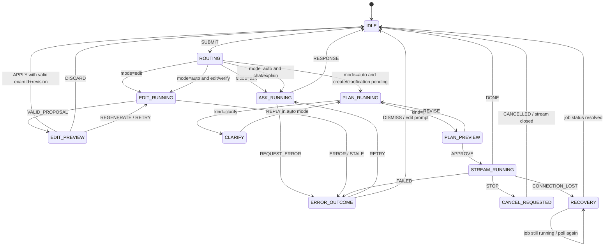
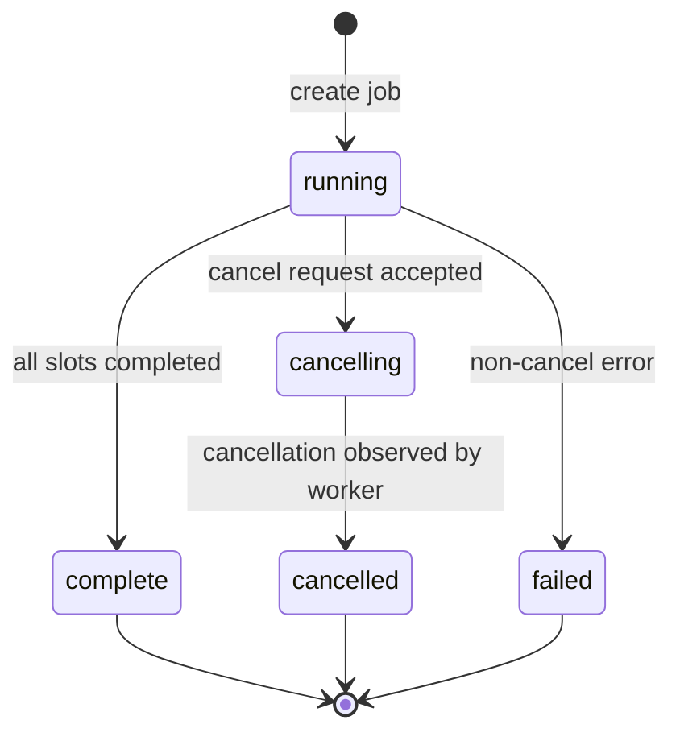

# Trợ lý AI và vòng đời Job

**Issue:** UI-3-001
**Work:** W01 – Mô hình trạng thái trợ lý
**Trạng thái:** Bản khảo sát / đề xuất để review
**Phạm vi khảo sát:** UI JavaScript và Node demo hiện có; chưa phải contract FastAPI đã được backend phê duyệt.

---

## 1. Mục tiêu

W01 mô tả luồng hỏi/sửa/tạo đề và các trạng thái cần phân biệt, làm cơ sở cho W02 (payload và contract) và W03 (fixture/mock).

W01 kế thừa hành vi UX đã ghi nhận trong `docs/CAI_THIEN_UX_CHAT.md` và `docs/CAI_THIEN_CHON_SUA_CHAT.md`; kế thừa nguyên tắc dữ liệu, revision, scope, job, idempotency và fixture trong `docs/course/CONTRACTS.md`. Không thiết kế lại demo D06/D07/D08/D09/D15 chỉ vì mô hình hóa lại state.

## 2. Source đã khảo sát

| File | Phần được khảo sát | Vai trò |
|---|---|---|
| `workbench.js` | `handleWorkbenchSubmit`, `planRequest`, `requestEdit`, `writePlan`, xử lý `stop-ai`, `apply-block-patch`, `watchJob` | Routing yêu cầu, trạng thái giao diện, proposal và streaming |
| `workbench-server.mjs` | Handler `/api/assistant/chat`, `/patch`, `/plan`, `/stream`, `/job`, `/cancel`; `retryValidated` | Hành vi API và vòng đời job trong Node demo |
| `subject-profiles.js` | `intentOf`, `makePlan` | Phân loại ý định và tạo kế hoạch theo quy tắc |
| `ai-providers.js` | `aiRequestError` | Chuyển đổi một số lỗi AI thành thông báo dễ hiểu |
| `tests/workbench.test.mjs` | Các test `makePlan` và quy tắc liên quan | Bằng chứng kiểm thử cho lập kế hoạch |
| `docs/course/CONTRACTS.md` | Các nguyên tắc version, scope, job, idempotency và fixture | Nguyên tắc contract cần kế thừa |

**Giới hạn:** Tên field, enum, payload và event trong Node demo chỉ được ghi nhận như implementation hiện tại. Không mặc định chúng là OpenAPI/DTO cuối cùng của FastAPI.

## 3. Phân biệt ASK, EDIT và AUTO

`handleWorkbenchSubmit()` đọc chế độ chat và phân loại như sau:

| Chế độ | Quy tắc | Luồng |
|---|---|---|
| `ask` | Ép intent thành `explain` | `/api/assistant/chat`; server được yêu cầu trả lời, không sửa tài liệu |
| `edit` | Ép intent thành `edit` | `/api/assistant/patch`; trả proposal để xem Diff và xác nhận |
| `auto` | Dùng `intentOf(text, context)` | Chọn chat, patch hoặc plan tùy intent |

`intentOf()` chuẩn hóa dấu/chữ thường rồi dùng regex để trả một trong các intent `explain`, `edit`, `create`, `verify`, `chat`. Đây là phân loại theo quy tắc từ khóa, không phải mô hình ngôn ngữ hoặc state machine.

Các nhánh đặc biệt:

- Nếu đã có `aiPlan` và người dùng xác nhận bằng câu đồng ý được nhận diện, handler gọi `writePlan()` trước bước phân loại thông thường.
- Trong `auto`, nếu đang có `aiClarification` hoặc intent là `create`, handler gọi `planRequest()`.
- Intent `verify` cũng đi vào `requestEdit()`, nhưng có chỉ dẫn giữ nguyên đề và phương án, chỉ cập nhật lời giải/barem/đáp án/hình khi cần.
- Khi `requestEdit()` thành công, hệ thống tạo proposal. Tài liệu chỉ thay đổi ở thao tác Apply sau khi kiểm tra proposal còn thuộc đúng `examId` và `revision`.

## 4. Assistant UI State Machine

### 4.1. Trạng thái quan sát được và trạng thái mô hình hóa

Source hiện dùng nhiều biến (`busy`, `stage`, `proposal`, `recovery`, `writeController`, `activeJobId`, `cancelRequested`, `watchedJob`) thay vì một enum state tập trung. Bảng dưới đây là mô hình khái niệm để mô tả hành vi, không phải tên enum đã tồn tại trong code.

| State khái niệm | Ý nghĩa | Căn cứ trong implementation |
|---|---|---|
| `IDLE` | Chờ yêu cầu; không bận | `busy === false` |
| `ROUTING` | Đọc mode và intent để chọn luồng | `handleWorkbenchSubmit()` |
| `ASK_RUNNING` | Đang chờ API chat | Nhánh `/api/assistant/chat`, `busy` và `stage` |
| `EDIT_RUNNING` | Đang tạo/validate patch | `requestEdit()` |
| `EDIT_PREVIEW` | Có proposal, chờ người dùng xem Diff / Apply / Discard | `proposal` và `showDiff()` |
| `PLAN_RUNNING` | Đang lập cấu trúc đề | `planRequest()` |
| `CLARIFY` | Cần người dùng bổ sung yêu cầu | `result.kind === 'clarify'`, `aiClarification` |
| `PLAN_PREVIEW` | Kế hoạch đề đã có, chờ xác nhận hoặc chỉnh | `aiPlan`, `planHTML()` |
| `STREAM_RUNNING` | Đang nhận các event sinh đề | `writePlan()`, `writeController`, `activeJobId` |
| `CANCEL_REQUESTED` | UI đã yêu cầu dừng job streaming | `stop-ai`, `cancelRequested`, API cancel |
| `RECOVERY` | Đang tra cứu/hiển thị kết quả job sau gián đoạn | `recovery`, `watchJob()` |
| `ERROR_OUTCOME` | Một thao tác thất bại và lỗi được thông báo | `catch`, `friendlyClientMessage()`, `aiRequestError()` |

`ERROR_OUTCOME` và `CANCEL_REQUESTED` là trạng thái mô hình hóa để mô tả giao tiếp. Source chưa dùng enum thống nhất cho toàn bộ luồng. Retry cũng nên được biểu diễn là **event/hành động** từ lỗi hoặc trạng thái có thể thử lại, không nhầm với một lần chạy thành công.

### 4.2. Sơ đồ luồng giao diện



**Cách đọc:** `ASK` không đi qua proposal/apply; `EDIT` phải đi qua preview và guard trước khi áp dụng; `CREATE` đi qua clarify hoặc plan confirmation trước streaming. `RETRY` là hành động quay lại luồng tương ứng sau lỗi, không phải bằng chứng retry mạng tự động đã có.

### 4.3. Bảng transition UI

| State hiện tại | Event | Guard / điều kiện | Action | State tiếp theo |
|---|---|---|---|---|
| `IDLE` | `SUBMIT` | Prompt không rỗng, không busy | Lưu prompt, đọc mode/context | `ROUTING` |
| `ROUTING` | `ASK` | Mode `ask`, hoặc intent auto là chat/explain | Gửi chat request | `ASK_RUNNING` |
| `ROUTING` | `EDIT` | Mode `edit`, hoặc intent auto là edit/verify | Tạo patch request với scope/snapshot | `EDIT_RUNNING` |
| `ROUTING` | `CREATE` | Auto và intent create hoặc clarification đang chờ | Gọi plan API | `PLAN_RUNNING` |
| `ASK_RUNNING` | `RESPONSE` | Response có message hợp lệ | Thêm tin nhắn assistant | `IDLE` |
| `ASK_RUNNING` | `REQUEST_ERROR` | Request thất bại | Báo lỗi, khôi phục prompt vào ô nhập | `ERROR_OUTCOME` rồi `IDLE` |
| `EDIT_RUNNING` | `VALID_PROPOSAL` | Validate thành công; exam ID/revision chưa đổi | Lưu proposal, cho xem Diff | `EDIT_PREVIEW` |
| `EDIT_RUNNING` | `STALE` / `ERROR` | Đề đổi hoặc patch không hợp lệ | Không áp dụng; báo lỗi | `ERROR_OUTCOME` |
| `EDIT_PREVIEW` | `APPLY` | `proposal.examId` và `proposal.revision` khớp đề hiện tại | Apply edits và ghi lịch sử | `IDLE` |
| `EDIT_PREVIEW` | `DISCARD` | Người dùng từ chối | Bỏ proposal | `IDLE` |
| `EDIT_PREVIEW` | `RETRY` | Người dùng yêu cầu đề xuất lại | Gửi patch mới theo scope/version hiện hành | `EDIT_RUNNING` |
| `PLAN_RUNNING` | `CLARIFY` | Server trả `kind: clarify` | Lưu `aiClarification`, hỏi bổ sung | `CLARIFY` |
| `PLAN_RUNNING` | `PLAN_READY` | Server trả `kind: plan` | Lưu và hiển thị `aiPlan` | `PLAN_PREVIEW` |
| `CLARIFY` | `REPLY` | Chế độ auto tiếp tục luồng tạo đề | Gửi request kèm pending clarification | `PLAN_RUNNING` |
| `PLAN_PREVIEW` | `APPROVE` | Người dùng xác nhận | Gọi `writePlan()` | `STREAM_RUNNING` |
| `PLAN_PREVIEW` | `REVISE` | Người dùng yêu cầu chỉnh cấu trúc | Gọi lại plan với yêu cầu mới | `PLAN_RUNNING` |
| `STREAM_RUNNING` | `DONE` | Nhận event hoàn tất | Nhận kết quả đề | `IDLE` |
| `STREAM_RUNNING` | `STOP` | Có controller/job ID tương ứng | Gửi cancel nếu có job ID, abort luồng phía client | `CANCEL_REQUESTED` |
| `CANCEL_REQUESTED` | `CANCELLED` | Kết quả hủy được xác nhận/xử lý | Giữ nội dung đề trước đó | `IDLE` |
| `STREAM_RUNNING` | `CONNECTION_LOST` | Luồng bị gián đoạn | Tra cứu job | `RECOVERY` |
| `RECOVERY` | `JOB_RESOLVED` | Đã đọc trạng thái job | Khôi phục hoặc thông báo kết quả | `IDLE` |
| `ERROR_OUTCOME` | `RETRY` | Lỗi có thể thử lại và prompt/scope còn hợp lệ | Gửi lại theo contract được duyệt | State chạy tương ứng |

**Lưu ý về cancel:** đoạn `stop-ai` đã khảo sát gắn với `writeController` và `activeJobId` của luồng sinh đề. Chưa thấy cơ chế hủy tương đương trong `requestEdit()`; không tuyên bố patch request cũng đã hỗ trợ cancel.

## 5. Backend Job State Machine (Node demo)

### 5.1. Trạng thái được tìm thấy

Trong handler `/api/assistant/stream` và `/api/assistant/cancel`, các giá trị thấy trong source là:

- `running`: job vừa được tạo và đang xử lý.
- `cancelling`: server đã nhận yêu cầu hủy khi job còn `running`.
- `complete`: toàn bộ slot đã được xử lý thành công.
- `cancelled`: xử lý bị kết thúc do cờ hủy.
- `failed`: xử lý kết thúc do lỗi khác.

`cancelling` là trạng thái trung gian. Đây là trạng thái job ở Node demo, chưa phải enum FastAPI được phê duyệt.

### 5.2. Sơ đồ vòng đời job



Server kiểm tra cờ hủy tại các điểm trong vòng lặp sinh slot và callback stage. Vì vậy, cancel không chứng minh nhà cung cấp AI đang chạy request bị ngắt tức thì. Cần kiểm thử race khi cancel đến sát thời điểm job chuyển `complete`.

### 5.3. API và SSE quan sát được

| Route | Method | Vai trò |
|---|---|---|
| `/api/assistant/plan` | POST | Lập kế hoạch / clarification |
| `/api/assistant/chat` | POST | Hỏi đáp không sửa tài liệu |
| `/api/assistant/patch` | POST | Tạo proposal sửa theo scope |
| `/api/assistant/stream` | POST | Tạo job và trả SSE |
| `/api/assistant/job` | GET | Tra cứu job |
| `/api/assistant/cancel` | POST | Yêu cầu hủy job |

Event SSE tìm thấy trong `/stream`:

| Event | Payload chính quan sát được |
|---|---|
| `job` | `id`, `credits` |
| `stage` | `text` |
| `block` | `question`, `index`, `total` |
| `done` | `id`, `questions`, `plan`, `credits`, `message` |
| `error` | `message`, `id` |

Server còn gửi heartbeat comment định kỳ; heartbeat không phải event nghiệp vụ. Tên `id` là tên field thấy trong Node demo; không tự đổi thành `jobId` trong contract mới khi chưa có xác nhận.

## 6. Retry, timeout và lỗi: phân biệt đúng

| Cơ chế | Điều đã thấy | Không được suy diễn thành |
|---|---|---|
| Server `retryValidated()` | Tối đa 3 lượt cho kết quả sinh/validate trong một số luồng | Retry mạng hoặc retry toàn job |
| Client `requestEdit()` | Tối đa 2 lượt gọi patch khi validateEdits từ chối kết quả | Nút retry của người dùng |
| `aiRequestError()` | Một số lỗi AI được bổ sung thông tin `/api/status` để hiển thị thông báo | Timeout hoặc retry request |
| `stop-ai` | Cancel job streaming qua API và abort phía client | Ngắt tức thì request model đang chạy |
| Phục hồi prompt | Lỗi submit khôi phục prompt để người dùng có thể gửi lại | Idempotency chống gửi trùng |

Trong API helper được khảo sát, chưa thấy timeout tổng quát hoặc `requestId` được truyền trong payload. Lỗi `fetch`/parse JSON cũng cần được kiểm thử riêng; không mặc định mọi lỗi đều qua `aiRequestError()`.

## 7. Bất biến cần giữ và câu hỏi bàn giao

Kế thừa `docs/course/CONTRACTS.md`:

- Mỗi proposal/job phải gắn đúng owner, exam ID và revision gốc.
- Sửa không được vượt ngoài danh sách scope đã cho phép.
- Kết quả của job/version cũ không được áp dụng lên tài liệu mới.
- Cancel không được để output đến muộn ghi đè nội dung.
- Fixture phải phân biệt rõ với kết quả model thật.
- Enum job phải nhất quán giữa UI, API và DB.

Các câu hỏi cần BE-1/BE-2/BE-5 thống nhất trong W02:

1. Enum job chính thức có những giá trị nào? `cancelling` có được giữ là trạng thái công khai không?
2. Payload chuẩn phân biệt `requestId`, `jobId`, `examId`, `baseRevision` và revision kết quả ra sao?
3. Retry khi mất kết nối dùng lại requestId trong trường hợp nào; deliberate retry có tạo requestId mới không?
4. SSE có sequence/cursor để deduplicate và resume không? Thứ tự event được đảm bảo thế nào?
5. Quy tắc xử lý race giữa cancel và complete là gì? Khi nào server xác nhận cancel có hiệu lực?
6. Timeout request và timeout toàn job được quy định riêng ra sao?
7. Patch có hỗ trợ cancel không? Nếu có, kết quả đến muộn bị vô hiệu hóa bằng guard nào?
8. Các lỗi nào retryable, lỗi nào phải yêu cầu người dùng sửa prompt/scope?

## 8. Ca kiểm tra cần thực hiện

Các ca sau là yêu cầu kiểm thử, **không phải kết quả đã chạy hoặc đã nghiệm thu**:

| Test | Kịch bản | Kết quả cần chứng minh |
|---|---|---|
| T01 | Hỏi rồi yêu cầu đề xuất sửa | ASK không sửa đề; EDIT tạo proposal; tài liệu chỉ đổi sau xác nhận |
| T02 | Fixture trả kết quả theo revision cũ | UI đánh dấu stale; không Apply; yêu cầu tạo proposal mới |
| T03 | Hủy sát event cuối rồi gửi lại prompt | Không áp dụng output muộn và không tạo nội dung trùng |
| T04 | Stream disconnect khi job còn running | Tra cứu đúng job; không tự tạo job mới ngoài quy tắc idempotency |
| T05 | Cancel và complete đến sát nhau | Một kết quả cuối có thẩm quyền; không vừa báo cancelled vừa áp output complete |
| T06 | Patch lỗi validation / lỗi mạng | Phân biệt retry validation với retry request; giữ prompt và scope an toàn |

## 9. Tình trạng kiểm thử baseline ghi nhận trong phiên làm việc

- `node tests/selection-browser.mjs`: đã chạy; các dòng PASS được hiển thị trong phiên làm việc.
- `node tests/workbench-browser.mjs`: đã chạy; các dòng PASS được hiển thị trong phiên làm việc.
- `node tests/usability-browser.mjs`: **FAIL** tại kiểm tra `auto-update-answers` (assertion mong `autoUpdate === true`, nhận `false`). Nguyên nhân chưa được xác minh; giả thuyết race khi lưu bất đồng bộ chưa được chứng minh.
- Môi trường hiện tại dùng Node 26.13.1, khác môi trường baseline nhóm ghi nhận Node 24.22.1. Cần tái kiểm trên Node 24 trước khi kết luận lỗi thuộc source hay môi trường.

Không đánh dấu các test T01–T06 là PASS khi chưa có fixture/log tương ứng.

## 10. Điều kiện hoàn thành W01

- [ ] Reviewer xác nhận sơ đồ ASK/EDIT/CREATE phản ánh đúng source hiện tại.
- [ ] Reviewer xác nhận đã tách Assistant UI State và Backend Job State.
- [ ] Chốt danh sách câu hỏi/điểm chưa rõ để chuyển sang W02 với BE-1/BE-2/BE-5.
- [ ] Tài liệu được đưa vào repository và liên kết trong issue UI-3-001.

W01 không bao gồm viết lại `workbench.js`, thay đổi migration/database hoặc tuyên bố contract FastAPI đã được duyệt.

## Đối chiếu bản tích hợp FastAPI

Chrome kiểm luồng sửa vùng trên FastAPI với fixture. App hiển thị đề xuất trước xác nhận, giữ phần ngoài vùng, hỗ trợ bỏ và hoàn tác, từ chối bản đã cũ. Nút **Dừng chờ đề xuất** hủy yêu cầu ở trình duyệt, giữ lại câu đã nhập và bỏ phản hồi đến muộn. Route sửa vùng trả một phản hồi HTTP. Khi Uvicorn nhận ngắt kết nối từ trình duyệt, FastAPI hủy lượt đợi model và nhả khóa xử lý. Đã thử qua kết nối TCP với model giả lập đang chờ: hủy giải phóng lượt và lần gửi tiếp theo trả đề xuất, nội dung đề giữ nguyên. Nhà cung cấp bên ngoài có thể tiếp tục xử lý yêu cầu đã nhận. Luồng sinh theo ma trận có job, event và API hủy riêng; kiểm hồi quy nằm trong backend.

---

# Mở rộng Thiết kế W02–W05 & Kịch bản T01–T03 (`UI-3-001`)

> **Bảo toàn W01:** Toàn bộ phần `W01` ở trên (của `PhuQuang0307`) và mục đối chiếu kèm theo được giữ nguyên vẹn làm cơ sở. Các mục từ `W02` đến `W05` và `T01`–`T03` dưới đây bổ sung đặc tả dựa trên kiểm chứng trực tiếp mã nguồn Python FastAPI và UI JavaScript hiện có.
>
> **Quy ước nhãn trạng thái:**
> - `[Hiện có / Đã chạy bằng Python]`: route, schema, mã lỗi và hành vi đã đọc trực tiếp trong `backend/src/mach_backend/` và UI JS tương ứng.
> - `[Fixture / Mock]`: kịch bản, script giả lập và dữ liệu tổng hợp dùng để kiểm thử cơ chế không cần AI thật; **tuyệt đối không coi là số đo chất lượng AI thật hoặc kết luận sư phạm**.
> - `[Chờ review nhóm / Thành viên xác nhận]`: điểm còn lệch giữa nhánh route hoặc hạng mục cần chốt ở `W05` (`keyboard`/`mobile`/`SSE`).

---

## 11. `W02` — Bảng Payload, Event & Error UI dùng thật (`scope`, `baseVersion`, `jobId`, `proposal`, `stale`, `out_of_scope`, `cancel`)

### 11.1. Hai nhánh tích hợp FastAPI hiện hữu trong repo

Khi đối chiếu trực tiếp mã nguồn backend, hệ thống Python đang có hai nhóm route cùng phục vụ trợ lý AI (chưa hợp nhất hết vào `mach_backend.main:app`, vốn mới có `/api/health` và `/api/readiness` trả `503`):

1. **Nhánh contract router chuẩn hóa (`[Hiện có / Đã chạy bằng Python]` trong module AI, chờ nối auth/repo thật toàn app):** [`ai_routes.py`](../../backend/src/mach_backend/ai_routes.py) (`build_ai_router`), [`patch_routes.py`](../../backend/src/mach_backend/patch_routes.py), [`patch_jobs.py`](../../backend/src/mach_backend/patch_jobs.py), [`patch_submission.py`](../../backend/src/mach_backend/patch_submission.py), [`generation_submission.py`](../../backend/src/mach_backend/generation_submission.py), [`patch_confirmation.py`](../../backend/src/mach_backend/patch_confirmation.py), [`check_routes.py`](../../backend/src/mach_backend/check_routes.py). Trong [`local_workspace.py#L818-L819`](../../backend/src/mach_backend/local_workspace.py#L818-L819), router sinh (`build_generation_router`) và router theo dõi job (`build_patch_job_router`, gắn `no_patch` cho nhánh tạo patch job mới) đã được mount, còn xác nhận sinh dùng endpoint `/confirm` riêng tại dòng `896`.
2. **Nhánh đang nối trực tiếp UI hiện tại (`[Hiện có / Đã chạy bằng Python]` trên bàn soạn local/team):** [`local_workspace.py`](../../backend/src/mach_backend/local_workspace.py), [`poc_scoped_patch.py`](../../backend/src/mach_backend/poc_scoped_patch.py), [`workspace_agent.py`](../../backend/src/mach_backend/workspace_agent.py) nối trực tiếp với [`workbench.js`](../../workbench.js), [`blocks.js`](../../blocks.js), [`matrix-chat.js`](../../matrix-chat.js) và [`matrix-synthesis.js`](../../matrix-synthesis.js).

### 11.2. Bảng Payload dùng thật cho `scope`, `baseVersion`, `jobId`, `proposal`, `cancel`

> **Ánh xạ thuật ngữ `baseVersion`:** Trong contract Python ([`ai_contract.py`](../../backend/src/mach_backend/ai_contract.py), [`patch_submission.py`](../../backend/src/mach_backend/patch_submission.py), [`poc_scoped_patch.py`](../../backend/src/mach_backend/poc_scoped_patch.py)), khái niệm `baseVersion` được tách rõ thành **`baseRevision`** (phiên bản cấp đề `int >= 1`, hoặc `exam.revision`) và **`questionVersion`** (phiên bản cấp câu `q.v >= 1`, hoặc `scopes[].version`), kèm **`sourceVersion`** ở cấp đoạn nguồn. UI không gộp các số phiên bản này thành một field chung.

| Khái niệm W02 | Nguồn code thật | Route & Method | Payload Request / Response dùng thật |
|---|---|---|---|
| **Hỏi đáp không sửa (`ASK`)** | [`workbench.js#L82`](../../workbench.js#L82), [`local_workspace.py#L582`](../../backend/src/mach_backend/local_workspace.py#L582) | `POST /api/assistant/chat` | **Req (`ChatSubmission`):** `{text: str(1..4000), context: list[JsonValue](<=20, <=20000 ký tự JSON), consent: bool}` *(UI gửi thêm `effort`, Pydantic mặc định bỏ qua hoặc từ chối tùy model)*<br>**Res (`200`):** `{message: str(1..5000), credits: {balance: 1000}}` |
| **`scope` & Đề xuất sửa vùng (luồng UI hiện tại)** | [`workbench.js#L52`](../../workbench.js#L52), [`poc_scoped_patch.py#L43-L71`](../../backend/src/mach_backend/poc_scoped_patch.py#L43-L71) | `POST /api/assistant/patch`<br>*(header `X-PoC-Config: <fingerprint>`)* | **Req (`Submission`, `extra="forbid"`):** `{exam: {id: str, revision: int>=1}, scopes: [Scope (1..12)], request: str(1..12000), consent: bool, effort: int=1}`.<br>Mỗi `Scope`: `{id, version (>=1), field ("stem"\|"options"\|"answer"\|"answerText"\|"truthValues"\|"explanation"\|"rubric"), allowFields, blockId, wholeField: bool, start: int>=0, end: int>=0, text: str, index: int(0..79)\|null, permission: "edit"\|"verify"}` *(tối đa `4` câu khác nhau/lượt PoC)*<br>**Res (`200`):** `{edits: [{blockId, op: "replace", content}], message, confirmationId: UUID \| null, checks: [str x 3], credits: {balance: 1000}}` |
| **Xác nhận / Bỏ sửa vùng (luồng UI hiện tại)** | [`workbench.js#L55-L64`](../../workbench.js#L55-L64), [`poc_scoped_patch.py#L479-L491`](../../backend/src/mach_backend/poc_scoped_patch.py#L479-L491) | `POST /api/exams/{exam_id}/edits/{proposal_id}/confirm`<br>`POST /api/exams/{exam_id}/edits/{proposal_id}/discard` | **Confirm Req:** `{}` *(snapshot gốc đã được hash SHA-256 ở `scoped-patch:<proposal_id>`)*<br>**Confirm Res (`200`):** `{examId: str, revision: int}`<br>**Discard Res (`200`):** `{"discarded": true}` |
| **`scope` & `baseVersion` sửa lời giải (`ai_routes.py` chuẩn)** | [`patch_submission.py#L28-L40`](../../backend/src/mach_backend/patch_submission.py#L28-L40), [`patch_routes.py#L68-L86`](../../backend/src/mach_backend/patch_routes.py#L68-L86) | `POST /api/exams/{exam_id}/proposals` | **Req (`PatchSubmission`):** `{requestId: UUID, baseRevision: int>=1, request: str(1..4000), consent: bool, requireEvidence: bool, sources: [{sourceId: UUID, sourceVersion: int>=1, locator: {kind: "page"\|"passage"\|"region", index: int>=1, regionId?}}], targets: [{questionId: UUID, questionVersion: int>=1, blockId: UUID, selection: [int>=0, int>=0] \| null}]}` *(tối đa `12` khối/nguồn)*<br>**Res (`202`):** `PatchJobStatus` |
| **Lập cấu trúc & duyệt ma trận trước sinh** | [`matrix-chat.js#L53-L58`](../../matrix-chat.js#L53-L58), [`matrix-synthesis.js#L186`](../../matrix-synthesis.js#L186), [`local_workspace.py#L568,L706`](../../backend/src/mach_backend/local_workspace.py#L568) | `POST /api/ai/exam-plan`<br>`POST /api/exams/{exam_id}/matrix/approve` | **`exam-plan` (`PlanRequest`):** `{request, subject, grade(1..12), term, count(1..30\|null), minutes(5..300\|null), types, consent}`<br>**`matrix/approve` (`Approval`):** `{baseRevision: int>=1, sourceText(<=12000), sourceName(1..200), sourceMode: "provided"\|"general"}` → `{baseRevision, plan, sources}` |
| **`jobId` & Tạo tác vụ Sinh theo ma trận** | [`matrix-synthesis.js#L189`](../../matrix-synthesis.js#L189), [`generation_submission.py#L13-L17`](../../backend/src/mach_backend/generation_submission.py#L13-L17), [`patch_routes.py#L137-L155`](../../backend/src/mach_backend/patch_routes.py#L137-L155) | `POST /api/exams/{exam_id}/proposals/generate`<br>*(header `X-PoC-Config` ở `local_workspace.py`)* | **Req (`GenerationSubmission`):** `{requestId: UUID, baseRevision: int>=1, consent: bool, requireEvidence: bool, plan: {subject, grade, instructions, slots: [{type, topic, level(0..3), pointsQ4(1..40)}]}, sources: [...]}`<br>**Res (`202`):** `PatchJobStatus` chứa `jobId` do Python cấp phát |
| **`jobId` & `proposal` trong trạng thái Job** | [`patch_jobs.py#L24-L28`](../../backend/src/mach_backend/patch_jobs.py#L24-L28), [`local_workspace.py#L794-L816`](../../backend/src/mach_backend/local_workspace.py#L794-L816) | `GET /api/exams/{exam_id}/proposals/{job_id}/status`<br>`GET /api/exams/{exam_id}/proposals/latest` | **Status (`PatchJobStatus`):** `{jobId: UUID, examId: UUID, baseRevision: int>=1, sequence: 1\|2, status: "running"\|"complete"\|"cancelled"\|"failed", proposal: PatchProposal \| GenerateProposal \| null, errorCode: str \| null}`.<br>Khi đọc từ DB qua `local_workspace.py` có thể kèm `saved: bool`; `/latest` trả thêm `discarded: bool`, `reviews: dict`, `input: {sourceText, sourceName, approval}`. |
| **Xác nhận / Rà / Bỏ `proposal` Sinh** | [`matrix-synthesis.js#L132,L201`](../../matrix-synthesis.js#L132), [`local_workspace.py#L853-L909`](../../backend/src/mach_backend/local_workspace.py#L853-L909), [`patch_routes.py#L37-L57`](../../backend/src/mach_backend/patch_routes.py#L37-L57) | `POST .../proposals/{job_id}/review`<br>`POST .../proposals/{job_id}/confirm`<br>`POST .../proposals/{job_id}/discard` | **`confirm` Req:** `{baseRevision: int>=1}` (`patch_routes.py`), riêng `local_workspace.py` khi `agent_mode=True` bắt buộc thêm `teacherConfirmation: true`.<br>**`confirm` Res (`PatchReceipt`):** `{jobId: UUID, examId: UUID, baseRevision: int, revision: int, changedQuestionIds: [UUID]}` |
| **`cancel` & Ngắt kết nối** | [`patch_jobs.py#L118-L125`](../../backend/src/mach_backend/patch_jobs.py#L118-L125), [`matrix-synthesis.js#L92`](../../matrix-synthesis.js#L92), [`poc_scoped_patch.py#L493-L509`](../../backend/src/mach_backend/poc_scoped_patch.py#L493-L509) | `POST /api/exams/{exam_id}/proposals/{job_id}/cancel`<br>Hoặc `AbortController.abort()` ở `POST /api/assistant/patch` | **`cancel` Req:** `{}` → **Res (`200`):** `PatchJobStatus` với `sequence: 2`, `status: "cancelled"` (hoặc `"complete"` nếu `run.publishing` đã commit bản xem trước trước khi lệnh hủy tới nơi).<br>Ở `/api/assistant/patch`, khi trình duyệt abort kết nối TCP, server nhận `http.disconnect`, hủy `asyncio.Task` đợi model, nhả `chat_lock` và trả `499`. |

### 11.3. Event SSE, Polling/Trace & Sự khác biệt cần lưu ý

1. **Event SSE trong `patch_routes.py` (`GET /api/exams/{exam_id}/proposals/{job_id}/events`):**
   - Header hỗ trợ nối lại: `Last-Event-ID` (`after: int` thuộc `0..2`).
   - Định dạng khung SSE:
     - `id: 1` / `event: patch` / `data: {"jobId":...,"examId":...,"baseRevision":...,"sequence":1,"status":"running","proposal":null,"errorCode":null}`
     - `id: 2` / `event: patch` / `data: {"jobId":...,"examId":...,"baseRevision":...,"sequence":2,"status":"complete"|"cancelled"|"failed","proposal":...,"errorCode":...}`
   - `PatchJobRunner` giữ tối đa 2 sequence (`1`: đang chạy; `2`: trạng thái kết thúc) với `Cache-Control: no-store`, `X-Accel-Buffering: no`.
2. **Polling & Trace đang chạy trên UI `matrix-synthesis.js` (`[Hiện có / Đã chạy bằng Python]`):**
   - Trên màn hình **Soạn theo ma trận**, `matrix-synthesis.js#L140-L152` hiện gọi lặp `1000ms` tới `GET .../status` và `GET .../trace` (hiển thị các event trace: `run_start`, `provider_model_switch`, `provider_key_switch`, `provider_retry`, `model_start`, `model_end`, `model_call_start`, `model_call_end`, `tool_call`, `structure_check`, `blind_content_check`, `level_recheck`, `candidate_check`, `generation_result`, `run_end`), sau đó lấy `GET .../report` và `GET .../audit`.
   - **`[Chờ review nhóm / Thành viên xác nhận]`:** `matrix-synthesis.js` hiện **chưa** tiêu thụ trực tiếp luồng SSE `GET .../events` của `patch_routes.py`, và **chưa** gọi các route legacy `/api/assistant/stream` hay `/api/assistant/job` (được xác nhận qua assert `legacyJobRequests: []` trong [`scripts/kiem-ui-matrix-chat.mjs#L26,L120`](../../scripts/kiem-ui-matrix-chat.mjs#L26)). Việc chuyển hoặc kết hợp SSE `/events` thay polling 1000ms cần chốt cùng `BE-5`.

### 11.4. Bảng mã lỗi chuẩn dùng thật cho UI (`stale`, `out_of_scope`, `cancel`, thiếu nguồn, lỗi hệ thống)

> **Lưu ý format lỗi HTTP FastAPI:** Route gắn qua `AIError` exception handler trong `local_workspace.py` trả `{"error": str, "code": str}`; các router dùng `HTTPException` trong `patch_routes.py` / `check_routes.py` trả `{"detail": {"code": str, "message": str}}`. Do đó `matrix-synthesis.js#L11` đọc cả `result.error || result.detail?.message` và `workbench.js` nên chuẩn hóa đọc được cả 2 envelope này.

| Nhóm lỗi thiết kế | Mã lỗi thật (`code` / `errorCode`) | HTTP Status | Nguồn phát sinh | Hành vi & thông báo UI dùng thật |
|---|---|---|---|---|
| **`stale` (Dữ liệu / cấu hình cũ)** | `stale_snapshot`<br>`config_changed`<br>`workspace_context_changed` | `409` | `poc_scoped_patch.py`, `patch_confirmation.py`, `patch_submission.py`, `local_workspace.py`, `team_workspace.py` | - `matrix-synthesis.js`: khóa `#matrix-confirm-save`, `#matrix-review-summary` báo `'Đề đã thay đổi. Giữ bản vừa sửa và tạo lượt sinh mới trước khi chấp nhận.'`, hoặc `errorNames.stale_snapshot` `'Đề hoặc nguồn đã thay đổi'`.<br>- `workbench.js`: không áp dụng proposal, `showDiff()` / `confirmOnServer()` báo `'Nội dung đã đổi. Hãy yêu cầu một đề xuất mới.'` / `'Chưa đồng bộ đề xuất sửa...'`.<br>- `config_changed`: yêu cầu mở lại bảng gửi để xác nhận cấu hình AI mới. |
| **`out_of_scope` (Quá vùng / sai phạm vi / xung đột cấu trúc)** | `invalid_scope`<br>`unsupported_scope`<br>`scope_limit`<br>`rich_document_conflict` | `409` (hoặc `422` ở `patch_routes`) | `poc_scoped_patch.py`, `ai_contract.py`, `rich_patch.py`, `blocks.js` | - Từ chối đề xuất thay chữ ngoài vùng bôi đen (`keep_outside`), chạm câu ngoài chọn, lặp `blockId`, sửa chéo ô bảng (`rich_document_conflict`), chọn sai dạng câu (`unsupported_scope`), hoặc vượt quá `4` câu PoC (`scope_limit`).<br>- Giữ nguyên đề, giữ nguyên prompt và yêu cầu chọn lại phạm vi hợp lệ. |
| **`cancel` (Người dùng hủy / ngắt kết nối)** | `cancelled` *(status trong `PatchJobStatus`)*<br>HTTP `499` *(client disconnect trên `/api/assistant/patch`)* | `200` (API cancel) / `499` (disconnect) | `patch_jobs.py`, `workspace_agent.py`, `poc_scoped_patch.py` | - **Sửa vùng (`stop-ai`):** abort fetch, ASGI hủy task đợi model & nhả `chat_lock`; UI giữ nguyên nội dung prompt trong `#chat-input` và bỏ qua phản hồi muộn.<br>- **Sinh ma trận (`#matrix-composer-stop` / `#matrix-stop`):** gọi `POST .../cancel`; nếu hủy thắng trước khi ghi preview, `status === "cancelled"`, giữ nguyên đề, hiện `#matrix-retry`. |
| **Thiếu nguồn / Quá giới hạn nguồn / Sai trích dẫn** | `missing_source`, `source_limit`, `source_not_found`, `forbidden_source`, `missing_evidence`, `invalid_evidence`, `unsupported_answer` | `404` / `409` / `422` | `ai_contract.py`, `ai_sources.py`, `local_workspace.py`, `poc_scoped_patch.py`, `matrix_agent.py` | - `matrix/approve` chặn nguồn < 20 ký tự (`missing_source`).<br>- `poc_scoped_patch.py` chặn tổng nguồn > `12.000` ký tự (`source_limit`); `ai_contract.py` chặn > `50.000` ký tự và > `12` đoạn nguồn.<br>- `unsupported_answer`: `errorNames` báo `'Chưa đủ căn cứ'`; không cho xác nhận kết quả tự luận/trắc nghiệm thiếu trích dẫn khớp nguồn khi `requireEvidence=true`. |
| **Chưa đồng ý / Chưa duyệt ma trận / Đề khóa** | `consent_required`, `plan_not_approved`, `exam_read_only`, `needs_review`, `proposal_discarded`, `proposal_not_found` | `400` / `403` / `404` / `409` | `ai_sources.py`, `generation_submission.py`, `local_workspace.py`, `workspace_store.py` | - Thiếu consent: hiển thị nút `Cho phép và gửi` (`chat-consent-send`) trong `workbench.js` (giữ nguyên prompt), hoặc chặn ngay trước gọi API ở `matrix-synthesis.js`.<br>- `needs_review`: chặn `/confirm` khi còn câu có nhận xét chưa xử lý (`#matrix-confirm-save` bị disable). |
| **Tranh chấp slot, trùng `requestId`, validation & provider** | `job_limit`, `job_conflict`, `call_budget`, `timeout`, `provider_timeout`, `provider_unavailable`, `provider_auth`, `provider_quota`, `incomplete_response`, `invalid_math`, `invalid_result`, `invalid_plan`, `invalid_options`, `invalid_answer`, `invalid_rubric`, `answer_disagreement`, `explanation_disagreement`, `level_disagreement`, `semantic_duplicate` | `409` / `422` / `429` / `502` / `503` / `504` | `patch_jobs.py`, `poc_policy.py`, `gemini_model.py`, `ai_service.py`, `matrix_agent.py`, `ai_questions.py` | - `job_limit`: tối đa `1` job chạy đồng thời trên runner + khóa `chat_lock` (`409` ở `local_workspace.py` / `429` ở `patch_routes.py`).<br>- `job_conflict`: dùng lại `requestId` với nội dung khác hoặc chéo giữa Sinh và Sửa.<br>- `matrix-synthesis.js:errorNames` dịch đầy đủ toàn bộ mã lỗi sang thông báo tiếng Việt, giữ nguyên đề và mở nút `#matrix-retry` (`Xem yêu cầu và thử lại`). |

---

## 12. `W03` — Danh mục kịch bản Mock / Fixture (`[Fixture / Mock]` tách biệt hoàn toàn khỏi Model thật)

> **Ranh giới bắt buộc:** Toàn bộ fixture dưới đây dùng dữ liệu tổng hợp (`synthetic`) và phản hồi soạn sẵn (`FixtureCase`, `AgentModelFixture`, `MockTransport`) với cờ `MACH_MODEL=GIA_LAP_KIEM_CO_CHE` (`"fixture": true` trong `/api/status`). Chúng chứng minh cơ chế kiểm soát phạm vi, phiên bản, đồng thời và xử lý lỗi của UI/Python; **không dùng làm số đo độ chính xác AI thật hay đánh giá sư phạm**.

### 12.1. Kiểm kê các tệp trong `tests/fixtures/`

| Tệp trong `tests/fixtures/` | Phạm vi & nội dung thực tế | Vai trò đối với `UI-3-001` |
|---|---|---|
| [`tests/fixtures/ai-math-structure.json`](../../tests/fixtures/ai-math-structure.json) | `17` mẫu LaTeX (`7` hợp lệ `accepted: true`, `10` lỗi cấu trúc `accepted: false` như thiếu đóng ngoặc, lồng sai `\begin{cases}...\end{matrix}`, `\verb\|{` chưa đóng) | Fixture kiểm chứng chéo `validate_ai_text` (Python) và KaTeX renderer (UI) trước khi hiển thị/xác nhận proposal |
| [`tests/fixtures/ai-patch-local.json`](../../tests/fixtures/ai-patch-local.json) | 1 khối mẫu (`questionId: 5907b3d3-...`, `blockId: d274a7ce-...`, `text: "🔎 Giữ $x^2$. Câu cũ. Kết luận giữ nguyên."`, `selectionText: "Câu cũ."`) + `3` case (`giu-ngoai-vung` hợp lệ; `doi-tien-to` và `doi-hau-to` bị từ chối) | Fixture chuẩn kiểm tra bất biến `keep_outside` UTF-16 & `invalid_scope` giữa Node và Python (`test_ai_patch.py`) |
| [`tests/fixtures/ai-sinh-kiem.json`](../../tests/fixtures/ai-sinh-kiem.json) | Nguồn mẫu (`sourceId: d9ce320a-...`, `sourceVersion: 3`, `quote: "kết quả bằng 3"`) + `4` câu đủ 4 dạng (`mcq`, `truefalse`, `short`, `essay`, `pointsQ4: 10`) | Fixture hợp đồng Sinh & Kiểm 4 dạng câu cho UI xem trước (`pointsQ4 / 4`) và trích dẫn nguồn |
| [`tests/fixtures/be3-legacy-kv.json`](../../tests/fixtures/be3-legacy-kv.json) | `21` bản ghi SQLite KV sạch (đủ `12` prefix) + `2` bản ghi hỏng của `BE-3-001` | Fixture di trú lưu trữ `BE-3`; không phải AI fixture |
| [`tests/fixtures/ui2-editor-golden.json`](../../tests/fixtures/ui2-editor-golden.json) | Golden fixture `multiSubjectExam`, `longPaginatedExam`, `duplicateFormulaDoc`, `crossTableTextEdit` của `UI-2-001` | Dùng phối hợp kiểm bảo toàn `richDoc`, `mathInline` trùng và từ chối sửa cắt ngang ô bảng khi áp proposal |

### 12.2. Danh mục kịch bản Mock / Fixture theo 5 nhóm `W03` `[Fixture / Mock]`

Các kịch bản dưới đây chạy được độc lập trên máy qua [`scripts/chay-fixture-poc.py`](../../scripts/chay-fixture-poc.py) (`CASES`: `repair`, `missing_question`, `multiple_correct`, `unsupported`, `unknown`, `wrong_level`, `duplicate`, `budget`, `cancel`), các suite `pytest` trong `backend/tests/` và bộ Chrome Playwright trong `scripts/kiem-ui-*.mjs`:

| Nhóm W03 | Tên kịch bản & nguồn `[Fixture / Mock]` | Điều kiện mô phỏng | Kết quả hệ thống & UI phải chứng minh |
|---|---|---|---|
| **1. Thành công** | - `repair` (`scripts/chay-fixture-poc.py --case repair`)<br>- `giu-ngoai-vung` (`tests/fixtures/ai-patch-local.json`, `scripts/kiem-ui-de-xuat-sua.mjs`)<br>- `purpose == "chat"` (`FixtureCase`) | - Sinh đề: vòng 1 giả lập lệch đáp án (`answer=1`), vòng 2 tự sửa khớp (`answer=0`).<br>- Sửa vùng: giữ nguyên tiền tố/hậu tố hoặc công thức ngoài đoạn bôi đen.<br>- Chế độ `ask`: trả lời JSON `{message}`. | - Vòng 1 bị chặn bởi `check_exam`, vòng 2 đạt `10/10` phép kiểm (`PASS`), trả preview nhưng **không ghi vào đề** cho tới khi bấm `✓ Chấp nhận`.<br>- Sửa vùng cho xem Diff xanh/đỏ, xác nhận tăng `revision`/`q.v` 1 lần, giữ công thức/ô bảng ngoài vùng, có nút `undo-ai`.<br>- Chế độ `ask` không làm thay đổi bất kỳ câu nào. |
| **2. Thiếu nguồn / Thiếu căn cứ** | - `unsupported` (`scripts/chay-fixture-poc.py --case unsupported`)<br>- `missing_source` / `source_limit` (`ai_contract.py`, `poc_scoped_patch.py`, `test_workspace_check.py`) | - `FixtureCase(case="unsupported")` bỏ trống `evidence` ở `question_check` và trả `supported: false` ở `blind_content_check`.<br>- Hoặc gửi nguồn `< 20` ký tự tới `/matrix/approve` hoặc tổng nguồn `> 12.000` ký tự PoC (`> 50.000` ký tự `ai_contract.py`). | - Lỗi `unsupported_answer` / `missing_evidence` / `missing_source` / `source_limit` được báo rõ ràng.<br>- Không tự gán trạng thái đã duyệt, không lưu proposal thiếu căn cứ vào đề. |
| **3. Quá vùng / Sai phạm vi** | - `doi-tien-to`, `doi-hau-to` (`tests/fixtures/ai-patch-local.json`)<br>- `test_blocks_unselected_question_and_partial_text_escape`, `test_editor_change_cannot_merge_distinct_table_cells` (`test_poc_scoped_patch.py`) | - Model fixture trả edit làm thay đổi ký tự ngoài đoạn `selection`, hoặc đổi `blockId` của câu khác, hoặc thay text gộp 2 ô bảng, hoặc sửa > `4` câu (`scope_limit`), hoặc chế độ `verify` cố sửa `stem`/`options`. | - `validate_draft` / `validate_proposal` / `update_rich` từ chối với `invalid_scope` / `scope_limit` / `rich_document_conflict` (`409` / `422`).<br>- Toàn bộ nội dung đề gốc giữ nguyên không bị ghi nửa vời. |
| **4. Stale (phiên bản cũ)** | - `test_conflict_after_preview_keeps_updated_exam` (`test_local_workspace.py`)<br>- `test_scoped_confirmation_rejects_change_without_version_bump` (`test_poc_scoped_patch.py`)<br>- Ca đổi tiêu đề / ghi từ tab khác trong `kiem-ui-matrix-chat.mjs` & `kiem-ui-de-xuat-sua.mjs` | - Sau khi nhận `proposal` ở `revision=1` (hoặc `q.v=1`), cập nhật đề lên `revision=2` qua `PUT /api/kv` hoặc đổi trực tiếp trên `.header-title`.<br>- Hoặc gửi `POST .../confirm` với `baseRevision=1`. | - Trên UI ma trận: `#matrix-confirm-save` tự động disable và `#matrix-review-summary` hiện `'Đề đã thay đổi...'`.<br>- Phía Python trả HTTP `409` `stale_snapshot`; dữ liệu mới hơn trên server được giữ nguyên; không hiện nút `undo-ai`. |
| **5. Stream đứt / Mất kết nối / Hủy** | - Rớt `/status` và `/audit` trong `scripts/kiem-ui-matrix-chat.mjs#L38-L65`<br>- `cancel` (`chay-fixture-poc.py --case cancel`, `kiem-ui-chat-context.mjs#L31-L32`)<br>- `test_disconnecting_patch_cancels_the_model_and_releases_workspace` (`test_poc_scoped_patch.py`)<br>- `test_combined_routes_share_one_model_slot_and_confirm` (`test_ai_routes.py`)<br>- `budget` (`chay-fixture-poc.py --case budget`) | - Playwright `route.abort('failed')` chặn `/status` và `/audit` của job đang chạy.<br>- Bấm `#matrix-composer-stop` khi `FixtureCase` đang `asyncio.sleep(2)`.<br>- Ngắt kết nối ASGI `http.disconnect` khi `POST /api/assistant/patch` đang đợi model.<br>- Hoặc test `PatchJobRunner.events(..., after=1)` / race `cancel` vs `publish`. | - Đứt `/status` hoặc `/audit`: không tạo job mới (`generations` vẫn = `1`), hiện nút `#matrix-poll-retry` (`Tải lại trạng thái`) giữ nguyên `jobId` và hồi phục preview.<br>- Hủy ma trận: `#matrix-composer-stop` gọi `POST .../cancel`, giữ nguyên nháp gõ dở trong `#chat-input`, đề không đổi, trả lại nút Gửi.<br>- Hủy patch (`499` / `stop-ai`): nhả `chat_lock`, giữ prompt, bỏ phản hồi muộn.<br>- `budget` hết lượt gọi trả `failed` với `errorCode: "call_budget"`, giữ nguyên đề. |

---

## 13. `W04` — Bố cục vùng ngữ cảnh, Diff, Xác nhận/Hủy, Giữ Prompt & Vùng đọc tin cũ

### 13.1. Bố cục chi tiết khung Trợ lý (`assets/usability.js`, `assets/usability.css`, `matrix-chat.css`)

```text
+-------------------------------------------------------------------+
| [✦ Trợ lý biên soạn]                    [⤢ Mở rộng] [⋯] [× Đóng] |  <- .assistant-head (52px)
|   (Popover #chat-options ẩn dưới ⋯: #chat-mode auto/ask/edit,     |
|    #ai-consent, #auto-update-answers, Kết nối AI, Xóa hội thoại)  |
+-------------------------------------------------------------------+
| VÙNG LỊCH SỬ HỘI THOẠI (.assistant-body, role="log", flex: 1)     |
|  - .assistant-message.user / .role-assistant                      |
|  - Hoặc .matrix-chat-session (phase: setup|running|review|error): |
|     ▸ #matrix-request-settings (thu gọn tự động ở phase review)   |
|     ▸ #matrix-status ("Đang xử lý..." / Lỗi + #matrix-retry)      |
|     ▸ #matrix-result-details (đóng mặc định: metrics, trace, log) |
|  - Hoặc .proposal-card (Đề xuất sửa N khối):                      |
|     [✓ Chấp nhận]  [✕ Bỏ đề xuất]  [Xem thay đổi xanh/đỏ]         |
|  - Hoặc .recovery-card (khi nối lại job running/complete)         |
+-------------------------------------------------------------------+
|                   [ ↓ Có tin mới / ↓ Cuối hội thoại ]             |  <- .ux-jump-latest (chỉ hiện khi cuộn lên xem tin cũ)
+-------------------------------------------------------------------+
| N câu chờ duyệt · [Xem đề xuất trên trang]  [✓ Chấp nhận] [✕ Bỏ] |  <- .matrix-decision-dock (cố định ngoài vùng cuộn khi phase=review)
+-------------------------------------------------------------------+
| Nguồn: [chip nguồn...]                                            |  <- .ux-source-summary (ẩn khi chưa gắn nguồn)
| +---------------------------------------------------------------+ |
| | [#context-chips: Bài X · Đề bài / Lời giải  (hoặc .context-stale)] |
| | [#chat-input: Nhập yêu cầu tạo, sửa, giải đề thi… (42..120px)]| |
| | [＋ Thêm]         [Mức: Trung bình ⌄]   [ ➤ Gửi / ■ Dừng ]    | |  <- .compose-bottom
| +---------------------------------------------------------------+ |
+-------------------------------------------------------------------+
```

**Các quy tắc bố cục đã kiểm chứng trên `1920×1080`, `1366×768`, `1024×768`, `390×844`, `360×640` (`kiem-ui-chat-context.mjs#L35-L39`):**
1. **Không che nhau giữa lịch sử và composer:** `.assistant` là flex column (`flex-direction: column`), `.assistant-body` chiếm `flex: 1 1 0; min-height: 0; overflow: auto`, `.matrix-decision-dock` nằm cố định giữa body và `.chat-compose` (`flex: 0 0 auto`), `.chat-compose` giới hạn `max-height: 40%` (`usability.css:186`; trên màn hình thấp `max-height: 600px` giảm `.assistant-head` còn `42px` và `#chat-input` `36px–64px`).
2. **Mobile (`<= 760px`):** `.assistant.open` phủ toàn viewport (`inset: 0`, `height: var(--chat-viewport-height, 100dvh)`), `#chat-input` đặt `font-size: 16px` tránh phóng to trình duyệt di động. Khi xem bản đề xuất sinh theo ma trận trên mobile, giáo viên bấm link `#matrix-view-proposal` (`Xem đề xuất trên trang`) để đóng overlay trợ lý và cuộn tới `.matrix-document-preview`, rồi bấm nút Trợ lý để quay lại `.matrix-decision-dock` chốt `✓ Chấp nhận` / `✕ Bỏ đề xuất` (`kiem-ui-matrix-chat.mjs#L111-L114`).
3. **Ngữ cảnh (`.context-chip` & `.selection-ask`):**
   - Bôi đen đoạn chữ trên `.stem-editor` / `.rich-field-editor` → hiện nút nổi `.selection-ask` (`✧ Hỏi AI`); bấm vào sẽ nạp `scopes` và hiển thị `.context-chip` trong `#context-chips` kèm nút `×` (`remove-context`). Bấm vào chip (trong `reference.js`) mở modal xem chi tiết đoạn chọn; sửa câu làm lệch snapshot sẽ gắn class `.context-stale` (nền `#fff5e4`, nhãn `'Đã đổi · bôi đen lại'`).

### 13.2. Thiết kế Diff & Nút xác nhận / hủy

1. **Với Sửa vùng (`workbench.js:55-65, 81`):**
   - Trong `.assistant-body`: thẻ `.proposal-card` hiện tóm tắt `Đề xuất sửa {edits.length} khối`, thông điệp `proposal.message`, các bước kiểm đã qua (`proposal.checks`), và 3 nút: **`✓ Chấp nhận`** (`apply-block-patch`), **`✕ Bỏ đề xuất`** (`discard-block-patch`), **`Xem thay đổi xanh/đỏ`** (`show-block-diff`).
   - Khi bấm `Xem thay đổi xanh/đỏ`: mở `<dialog id="dialog">` (`showDiff()`), render từng khối bị sửa (`Bài X · Đề bài / Lời giải / Thang điểm / Phương án / Đáp án...`) với cặp `<del>` (đỏ) và `<ins>` (xanh) thông qua `diffContentHTML()` (hỗ trợ KaTeX và bảng barem `.diff-points` `white-space: nowrap`), kèm 2 nút chân modal: `Bỏ đề xuất` và `Áp dụng cùng một lần`.
   - Trong lúc đang gửi `/edits/{proposal_id}/confirm` (`confirmOnServer`): `busy = true`, các nút submit/xác nhận bị disable để chống bấm đúp (đã kiểm double-click chỉ gọi `confirm` 1 lần ở `kiem-ui-de-xuat-sua.mjs#L261-L271`). Sau khi server lưu thành công, tin nhắn kết quả gắn nút **`↶ Hoàn tác lần AI vừa sửa`** (`undo-ai` kèm `data-revision`).
2. **Với Sinh theo ma trận (`matrix-chat.js`, `matrix-synthesis.js`):**
   - Bản xem trước chưa lưu hiển thị ngay trên vùng giấy đề (`.matrix-document-preview`) có banner **`Đề xuất chưa lưu`** và form `Góp ý câu này nếu còn vấn đề` (`[data-matrix-review]`) trên từng câu.
   - Thanh quyết định `.matrix-decision-dock` luôn hiện cố định bên ngoài vùng cuộn khi `flow.phase === 'review'` và tự biến mất ngay khi hủy/bỏ/lưu xong.
   - Khi bấm `✓ Chấp nhận` (`#matrix-confirm-save`): UI khóa tương tác toàn trang bằng `inert` và chặn phím tắt `Ctrl/Cmd` (`matrix-synthesis.js#L195-L197`), gọi `c.persist()` → `POST .../confirm`, đồng bộ lại `state` mới từ server (`requireRemote: true`) rồi mới mở khóa và thông báo có thể Hoàn tác.
3. **Nút Hủy / Dừng (`stop-ai` / `#matrix-composer-stop`):**
   - Nút Gửi `button[type="submit"]` bị ẩn (`hidden`) và được thay tại đúng vị trí bởi nút dừng `■`:
     - Khi đang chạy patch (`patchController` tồn tại): `.stop-ai-button` với `aria-label="Dừng chờ đề xuất"`.
     - Khi đang chạy stream/sinh (`writeController` hoặc `flow.phase === 'running'`): `.stop-ai-button` (`Dừng soạn đề`) hoặc `#matrix-composer-stop` (`Dừng tác vụ`, chỉ enable khi `cancellable`, tức đã nhận được `jobId`).

### 13.3. Cơ chế giữ nguyên nội dung prompt & giữ vùng đọc tin cũ khi lỗi / có tin mới

| Yêu cầu W04 | Cơ chế thực thi đã kiểm chứng trong code | Bằng chứng kiểm thử |
|---|---|---|
| **Giữ nguyên nội dung prompt khi lỗi, thiếu quyền hoặc đang chạy** | - `workbench.js#L14,L41-L42`: `drafts = new Map()` lưu nội dung `#chat-input` theo từng `examId` qua sự kiện `input` và nạp lại khi `mountWorkbench` chạy.<br>- **Thiếu consent (`!e.aiConsent`):** `handleWorkbenchSubmit` lưu `drafts.set(examId, text)` và **không xóa** `#chat-input`.<br>- **Khi AI đang chạy (`busy \|\| matrixChatRunning(c)`):** `handleWorkbenchSubmit` return `true` sớm, giữ nguyên câu người dùng đang gõ dở trong `#chat-input`.<br>- **Khi gửi lỗi hoặc bấm Dừng (`stop-ai`):** trong `finally` của `handleWorkbenchSubmit` (`workbench.js#L82`), nếu `!success`, code gán lại `drafts.set(examId, text)` và điền lại `text` vào `#chat-input` (nếu vẫn đang ở đúng `examId`).<br>- **Trong luồng Sinh ma trận:** dữ liệu nguồn/yêu cầu được lưu trên server (`matrix-latest:<examId>`) và khôi phục lại ô nhập qua `GET .../proposals/latest` (`matrix-synthesis.js#L240-L241`). | [`scripts/kiem-ui-chat-context.mjs#L27,L32`](../../scripts/kiem-ui-chat-context.mjs#L27) |
| **Giữ vùng đọc tin cũ khi lỗi hoặc có tin mới** | - `assets/usability.js#L3-L7,L36-L41`: `positions = new Map()` lưu `{top, follow, unread}` theo từng `examId`.<br>- `scroll` listener trên `.assistant-body` cập nhật `mountedState.top = scrollTop` và tính `follow = (scrollHeight - clientHeight - scrollTop < 50)` (kế thừa cơ chế kiểm `bottom` trong `workbench.js#L35`).<br>- `assets/usability.css#L14` đặt `overflow-anchor: none; scroll-behavior: auto` để việc nối thêm tin nhắn mới hoặc thông báo lỗi không tự kéo nhảy thanh cuộn khi giáo viên đang đọc đoạn tin cũ (`!s.follow`).<br>- `MutationObserver` trên `.assistant-body`: nếu `!s.follow`, đặt `s.unread = true` và gọi `paintJump()` bật nút `.ux-jump-latest` hiển thị **`↓ Có tin mới`** (thay vì ép `scrollTop = scrollHeight`). Chỉ cuộn xuống đáy khi `s.follow === true` hoặc khi chính người dùng vừa gửi tin (`submit` listener đặt `s.follow = true; s.unread = false`). | Đọc kiểm chứng trực tiếp tại [`assets/usability.js#L3-L46`](../../assets/usability.js#L3-L46) và [`assets/usability.css#L14`](../../assets/usability.css#L14) *(chưa có test Playwright chuyên biệt đo vị trí cuộn khi đang đọc tin cũ — cần bổ sung ca kiểm ở `UI-3-002`/`UI-3-003`)* |

---

## 14. `W05` — `[Chờ review keyboard/mobile với nhóm]`

Các đầu mục cần `UI-1`, `UI-2`, `BE-1` và `BE-5` cùng review và chốt trước khi khóa giao diện `UI-3-002`:
1. **Điều hướng bàn phím (Keyboard/Focus):**
   - Kiểm tra đầy đủ thứ tự `Tab` qua `.assistant-body` (`tabIndex=0`), `.ux-jump-latest`, `.matrix-decision-dock`, `.ux-attach-menu`, `.ux-chat-options` và modal `showDiff()`.
   - Thống nhất `Escape` khi đang mở `#chat-options` hoặc `#chat-attachments` (đã trả focus về nút kích hoạt trong `usability.js:8-9,49-50`) với hành vi đóng modal `showDiff()` và đóng `.assistant.open` trên mobile.
2. **Thiết bị di động thật (`<= 760px` & bàn phím ảo):**
   - Xác minh thực tế biến `--chat-viewport-height` theo `window.visualViewport` (`usability.js:12`) trên iOS Safari / Android Chrome thật khi mở bàn phím ảo (hiện mới kiểm bằng viewport mô phỏng `390×844` và `360×640` trong Chrome headless).
   - Bổ sung kiểm tra tự động trường hợp giữ nguyên vị trí cuộn đọc tin cũ (`!s.follow` + hiện `.ux-jump-latest` `↓ Có tin mới`) khi có lỗi hoặc tin nhắn trợ lý mới xuất hiện.
3. **Đồng bộ luồng SSE / Cancel với backend (`BE-1`, `BE-5`):**
   - Chốt chuyển `matrix-synthesis.js` từ polling `1000ms` (`/status` + `/trace`) sang kết nối SSE `GET .../events` (hỗ trợ `Last-Event-ID`) của `patch_routes.py` hoặc kết hợp fallback.
   - Nếu chuyển luồng sửa vùng (`/api/assistant/patch`) sang `PatchJobRunner` bất đồng bộ (`POST /api/exams/{exam_id}/proposals`), thay `no_patch` trong `local_workspace.py` bằng `read_patch` thật và nối nút `stop-ai` tới `POST .../cancel`.

---

## 15. Kịch bản kiểm thử `T01`–`T03` (`UI-3-001`)

> Theo [`docs/team/BACKLOG.md`](../team/BACKLOG.md) và [`docs/testing/KIEM_THU_TICH_HOP.md`](../testing/KIEM_THU_TICH_HOP.md), bảng dưới tách bạch giữa tiêu chí phải chứng minh và bằng chứng `[Fixture / Mock]` đã chạy trên Python/Chrome so với phần còn mở.

| Ca | Loại | Thao tác / Điều kiện | Kết quả phải chứng minh (Expected) | Hiện trạng kiểm chứng thực tế |
|---|---|---|---|---|
| **T01** | Đúng | Bật chế độ **Chỉ hỏi / giải thích** (`#chat-mode = "ask"`), gửi câu hỏi (`"Giải thích câu này giúp tôi"`). Sau đó chuyển về `auto` (hoặc `edit`), bôi đen cụm chữ trên thân câu hoặc bước barem → gửi yêu cầu sửa → mở **Xem thay đổi xanh/đỏ** → thử **Bỏ đề xuất**, rồi yêu cầu lại và bấm **Áp dụng cùng một lần** (`confirm`). | - Chế độ `ask` chỉ gọi `/api/assistant/chat`, nội dung đề và `revision` không đổi.<br>- Yêu cầu sửa chỉ tạo proposal xem trước (`confirmationId`), đề chưa đổi khi xem Diff hoặc khi bấm Bỏ đề xuất.<br>- Sau xác nhận `/edits/{proposal_id}/confirm`, câu chỉ sửa đúng vùng chọn, giữ công thức/định dạng/ô ngoài vùng, tăng `revision` và `q.v` đúng 1 lần (kể cả double-click), và xuất hiện nút `↶ Hoàn tác lần AI vừa sửa`. | `[Hiện có / Đã chạy bằng Python]` + `[Fixture / Mock]`: Đã chạy đạt toàn bộ ca trên Chrome + FastAPI (`FixtureCase`) tại [`scripts/kiem-ui-de-xuat-sua.mjs#L151-L294`](../../scripts/kiem-ui-de-xuat-sua.mjs#L151-L294) (`IT-06`, gồm hỏi `ask`, bỏ đề xuất, double-click confirm chỉ gửi 1 request, sửa đa đoạn, ô bảng, công thức, bước barem và `undo-ai`). Vẫn cần nghiệm thu trên model AI thật ở `M3`. |
| **T02** | Lỗi / Từ chối | Tạo proposal ở `revision=1` (hoặc câu `v=1`) cho sửa vùng hoặc sinh theo ma trận. Trước khi bấm xác nhận, thay đổi đề trên một tab/request khác lên `revision=2` (hoặc sửa trực tiếp `.header-title` trên trang). Sau đó bấm xác nhận hoặc gửi request `/confirm` với `baseRevision=1`. | - Ở giao diện ma trận: phát hiện thay đổi, disable `#matrix-confirm-save`, `#matrix-review-summary` cảnh báo `"Đề đã thay đổi..."`.<br>- Ở API `/proposals/{job_id}/confirm` và `/edits/{proposal_id}/confirm`: FastAPI trả HTTP `409` (`stale_snapshot`), giữ nguyên hoàn toàn dữ liệu mới hơn trên máy chủ; không xuất hiện nút `undo-ai` giả.<br>- Phía UI báo chưa đồng bộ, giữ đề hiện hành và hướng dẫn tạo proposal mới. | `[Hiện có / Đã chạy bằng Python]` + `[Fixture / Mock]`: Đã chạy đạt cả 2 nhánh: nhánh sửa vùng tại [`scripts/kiem-ui-de-xuat-sua.mjs#L295-L306`](../../scripts/kiem-ui-de-xuat-sua.mjs#L295-L306) (trả `409`, hiện `'Chưa đồng bộ đề xuất sửa'`, `undo-ai` count = `0`) và nhánh sinh ma trận tại [`scripts/kiem-ui-matrix-chat.mjs#L92-L103`](../../scripts/kiem-ui-matrix-chat.mjs#L92-L103), cộng pytest [`test_local_workspace.py#L257-L280`](../../backend/tests/test_local_workspace.py#L257-L280) và [`test_poc_scoped_patch.py#L206-L218`](../../backend/tests/test_poc_scoped_patch.py#L206-L218). |
| **T03** | Biên / Đồng thời | 1) **Nhánh Sửa vùng:** Gửi `/api/assistant/patch` khi model fixture đang chờ → bấm **Dừng chờ đề xuất** (`stop-ai`), sau đó thả phản hồi cũ (nếu còn trễ) và gửi lại prompt mới.<br>2) **Nhánh Job Sinh / SSE:** Gửi `POST .../cancel` khi `PatchJobRunner` sắp chạm bước `publish` / `complete`, rồi gửi lại yêu cầu mới. | - **Nhánh Sửa vùng:** Trình duyệt hủy fetch, server nhận `http.disconnect` hủy coroutine đợi model và nhả `chat_lock`; prompt được giữ lại trong `#chat-input`, phản hồi muộn bị bỏ, lần gửi tiếp tạo đề xuất mới sạch sẽ không nhân đôi.<br>- **Nhánh Job Sinh:** `run.publishing` (`asyncio.Lock`) chỉ cho phép một terminal state duy nhất (`cancelled` **hoặc** `complete`); nếu `cancelled` thì kết quả muộn không gọi `store_pending`, UI chuyển trạng thái dừng, khôi phục nút Gửi và `#matrix-retry`, không áp đề xuất cũ và không tạo nội dung trùng khi gửi lại. | - `[Hiện có / Đã chạy bằng Python]` + `[Fixture / Mock]`: Đã kiểm chứng ngắt kết nối patch tại [`test_poc_scoped_patch.py#L87-L147`](../../backend/tests/test_poc_scoped_patch.py#L87-L147) và Chrome `stop-ai` trong đối chiếu W01; kiểm hủy job ma trận `cancel` + giữ nguyên nháp `#chat-input` tại [`scripts/kiem-ui-chat-context.mjs#L31-L32`](../../scripts/kiem-ui-chat-context.mjs#L31-L32) và [`test_local_workspace.py#L598-L650`](../../backend/tests/test_local_workspace.py#L598-L650).<br>- `[Chờ review nhóm / Thành viên xác nhận]`: Ca race condition bấm `cancel` sát mili-giây `complete` trên luồng SSE `/events` (`Last-Event-ID`) giữa client Chrome và `PatchJobRunner` cần bổ sung bài test chuyên biệt khi nối SSE vào `matrix-synthesis.js`. |

