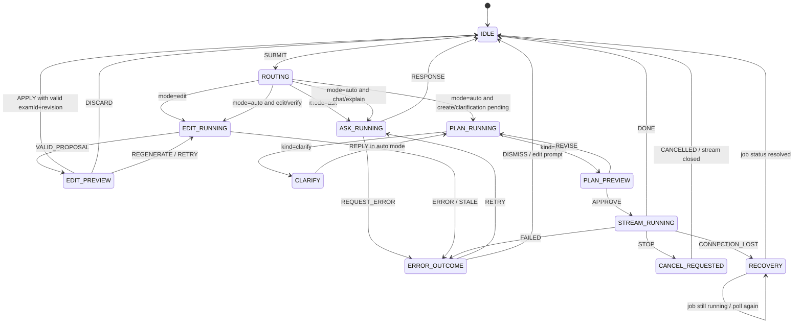
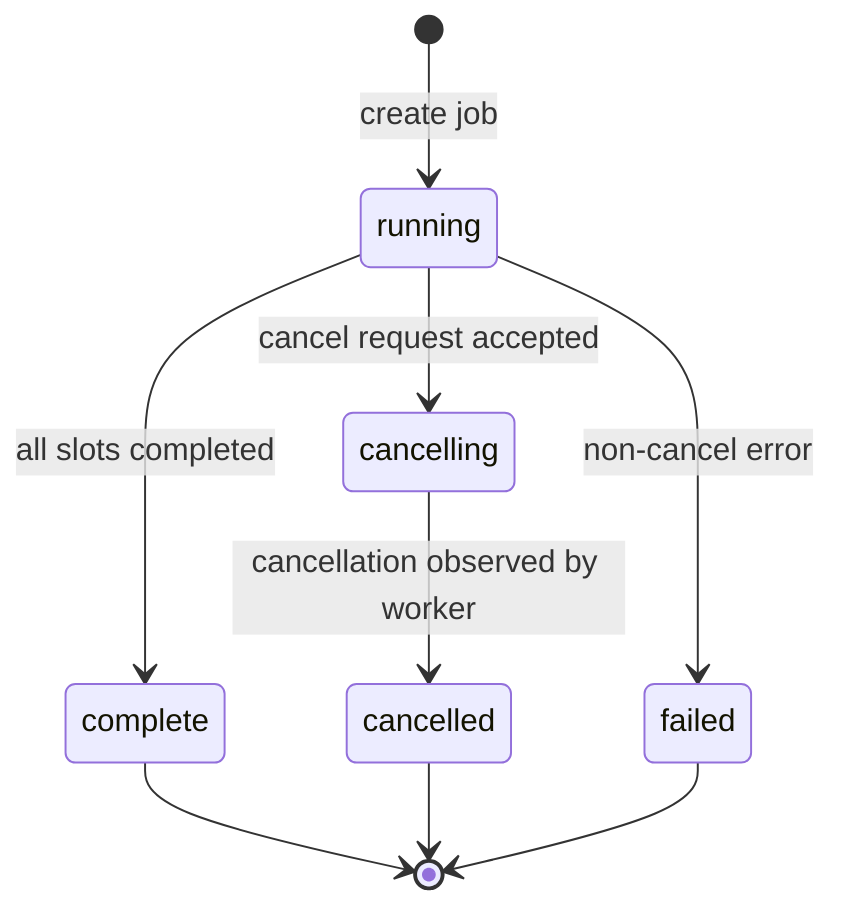

# Trợ lý AI và vòng đời Job

**Issue:** UI-3-001
**Work:** W01 – Mô hình trạng thái trợ lý
**Trạng thái:** Bản khảo sát / đề xuất để review
**Phạm vi khảo sát:** UI JavaScript và Node demo hiện có; chưa phải contract FastAPI đã được backend phê duyệt.

---

## 1. Mục tiêu

W01 mô tả luồng hỏi/sửa/tạo đề và các trạng thái cần phân biệt, làm cơ sở cho W02 (payload và contract) và W03 (fixture/mock).

W01 kế thừa hành vi UX đã ghi nhận trong `docs/CAI_THIEN_UX_CHAT.md` và `docs/CAI_THIEN_CHON_SUA_CHAT.md`; kế thừa nguyên tắc dữ liệu, revision, scope, job, idempotency và fixture trong `docs/course/CONTRACTS.md`. Không thiết kế lại demo D06/D07/D08/D09/D15 chỉ vì mô hình hóa lại state.

## 2. Source đã khảo sát

| File | Phần được khảo sát | Vai trò |
|---|---|---|
| `workbench.js` | `handleWorkbenchSubmit`, `planRequest`, `requestEdit`, `writePlan`, xử lý `stop-ai`, `apply-block-patch`, `watchJob` | Routing yêu cầu, trạng thái giao diện, proposal và streaming |
| `workbench-server.mjs` | Handler `/api/assistant/chat`, `/patch`, `/plan`, `/stream`, `/job`, `/cancel`; `retryValidated` | Hành vi API và vòng đời job trong Node demo |
| `subject-profiles.js` | `intentOf`, `makePlan` | Phân loại ý định và tạo kế hoạch theo quy tắc |
| `ai-providers.js` | `aiRequestError` | Chuyển đổi một số lỗi AI thành thông báo dễ hiểu |
| `tests/workbench.test.mjs` | Các test `makePlan` và quy tắc liên quan | Bằng chứng kiểm thử cho lập kế hoạch |
| `docs/course/CONTRACTS.md` | Các nguyên tắc version, scope, job, idempotency và fixture | Nguyên tắc contract cần kế thừa |

**Giới hạn:** Tên field, enum, payload và event trong Node demo chỉ được ghi nhận như implementation hiện tại. Không mặc định chúng là OpenAPI/DTO cuối cùng của FastAPI.

## 3. Phân biệt ASK, EDIT và AUTO

`handleWorkbenchSubmit()` đọc chế độ chat và phân loại như sau:

| Chế độ | Quy tắc | Luồng |
|---|---|---|
| `ask` | Ép intent thành `explain` | `/api/assistant/chat`; server được yêu cầu trả lời, không sửa tài liệu |
| `edit` | Ép intent thành `edit` | `/api/assistant/patch`; trả proposal để xem Diff và xác nhận |
| `auto` | Dùng `intentOf(text, context)` | Chọn chat, patch hoặc plan tùy intent |

`intentOf()` chuẩn hóa dấu/chữ thường rồi dùng regex để trả một trong các intent `explain`, `edit`, `create`, `verify`, `chat`. Đây là phân loại theo quy tắc từ khóa, không phải mô hình ngôn ngữ hoặc state machine.

Các nhánh đặc biệt:

- Nếu đã có `aiPlan` và người dùng xác nhận bằng câu đồng ý được nhận diện, handler gọi `writePlan()` trước bước phân loại thông thường.
- Trong `auto`, nếu đang có `aiClarification` hoặc intent là `create`, handler gọi `planRequest()`.
- Intent `verify` cũng đi vào `requestEdit()`, nhưng có chỉ dẫn giữ nguyên đề và phương án, chỉ cập nhật lời giải/barem/đáp án/hình khi cần.
- Khi `requestEdit()` thành công, hệ thống tạo proposal. Tài liệu chỉ thay đổi ở thao tác Apply sau khi kiểm tra proposal còn thuộc đúng `examId` và `revision`.

## 4. Assistant UI State Machine

### 4.1. Trạng thái quan sát được và trạng thái mô hình hóa

Source hiện dùng nhiều biến (`busy`, `stage`, `proposal`, `recovery`, `writeController`, `activeJobId`, `cancelRequested`, `watchedJob`) thay vì một enum state tập trung. Bảng dưới đây là mô hình khái niệm để mô tả hành vi, không phải tên enum đã tồn tại trong code.

| State khái niệm | Ý nghĩa | Căn cứ trong implementation |
|---|---|---|
| `IDLE` | Chờ yêu cầu; không bận | `busy === false` |
| `ROUTING` | Đọc mode và intent để chọn luồng | `handleWorkbenchSubmit()` |
| `ASK_RUNNING` | Đang chờ API chat | Nhánh `/api/assistant/chat`, `busy` và `stage` |
| `EDIT_RUNNING` | Đang tạo/validate patch | `requestEdit()` |
| `EDIT_PREVIEW` | Có proposal, chờ người dùng xem Diff / Apply / Discard | `proposal` và `showDiff()` |
| `PLAN_RUNNING` | Đang lập cấu trúc đề | `planRequest()` |
| `CLARIFY` | Cần người dùng bổ sung yêu cầu | `result.kind === 'clarify'`, `aiClarification` |
| `PLAN_PREVIEW` | Kế hoạch đề đã có, chờ xác nhận hoặc chỉnh | `aiPlan`, `planHTML()` |
| `STREAM_RUNNING` | Đang nhận các event sinh đề | `writePlan()`, `writeController`, `activeJobId` |
| `CANCEL_REQUESTED` | UI đã yêu cầu dừng job streaming | `stop-ai`, `cancelRequested`, API cancel |
| `RECOVERY` | Đang tra cứu/hiển thị kết quả job sau gián đoạn | `recovery`, `watchJob()` |
| `ERROR_OUTCOME` | Một thao tác thất bại và lỗi được thông báo | `catch`, `friendlyClientMessage()`, `aiRequestError()` |

`ERROR_OUTCOME` và `CANCEL_REQUESTED` là trạng thái mô hình hóa để mô tả giao tiếp. Source chưa dùng enum thống nhất cho toàn bộ luồng. Retry cũng nên được biểu diễn là **event/hành động** từ lỗi hoặc trạng thái có thể thử lại, không nhầm với một lần chạy thành công.

### 4.2. Sơ đồ luồng giao diện

**Cách đọc:** `ASK` không đi qua proposal/apply; `EDIT` phải đi qua preview và guard trước khi áp dụng; `CREATE` đi qua clarify hoặc plan confirmation trước streaming. `RETRY` là hành động quay lại luồng tương ứng sau lỗi, không phải bằng chứng retry mạng tự động đã có.

### 4.3. Bảng transition UI

| State hiện tại | Event | Guard / điều kiện | Action | State tiếp theo |
|---|---|---|---|---|
| `IDLE` | `SUBMIT` | Prompt không rỗng, không busy | Lưu prompt, đọc mode/context | `ROUTING` |
| `ROUTING` | `ASK` | Mode `ask`, hoặc intent auto là chat/explain | Gửi chat request | `ASK_RUNNING` |
| `ROUTING` | `EDIT` | Mode `edit`, hoặc intent auto là edit/verify | Tạo patch request với scope/snapshot | `EDIT_RUNNING` |
| `ROUTING` | `CREATE` | Auto và intent create hoặc clarification đang chờ | Gọi plan API | `PLAN_RUNNING` |
| `ASK_RUNNING` | `RESPONSE` | Response có message hợp lệ | Thêm tin nhắn assistant | `IDLE` |
| `ASK_RUNNING` | `REQUEST_ERROR` | Request thất bại | Báo lỗi, khôi phục prompt vào ô nhập | `ERROR_OUTCOME` rồi `IDLE` |
| `EDIT_RUNNING` | `VALID_PROPOSAL` | Validate thành công; exam ID/revision chưa đổi | Lưu proposal, cho xem Diff | `EDIT_PREVIEW` |
| `EDIT_RUNNING` | `STALE` / `ERROR` | Đề đổi hoặc patch không hợp lệ | Không áp dụng; báo lỗi | `ERROR_OUTCOME` |
| `EDIT_PREVIEW` | `APPLY` | `proposal.examId` và `proposal.revision` khớp đề hiện tại | Apply edits và ghi lịch sử | `IDLE` |
| `EDIT_PREVIEW` | `DISCARD` | Người dùng từ chối | Bỏ proposal | `IDLE` |
| `EDIT_PREVIEW` | `RETRY` | Người dùng yêu cầu đề xuất lại | Gửi patch mới theo scope/version hiện hành | `EDIT_RUNNING` |
| `PLAN_RUNNING` | `CLARIFY` | Server trả `kind: clarify` | Lưu `aiClarification`, hỏi bổ sung | `CLARIFY` |
| `PLAN_RUNNING` | `PLAN_READY` | Server trả `kind: plan` | Lưu và hiển thị `aiPlan` | `PLAN_PREVIEW` |
| `CLARIFY` | `REPLY` | Chế độ auto tiếp tục luồng tạo đề | Gửi request kèm pending clarification | `PLAN_RUNNING` |
| `PLAN_PREVIEW` | `APPROVE` | Người dùng xác nhận | Gọi `writePlan()` | `STREAM_RUNNING` |
| `PLAN_PREVIEW` | `REVISE` | Người dùng yêu cầu chỉnh cấu trúc | Gọi lại plan với yêu cầu mới | `PLAN_RUNNING` |
| `STREAM_RUNNING` | `DONE` | Nhận event hoàn tất | Nhận kết quả đề | `IDLE` |
| `STREAM_RUNNING` | `STOP` | Có controller/job ID tương ứng | Gửi cancel nếu có job ID, abort luồng phía client | `CANCEL_REQUESTED` |
| `CANCEL_REQUESTED` | `CANCELLED` | Kết quả hủy được xác nhận/xử lý | Giữ nội dung đề trước đó | `IDLE` |
| `STREAM_RUNNING` | `CONNECTION_LOST` | Luồng bị gián đoạn | Tra cứu job | `RECOVERY` |
| `RECOVERY` | `JOB_RESOLVED` | Đã đọc trạng thái job | Khôi phục hoặc thông báo kết quả | `IDLE` |
| `ERROR_OUTCOME` | `RETRY` | Lỗi có thể thử lại và prompt/scope còn hợp lệ | Gửi lại theo contract được duyệt | State chạy tương ứng |

**Lưu ý về cancel:** đoạn `stop-ai` đã khảo sát gắn với `writeController` và `activeJobId` của luồng sinh đề. Chưa thấy cơ chế hủy tương đương trong `requestEdit()`; không tuyên bố patch request cũng đã hỗ trợ cancel.

## 5. Backend Job State Machine (Node demo)

### 5.1. Trạng thái được tìm thấy

Trong handler `/api/assistant/stream` và `/api/assistant/cancel`, các giá trị thấy trong source là:

- `running`: job vừa được tạo và đang xử lý.
- `cancelling`: server đã nhận yêu cầu hủy khi job còn `running`.
- `complete`: toàn bộ slot đã được xử lý thành công.
- `cancelled`: xử lý bị kết thúc do cờ hủy.
- `failed`: xử lý kết thúc do lỗi khác.

`cancelling` là trạng thái trung gian. Đây là trạng thái job ở Node demo, chưa phải enum FastAPI được phê duyệt.

### 5.2. Sơ đồ vòng đời job

Server kiểm tra cờ hủy tại các điểm trong vòng lặp sinh slot và callback stage. Vì vậy, cancel không chứng minh nhà cung cấp AI đang chạy request bị ngắt tức thì. Cần kiểm thử race khi cancel đến sát thời điểm job chuyển `complete`.

### 5.3. API và SSE quan sát được

| Route | Method | Vai trò |
|---|---|---|
| `/api/assistant/plan` | POST | Lập kế hoạch / clarification |
| `/api/assistant/chat` | POST | Hỏi đáp không sửa tài liệu |
| `/api/assistant/patch` | POST | Tạo proposal sửa theo scope |
| `/api/assistant/stream` | POST | Tạo job và trả SSE |
| `/api/assistant/job` | GET | Tra cứu job |
| `/api/assistant/cancel` | POST | Yêu cầu hủy job |

Event SSE tìm thấy trong `/stream`:

| Event | Payload chính quan sát được |
|---|---|
| `job` | `id`, `credits` |
| `stage` | `text` |
| `block` | `question`, `index`, `total` |
| `done` | `id`, `questions`, `plan`, `credits`, `message` |
| `error` | `message`, `id` |

Server còn gửi heartbeat comment định kỳ; heartbeat không phải event nghiệp vụ. Tên `id` là tên field thấy trong Node demo; không tự đổi thành `jobId` trong contract mới khi chưa có xác nhận.

## 6. Retry, timeout và lỗi: phân biệt đúng

| Cơ chế | Điều đã thấy | Không được suy diễn thành |
|---|---|---|
| Server `retryValidated()` | Tối đa 3 lượt cho kết quả sinh/validate trong một số luồng | Retry mạng hoặc retry toàn job |
| Client `requestEdit()` | Tối đa 2 lượt gọi patch khi validateEdits từ chối kết quả | Nút retry của người dùng |
| `aiRequestError()` | Một số lỗi AI được bổ sung thông tin `/api/status` để hiển thị thông báo | Timeout hoặc retry request |
| `stop-ai` | Cancel job streaming qua API và abort phía client | Ngắt tức thì request model đang chạy |
| Phục hồi prompt | Lỗi submit khôi phục prompt để người dùng có thể gửi lại | Idempotency chống gửi trùng |

Trong API helper được khảo sát, chưa thấy timeout tổng quát hoặc `requestId` được truyền trong payload. Lỗi `fetch`/parse JSON cũng cần được kiểm thử riêng; không mặc định mọi lỗi đều qua `aiRequestError()`.

## 7. Bất biến cần giữ và câu hỏi bàn giao

Kế thừa `docs/course/CONTRACTS.md`:

- Mỗi proposal/job phải gắn đúng owner, exam ID và revision gốc.
- Sửa không được vượt ngoài danh sách scope đã cho phép.
- Kết quả của job/version cũ không được áp dụng lên tài liệu mới.
- Cancel không được để output đến muộn ghi đè nội dung.
- Fixture phải phân biệt rõ với kết quả model thật.
- Enum job phải nhất quán giữa UI, API và DB.

Các câu hỏi cần BE-1/BE-2/BE-5 thống nhất trong W02:

1. Enum job chính thức có những giá trị nào? `cancelling` có được giữ là trạng thái công khai không?
2. Payload chuẩn phân biệt `requestId`, `jobId`, `examId`, `baseRevision` và revision kết quả ra sao?
3. Retry khi mất kết nối dùng lại requestId trong trường hợp nào; deliberate retry có tạo requestId mới không?
4. SSE có sequence/cursor để deduplicate và resume không? Thứ tự event được đảm bảo thế nào?
5. Quy tắc xử lý race giữa cancel và complete là gì? Khi nào server xác nhận cancel có hiệu lực?
6. Timeout request và timeout toàn job được quy định riêng ra sao?
7. Patch có hỗ trợ cancel không? Nếu có, kết quả đến muộn bị vô hiệu hóa bằng guard nào?
8. Các lỗi nào retryable, lỗi nào phải yêu cầu người dùng sửa prompt/scope?

## 8. Ca kiểm tra cần thực hiện

Các ca sau là yêu cầu kiểm thử, **không phải kết quả đã chạy hoặc đã nghiệm thu**:

| Test | Kịch bản | Kết quả cần chứng minh |
|---|---|---|
| T01 | Hỏi rồi yêu cầu đề xuất sửa | ASK không sửa đề; EDIT tạo proposal; tài liệu chỉ đổi sau xác nhận |
| T02 | Fixture trả kết quả theo revision cũ | UI đánh dấu stale; không Apply; yêu cầu tạo proposal mới |
| T03 | Hủy sát event cuối rồi gửi lại prompt | Không áp dụng output muộn và không tạo nội dung trùng |
| T04 | Stream disconnect khi job còn running | Tra cứu đúng job; không tự tạo job mới ngoài quy tắc idempotency |
| T05 | Cancel và complete đến sát nhau | Một kết quả cuối có thẩm quyền; không vừa báo cancelled vừa áp output complete |
| T06 | Patch lỗi validation / lỗi mạng | Phân biệt retry validation với retry request; giữ prompt và scope an toàn |

## 9. Tình trạng kiểm thử baseline ghi nhận trong phiên làm việc

- `node tests/selection-browser.mjs`: đã chạy; các dòng PASS được hiển thị trong phiên làm việc.
- `node tests/workbench-browser.mjs`: đã chạy; các dòng PASS được hiển thị trong phiên làm việc.
- `node tests/usability-browser.mjs`: **FAIL** tại kiểm tra `auto-update-answers` (assertion mong `autoUpdate === true`, nhận `false`). Nguyên nhân chưa được xác minh; giả thuyết race khi lưu bất đồng bộ chưa được chứng minh.
- Môi trường hiện tại dùng Node 26.13.1, khác môi trường baseline nhóm ghi nhận Node 24.22.1. Cần tái kiểm trên Node 24 trước khi kết luận lỗi thuộc source hay môi trường.

Không đánh dấu các test T01–T06 là PASS khi chưa có fixture/log tương ứng.

## 10. Điều kiện hoàn thành W01

- [ ] Reviewer xác nhận sơ đồ ASK/EDIT/CREATE phản ánh đúng source hiện tại.
- [ ] Reviewer xác nhận đã tách Assistant UI State và Backend Job State.
- [ ] Chốt danh sách câu hỏi/điểm chưa rõ để chuyển sang W02 với BE-1/BE-2/BE-5.
- [ ] Tài liệu được đưa vào repository và liên kết trong issue UI-3-001.

W01 không bao gồm viết lại `workbench.js`, thay đổi migration/database hoặc tuyên bố contract FastAPI đã được duyệt.

## Đối chiếu bản tích hợp FastAPI

Chrome kiểm luồng sửa vùng trên FastAPI với fixture. App hiển thị đề xuất trước xác nhận, giữ phần ngoài vùng, hỗ trợ bỏ và hoàn tác, từ chối bản đã cũ. Nút **Dừng chờ đề xuất** hủy yêu cầu ở trình duyệt, giữ lại câu đã nhập và bỏ phản hồi đến muộn. Route sửa vùng hiện trả một phản hồi HTTP; dừng chờ ở trình duyệt chưa xác nhận model đã dừng phía máy chủ. Luồng sinh theo ma trận có job, event và API hủy riêng; kiểm hồi quy nằm trong backend.
