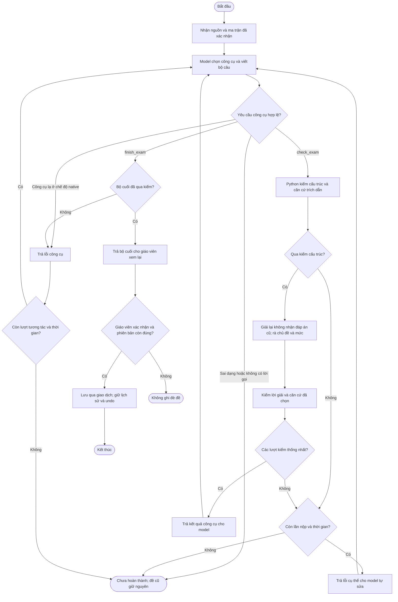

# PoC sinh bộ câu theo ma trận bằng vòng gọi công cụ

> Cập nhật 14/11: hướng dẫn và kết quả hiện hành ở [DEMO_LOCAL.md](../../DEMO_LOCAL.md). Các mục 1–11 dưới đây giữ mốc lịch sử, gồm giới hạn hai lần nộp/tám API call và key chỉ ở RAM của bản cũ; không dùng chúng mô tả app nâng cấp.

Ngày làm: 12/11/2026. Đây là bản thử trên nhánh `codex/sinh-ma-tran-app-that`, kế thừa PR #39 ở `ab11137`; chưa merge vào app chung. Các lượt chạy model thật được lưu riêng, không lấy test giả lập làm kết quả AI.

## 1. Nhóm đang kiểm điều gì?

Giáo viên đưa ngữ liệu và xác nhận ma trận. Trợ lý phải tự soạn bộ câu, gọi công cụ kiểm, nhận lại lỗi để sửa và kiểm tiếp. Giáo viên xem lại kết quả cuối trước khi lưu. Nếu hết lượt mà vẫn không đạt thì hệ thống báo chưa hoàn thành, không ghi bộ câu dở vào đề.

Vì vậy, phần cần chứng minh không dừng ở một câu trả lời của chatbot. Log phải cho thấy yêu cầu gọi công cụ do model tạo, công cụ thực sự chạy trong Python, lỗi được đưa về model và bộ câu được nộp lại. Chạy được vòng này vẫn chưa đủ để kết luận câu hỏi đúng kiến thức hoặc đúng mức nhận thức.

### Điều kiện để gọi đây là một lát tác vụ của trợ lý ảo

- Giáo viên giao việc và xác nhận nguồn/ma trận; không phải tự chép lỗi về chat để yêu cầu sửa.
- Model gửi yêu cầu công cụ bằng native tool calling hoặc JSON action có ghi rõ giao thức. Python thực thi hàm kiểm thật, không chỉ in câu “đã kiểm tra”.
- Lỗi trả về đúng vòng đang chạy. Model phải tự sửa và nộp kiểm lại trong giới hạn; kết quả nộp lại vẫn có thể sai.
- Chỉ trả đề xuất cuối sau khi công cụ báo đạt. Giáo viên rà và xác nhận cuối, không duyệt từng lỗi trung gian để cho vòng chạy tiếp.
- Không hoàn thành được thì báo rõ lý do và giữ bản đề. Trạng thái dừng an toàn không được tính là sinh đề thành công.

Ảnh trao đổi Thuận gửi là căn cứ nhấn mạnh yêu cầu này. Chưa có bản ghi nguyên văn từ giảng viên cho từng câu trong ảnh, nên đây là tiêu chí nhóm rút ra và áp dụng, không gán thành trích dẫn trực tiếp của thầy.

## 2. Một bộ thử xuyên suốt

Đầu vào ở `backend/poc-data/thu-vien.json`: ngữ liệu tự viết về Mai, Nam và cô Loan tại thư viện. Đây không phải trích SGK và chưa được giáo viên duyệt. Bộ thử dùng Ngữ văn lớp 6 để kiểm đọc hiểu; chưa đại diện cho tất cả môn học.

| Chủ đề | Nhận biết | Thông hiểu | Vận dụng | Điểm |
|---|---:|---:|---:|---:|
| Chi tiết trong ngữ liệu | 1 | 1 | 0 | 5 |
| Ý nghĩa hành động | 1 | 1 | 0 | 5 |
| Tổng | 2 | 2 | 0 | 10 |

Mỗi câu trắc nghiệm có bốn phương án, chỉ một đáp án đúng và 2,5 điểm. `pointsQ4 = 10` nghĩa là 10 đơn vị 0,25 điểm. Không phải 10 điểm cho một câu.

Nhận biết yêu cầu tìm hoặc nhớ lại thông tin nêu trực tiếp. Thông hiểu yêu cầu giải thích, suy ra hoặc liên hệ các chi tiết. Không coi mọi câu có từ “vì sao” là Thông hiểu. Mức độ nhận thức cũng khác với độ khó đo từ kết quả học sinh làm bài.

## 3. Trợ lý tự làm đến đâu?

Model viết nội dung bộ câu và chọn công cụ cần gọi. Python chỉ thực thi các công cụ trong danh sách cho phép. `check_exam` kiểm bộ câu; `finish_exam` yêu cầu trả kết quả cuối. Lệnh lưu đề, chạy shell hoặc công cụ lạ không có trong danh sách.

Bản local dùng JSON có cấu trúc để model gửi `action` và `arguments`. Python đọc yêu cầu đó, gọi hàm thật rồi gửi lại kết quả. Đây là giao thức gọi công cụ do ứng dụng tổ chức; không gọi nó là native tool calling của Ollama. Chế độ native được giữ riêng để thử và có nhãn riêng trong log.



Sơ đồ trên mô tả quyết định, không phải thứ tự các bảng dữ liệu. Nhánh lỗi giao thức còn bị chặn bởi giới hạn số lượt tương tác; không chạy vòng lặp vô hạn.

Với JSON action, phản hồi sai dạng hoặc tên công cụ không được phép bị bộ đọc chặn và dừng; không cố đoán ý rồi thực thi. Với lời gọi hợp lệ nhưng `finish_exam` quá sớm, lỗi được gửi lại cho model. Hai nhánh này không giống nhau.

## 4. Bộ kiểm gồm những gì?

| Việc kiểm | Ai thực hiện | Giới hạn |
|---|---|---|
| Số câu, kiểu trường, bốn phương án, đáp án trong 0–3, tổng điểm | Python/Pydantic và validator của backend | Không suy ra chất lượng sư phạm từ cấu trúc đúng |
| Chủ đề, mức và điểm metadata khớp từng ô | Python gắn từ ma trận đã duyệt rồi kiểm hợp đồng | Đây là nhãn yêu cầu, không chứng minh nội dung đạt mức |
| Câu trùng chữ, phương án trùng nội dung kể cả khác nhãn A/B/C/D | Python chuẩn hóa và so sánh | Trùng ý được một lượt model rà riêng trong cùng báo cáo; chưa có số đo phát hiện/bỏ sót |
| Mã nguồn, phiên bản, vị trí và trích đoạn có trong nguồn | Python | Trích đúng nguyên văn chưa có nghĩa đủ căn cứ cho đáp án |
| Giải lại, rà từng phương án đúng/sai/chưa rõ, mức thực tế, chủ đề và trùng ý với các câu trước | Một lượt model khác, không nhận đáp án/lời giải/nhãn mức do lượt sinh tự gán | Vẫn dùng cùng model và cùng bộ nguồn; có thể sai hoặc mắc lỗi tương quan |
| Lời giải có khớp phương án được chọn và căn cứ hay không | Lượt model riêng sau bước giải lại | Không phải kiểm chứng đúng tuyệt đối |
| Còn đúng đề, nguồn và phiên bản lúc lưu | Python và giao dịch SQLite | Bản local một người; chưa thay hệ thống tài khoản/phân quyền chung |

Lượt giải lại nhận nội dung câu, các phương án, chủ đề cần hỏi và bộ nguồn. Nó không nhận đáp án, lời giải hay mức do lượt sinh tự khai. Bản thử dùng toàn bộ đoạn nguồn ngắn, chưa có truy xuất tài liệu độc lập. Không dùng từ “verifier độc lập” để ám chỉ một mô hình khác hoặc bằng chứng độc lập đã được kiểm chứng.

Khi công cụ phát hiện bất đồng hoặc không đủ căn cứ, nó trả mã lỗi và vị trí câu cho model. Model phải tự sửa. Không có bước yêu cầu người dùng tự tìm rồi sửa từng lỗi để vòng chạy tiếp tục.

### Bộ Sinh học theo nội dung nhóm cập nhật ngày 13/11

`backend/poc-data/bio-tham-thau.json` chứa ngữ liệu tự biên soạn, không phải trích SGK. Ma trận gồm hai chủ đề, 2 câu Nhận biết, 1 Thông hiểu và 1 Vận dụng, mỗi câu 2,5 điểm. Bộ câu tham chiếu tự soạn trong Docs không đưa vào prompt.

Chạy từ CMD qua chính API app bằng `python scripts/chay-poc-app.py --run --dataset bio-tham-thau --output <thư-mục-log-mới>`. Cần app đã chọn Gemini, lưu key và xác nhận Free tier. Lệnh không đọc key, không xác nhận thay giáo viên, không tự ghi bộ câu vào đề. API tạo mã nguồn thật riêng cho toàn văn; S1/S2/S3 là nhãn đoạn nằm trong nội dung, không thay UUID hoặc locator trong log.

Giới hạn vẫn là 2 lần nộp, 900 giây và 8 lần gọi Gemini. Rà phương án và trùng ý được thêm vào lượt giải mù hiện có, không tăng số lượt gọi. Nếu thiếu bốn nhãn, còn unknown, nhiều phương án đúng hoặc nghi trùng ý thì không cho finish. Đây là kiểm ý kiến model theo hợp đồng, chưa là xác nhận chất lượng sư phạm. Chưa có phép kiểm tất định riêng cho mọi bài toán thẩm thấu; không tuyên bố đã triển khai `check_osmosis_case`.

## 5. Đếm lượt cho khỏi nhầm

Trong cấu hình demo, tối đa **hai lần nộp bộ câu**: một lần đầu và một lần sửa. Không gọi đó là “hai lần sinh lại”. Giới hạn lượt tương tác bảo vệ cả trường hợp model gọi `finish_exam` quá sớm hoặc chọn công cụ sai.

Số lần gọi model có thể lớn hơn hai vì còn lượt giải lại, rà lời giải và chọn bước kết thúc. Số lần gọi công cụ cũng có thể lớn hơn hai nếu model yêu cầu kết thúc khi chưa qua kiểm. Ba lần gọi công cụ không có nghĩa có ba bộ câu.

CLI và bản ghép vào job của app cùng giới hạn 900 giây cho toàn tác vụ. Bản cũ 300 giây không đủ cho nhiều lượt model trên CPU. Đây là giới hạn dừng, không phải cam kết thời gian đáp ứng. Các lượt app cũ 300 giây được giữ riêng, không gộp vào bảng đối chiếu mới.

## 6. Data model đang dùng trong code

| Đối tượng | Trường chính | Ý nghĩa |
|---|---|---|
| `SourceFragment` | `sourceId: UUID`, `sourceVersion: int`, `locator`, `text`, `ownerId` | Một đoạn nguồn và vị trí thuộc đúng phiên bản |
| `GenerateJob` | `jobId`, `examId`, `baseRevision`, `subject`, `grade`, `slots[]`, `sources[]`, `requireEvidence` | Yêu cầu backend tạo từ nguồn/ma trận đã xác nhận |
| `ExamSlot` | `type`, `topic`, `level`, `pointsQ4` | Một ô cần sinh một câu; mức 0/1/2 lần lượt là NB/TH/VD |
| `DraftQuestion` | `stem`, `options[4]`, `answer`, `explanation`, `evidenceIds[]` | Nội dung model tự viết trước khi gắn metadata |
| `GenerateProposal` | `jobId`, `examId`, `baseRevision`, `questions[]` | Bộ đề xuất đã kiểm hợp đồng, chưa ghi vào đề |
| `Evidence` | `sourceId`, `sourceVersion`, `locator`, `quote` | Căn cứ trỏ về nguồn; khác với chỉ số tạm trong danh mục đoạn |
| Câu trong workspace | `id`, `v`, `blockIds`, `verificationStatus`, `approvalStatus` | UUID/phiên bản được backend tạo lúc xác nhận; không dùng số thứ tự câu làm ID |

`locator.index` tính từ 1. `answer` của trắc nghiệm là vị trí 0–3; giao diện hiện A–D. `evidenceIds` chỉ là chỉ số 0-based trong danh mục đoạn của lượt chạy; Python đổi nó thành `Evidence` đầy đủ, không dùng nó thay UUID nguồn.

Schema được xuất từ lớp Pydantic trong mã nguồn, không viết một bộ schema khác chỉ để thuyết trình. Bản khái niệm Abstraction và tên trường triển khai cần được phân biệt; không nói workspace đã hiện thực toàn bộ UML của proposal.

## 7. Bằng chứng và cách đọc

Mỗi lượt CLI có `input.json`, `environment.json`, `events.jsonl`, `call-XX-request.json`, `call-XX-response.json`, `result.json` và snapshot mã Python. `events.jsonl` ghi thời gian UTC và số giây từ lúc bắt đầu; phản hồi gốc của Ollama được giữ để kiểm lại. Không sửa đáp án model trong các file này.

Khi trình bày, mở lệnh chạy trước, chỉ ma trận/nguồn, rồi đi qua các dòng `tool_call`, `structure_check`, `generation_result` và `run_end`. Mở phản hồi model tương ứng để xem nó thực sự đã viết gì. Kết luận phải dựa trên bộ câu và log, không dựa riêng vào thông báo trên giao diện.

Đối chiếu hai model local trên cùng đầu vào, cấu hình và bản code được đóng băng. Báo số giây lần đầu, toàn tác vụ, số lần nộp và lỗi cuối. Mỗi model chỉ có một lượt đối chiếu thì chưa đủ suy ra model nào tốt hơn nói chung. Thời gian có cả ảnh hưởng tải model/cache và máy đang chạy việc khác; ghi riêng khi có.

## 8. Chạy lại tại máy

Từ thư mục dự án, chạy `scripts\demo-poc-cmd.cmd qwen2.5:3b` hoặc thay bằng `qwen2.5:1.5b`. Script gọi Python thật; Ollama local phải chạy sẵn. Cần `uv sync --frozen` trong `backend` trước lần đầu. Không cần GreenNode cho phép thử này và không gọi dịch vụ trả phí.

Để mở lát app tích hợp, chạy `scripts\demo-app-local.cmd`; launcher đang được chat thực hành hoàn thiện dùng `http://127.0.0.1:4182` và kho thử riêng. Cổng 4180 thuộc các lượt thử trước, không phải địa chỉ mặc định của launcher mới. Chọn hoặc tạo đề, xác nhận ma trận, mở “Sinh theo ma trận · Python”, nhập nguồn và bắt đầu. App tự chạy vòng công cụ. Chỉ khi có kết quả cuối đủ điều kiện mới cho xác nhận lưu. Nếu giáo viên ghi góp ý còn lỗi thì bản đó tiếp tục bị chặn lưu.

App đang thử vẫn thiếu các lát chuyển Python khác: tài khoản dùng chung và OCR. Bên thực hành đã nối nhập TXT/MD/DOCX/PPTX và xuất HTML/PDF/Word; Word hiện là bản chữ PoC, chưa ngang phần xuất rich document/OMML cũ. Chat Python hiện dùng đường local riêng; lựa chọn Gemini ở đây áp dụng vòng sinh ma trận và tự kiểm, chưa là chuyển toàn bộ chat legacy. Không dùng app này như bản nộp hoàn chỉnh của toàn dự án. Kho demo và log tách riêng khỏi dữ liệu thật.

## 9. Các ca phải phân biệt khi báo cáo

Test giả lập kiểm: lần đầu sai đáp án → tự kiểm phát hiện → lần sửa khớp → chờ xác nhận cuối; hai lần vẫn sai → không có preview; gọi kết thúc quá sớm → bị chặn; gọi công cụ lạ → không thực thi; đổi phiên bản → không ghi đè; phương án khác nhãn nhưng cùng nội dung → bị chặn. Các ca này kiểm cơ chế code, không được ghi thành thành công của model thật.

Kết quả thật và bảng số giây nằm trong gói log đi kèm. Nếu chưa có bộ câu đủ chất lượng thì nói rõ chưa chứng minh được mục tiêu sinh đề, dù vòng gọi công cụ đã chạy. Model mạnh hơn trên GreenNode là hướng thử tiếp, không phải lời bảo đảm sẽ hết lỗi. Chỉ Thuận vận hành GreenNode.

## 10. Kết quả đã đo trong bản này

Hai lượt CLI ngày 12/11 dùng cùng input và request đầu, chỉ khác tên model. Qwen2.5 3B mất 383,21 giây, gọi model 6 lần, nộp 2 bộ; có đổi bộ câu sau nhận lỗi nhưng kiểm lại vẫn không đạt. Qwen2.5 1.5B mất 82,28 giây, gọi model 3 lần và công cụ 3 lần, nộp 2 bộ; một lần xin kết thúc quá sớm bị chặn và bộ nộp lại không đổi. Cả hai kết thúc `attempt_limit`, `saved=false`. Mã CLI/bộ kiểm giống nhau; khác biệt snapshot toàn package nằm ở dòng cấu hình UI, không thuộc đường chạy CLI. Mỗi model mới có một lượt đối chiếu; không gọi đây là benchmark đại diện.

Thử qua app ngày 13/11: Qwen2.5 3B, 215,14 giây phía client; hai lần nộp vẫn còn câu trùng. Không lưu câu nào, revision giữ 1. Lượt này dùng nguồn/ID job của workspace riêng, không gộp vào bảng CLI. CMD launcher cũng được chạy thật trên Windows sau sửa CRLF; kết quả được giữ riêng trong gói bằng chứng.

Khi quay, ảnh `03-ket-qua-app-that.png` được chụp lúc giao diện vẫn đang cập nhật lượt chạy; kết quả terminal phải đọc từ `app-real-result.json` và log backend. Không dùng ảnh đó để chứng minh giao diện đã hiện trạng thái cuối. Script E2E đã bổ sung chờ nút bắt đầu mở lại trước khi chụp trong những lần chạy tiếp theo.

### Thử thêm Qwen3 Instruct và sửa bộ rà ngày 13/11

Lượt V7 native của `qwen3:4b-instruct-2507-q4_K_M` mất 429,39 giây. Model nộp năm câu, nhận lỗi số lượng rồi tự nộp lại bốn câu. Bộ rà sau đó trả đáp án `null` trong khi tự báo không còn nghi ngờ, và có hai nhận xét cho cùng một câu. Kết thúc không đạt, không lưu. Lượt Qwen3 4B mặc định trước đó hết hạn một lần gọi sau 180,34 giây; không dùng nó để đánh giá chất lượng vì chưa có bộ câu trả về.

Từ lỗi thật này, đầu vào lượt giải lại ghi rõ chỉ số 0–3 cho từng phương án. Lượt rà lời giải nhận cả chỉ số và nguyên văn phương án đang chọn. Schema giới hạn đúng số nhận xét, mỗi câu một mã và lý do ngắn; Python chặn phản hồi tự báo chắc chắn nhưng thiếu đáp án. Phản hồi sửa đáp án nêu cả chỉ số đang chọn và chỉ số lượt giải tìm được. Với lệch mức, phản hồi nêu mức yêu cầu, mức quan sát và thao tác cần có; không cho model chỉ đổi nhãn để qua kiểm.

Lượt V8 structured sau sửa đầu vào bộ rà mất 522,34 giây, sáu lần gọi model và hai lần nộp. Các nhận xét đã đúng hợp đồng về số lượng và chỉ số, model tự sửa hai chỉ số đáp án nhưng không sửa thân câu; vẫn còn lỗi nên dừng không đạt. Hợp đồng hợp lệ không đồng nghĩa nhận định mức nhận thức chính xác. V7/V8 khác code và giao thức, không dùng hai số thời gian này để xếp hạng model hoặc đo tác dụng riêng của một thay đổi. Log mỗi lượt giữ nguyên input, code snapshot và phản hồi gốc.

V9 kết thúc sau 306,54 giây vì lượt rà thứ nhất hết hạn HTTP 180 giây; chưa có lần kiểm hoàn tất để đánh giá cả vòng. Từ lượt V10, lớp gọi model dùng hạn chờ HTTP 300 giây cho cả CLI và app; trần toàn tác vụ vẫn 900 giây. Các giới hạn là mức dừng khi thử, không phải cam kết model phản hồi trong từng ấy giây hoặc đổi model sẽ hết lỗi.

## 11. Gemini qua cùng app Python

Mở `http://127.0.0.1:4182`, chọn **Kết nối AI**, chọn Gemini, model và nhập key Google AI Studio. Key chỉ giữ trong RAM, khởi động lại app cần nhập lại. API cấu hình chỉ trả `hasKey`; không ghi key vào SQLite, log hoặc snapshot. Bản thử chỉ cho chọn `gemini-3.8-flash`, `gemini-3.6-flash`, `gemini-3.5-flash-lite`; [bảng giá Google](https://aistudio.google.com/docs/pricing) hiện có Free tier cho các model này. Người vận hành xác nhận project đang ở Free tier; app chưa tự xác minh cấu hình billing của tài khoản. Không tự chuyển model, không bật billing hoặc dùng dịch vụ trả phí.

Chỉ dùng ngữ liệu nhóm tự viết đã được cho phép. Free tier có thể dùng nội dung để cải thiện sản phẩm Google theo điều khoản hiện hành; không gửi đề chưa công bố hoặc tài liệu nhạy cảm. Kết nối lưu được chưa chứng minh có quyền gọi model.

Từ CMD ở root app, chạy:

```cmd
backend\.venv\Scripts\python.exe -X utf8 scripts\chay-poc-app.py --run --output outputs\poc-gemini-luot-moi
```

Thư mục output phải chưa tồn tại. CMD gọi API local của chính app, không nhận hoặc đọc key. Mỗi lần tạo một bản đề thử mới, giữ các đề cũ và dùng kiểm revision khi ghi workspace. App gọi Gemini qua endpoint REST chính thức tương thích OpenAI; giữ ID và dữ liệu chữ ký công cụ qua lượt phản hồi. Bộ kiểm Python và giới hạn hai lần nộp vẫn như trước. Có thêm trần tám lần gọi API mỗi tác vụ, hạn chờ 180 giây/lần; không retry HTTP ngầm. Các request/response đầy đủ nằm ở `outputs/local-demo/data/agent-logs/<jobId>`, cùng source snapshot. Client lưu input, trace, kết quả và thời gian toàn tác vụ; tuyệt đối không tự xác nhận/lưu bộ câu.

Ngày 13/11, ba lượt Gemini 3.8 Flash đều trả HTTP 503 trước khi sinh nội dung: client lần lượt 14,74; 36,46; 9,52 giây. Đề giữ revision 1 và không có câu được lưu. Đây là thời gian tác vụ lỗi dịch vụ, không phải tốc độ sinh đề hoặc bằng chứng về chất lượng model. Không gộp vào bảng so chất lượng với Qwen. Log gốc ở gói `PoC_ban_giao/gemini-api-that-01…03`; chưa có kết quả Gemini sinh đề thành công tại thời điểm ghi mục này.
